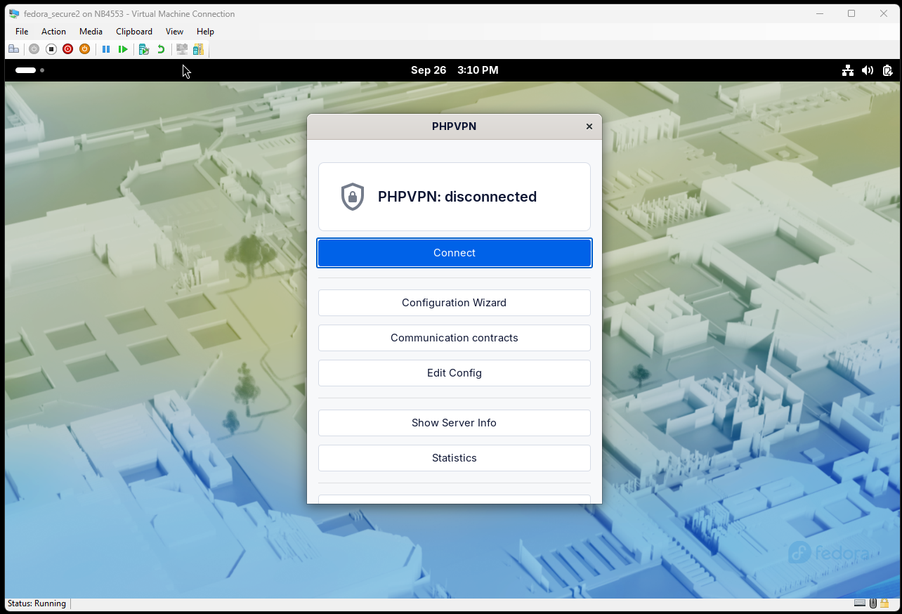
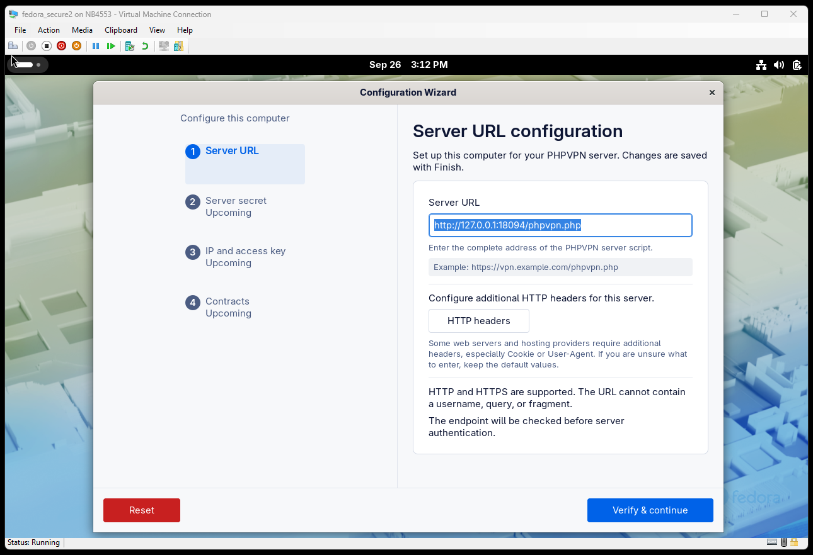
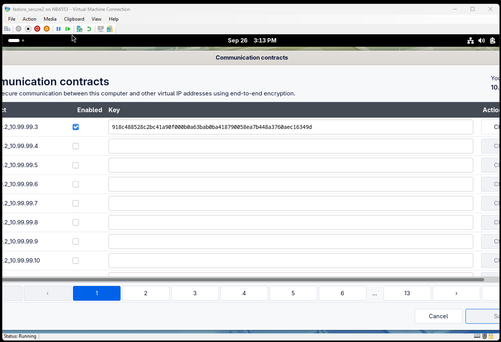

# Záznam původní konverzace k intentu

Chronologický přepis viditelných vstupů uživatele a odpovědí AI od žádosti o založení tohoto intentu. Hlasové vstupy vycházejí z přepisu v původním chatu. Obrázky jsou zachovány v této složce a uvedeny v okamžiku, kdy byly poslány. Opakované překryvy přepisu hlasové konverzace jsou uvedeny jen jednou.

**User:** Vytvoř nový intent.

**AI:** Našla jsem rozpracovaný předchozí intent: značka uvádí dokončenou verzi, ale chybí její povinný soubor se záznamem chatu. Podle pravidel Intent Builderu musím tento rozpor vyjasnit před založením dalšího intentu. Mám předchozí intent ponechat beze změny a založit nový?

**User:** Ano, založ nový intent.

**AI:** Nový intent je založený a připravený k zachycení zadání. Předchozí intent zůstal beze změny. Můžeš diktovat, kdykoli zachycení pozastavit nebo mě požádat o zpracování intentu.

**User:** Tak, když se podíváš teďka na obrazovku, kterou ti dám do chatu, tak jde vidět, že na té virtuální obrazovce není... v pravém horním rohu žádná ikona, týkající se PHP VPN. Nevím, jestli je to dobře nebo špatně. Tu ikonu jsem našel na Fedoře pouze v aplikacích. A když jsem spustil PHP VPN, tak první věc, nejde vidět exit tlačítko, to je tam až pod scroll barem, a druhá věc, nahoře se zobrazuje logo, které už jsme... kterého jsme se chtěli úplně vyvarovat. Ikona takovéhoto štítu s... se zámkem. Té ikony jsme se chtěli... tu ikonu jsme chtěli dát pryč, protože už máme vlastní ikonu a taky nechceme být závislí licenčně na Googlu a na jejich Material Designu. Takže tohle to je první věc, která musí jít pryč. Ten formulář se musí nějakým způsobem upravit, třeba to logo nahoře má kolem sebe příliš velký padding, dal bych tam tu naši ikonu, modrou, tu defaultní, třeba ve vektoru, převést jí do vektoru ona už několikrát do vektoru byla převedena například v projektu c dvojtečka lomeno git lomeno SMS web. Ale můžeš ji klidně převést znova. A tlačítko exit by mělo jít vidět a pokud je možné zařídit, aby šlo někde vidět v pravém horním rohu i i to, že PHP VPN běží, tak by to bylo fajn, ale pokud to vidět nepůjde, no tak se nic nedá dělat, to nevadí. Posílám ti do chatu ten obrázek.

**AI:** Až obrázek dorazí, zahrnu ho do zadání. Můžeš pokračovat.

**User:** [Snímek hlavního okna PHPVPN na Fedoře](01-hlavni-okno-fedora.png).

**AI:** Obrázek dorazil a je součástí podkladů k novému intentu. Můžeš pokračovat v zadání.

**User:** Dobrá, druhá věc, která mě štve. Když jsem teďka na configuration wizardu... Když jsem teď v configuration wizardu... tak... Pokud... a pošlu ti zase printscreen do chatu, tak pokud si ho zobrazím v defaultu, tak to vypadá, že ten configuration wizard je rozdělený vertikální čárou přímo uprostřed formuláře.

**AI:** Poznámku k výchozímu zobrazení Configuration Wizardu jsem zachytila. Obrázek zatím nedorazil.

**User:** [Snímek širokého Configuration Wizardu](02-pruvodce-siroke-okno.png).

**AI:** Snímek Configuration Wizardu dorazil a přidala jsem ho k podkladům intentu. Můžeš pokračovat v popisu.

**User:** Což... není dobře, třeba ve Windows to máme uděláno tak... Třeba ve Windows to máme uděláno... tak... Ticho, teď mluvím já.

**AI:** Jasně. Pokračuj.

**User:** Pošlu ti do chatu, jak to vypadá, ve Windows to máme uděláno tak, že ty kroky, ty jednotlivé kroky zabírají pouze relativně málo místa vlevo nebo nějaké statické místo vlevo a celá pravá oblast je vyhrazena vyloženě pro ten configuration wizard. Tady to vypadá, že je to rozděleno půl na půl. To se mi nelíbí.

**User:** Když ten formulář potom zmenším a ty jednotlivé kroky skočí nahoru, tak to už je v pohodě, tam už to vypadá dobře. Až na jednu drobnou věc, že ty dvě tlačítka potom nejsou na stejném řádku. Opět ti posílám print screen do chatu.

**AI:** Zachytila jsem požadavek na užší levý sloupec kroků a zarovnání tlačítek v menším okně. Čekám na další snímek.

**User:** [Snímek užšího Configuration Wizardu](03-pruvodce-uzke-okno.png).

**AI:** Snímek zmenšeného Configuration Wizardu dorazil a je součástí podkladů intentu. Můžeš pokračovat.

**User:** [Snímek Communication contracts](04-komunikacni-kontrakty.png).

**AI:** Dorazil i snímek okna Communication contracts. Připojila jsem ho k podkladům intentu.

**User:** Stránka Communication Contracts je příliš velká, strašně obrovská, mnohem větší než Configuration Wizard. A to si myslím, že není dobře. Všechno se to musí koncipovat tak, aby se v defaultu ty formuláře vešly do rozlišení tisíc dvacet čtyři na sedm šest osm, což určitě Communication Contracts nesplňuje. Podívej se, jak to vypadá. Z print screenu by mělo jít vidět, že se ten Communication Contracts tam vůbec nevejde.

**AI:** Snímek Communication contracts mám v chatu a další část zadání je zachycená.

**User:** Edit config je v podstatě asi jediné okno, které je v pohodě, co se týká velikosti obsahu, takže tohle přeskakuju, to vypadá hezky. Show Server Info vypadá taky hezky, to taky přeskakuju, tady asi nemám teďka nic, co bych řekl, že je špatně. Statistika vypadá taky hezky, taky nemám nic, co bych na první pohled vytknul a řekl, že je špatně. Štve mě, že se na všech možných formulářích používá ikona, která obsahuje ten badge, teda ten ten štít. Používá se to například na na stránce... Configuration Wizard ne, vydrž vteřinu, používá se to určitě na stránce Connect, kde se zobrazuje connecting a pak se tam odpočítavají vteřiny, tak tam se používá ikona toho... toho zámku ve štítu, tu ikonu dej pryč, to tam vůbec nemusíme dávat, ikonu dej pryč, chceme se zbavit licenční závislosti na téhleté ikoně, budeme používat jen to, co je naše.

**User:** A to nejenom v Linuxu, ale i ve Windows.

**AI:** Tuhle část zadání jsem zachytila. Pokračuj, až budeš chtít.

**User:** Tak, zpracuj intent, včetně obrázku, ať jsou tam odkazy na obrázky a ať té intent složce jsou i ty obrázky, co jsem tady dal do chatu, ať na ně odkazuje korektně text.
