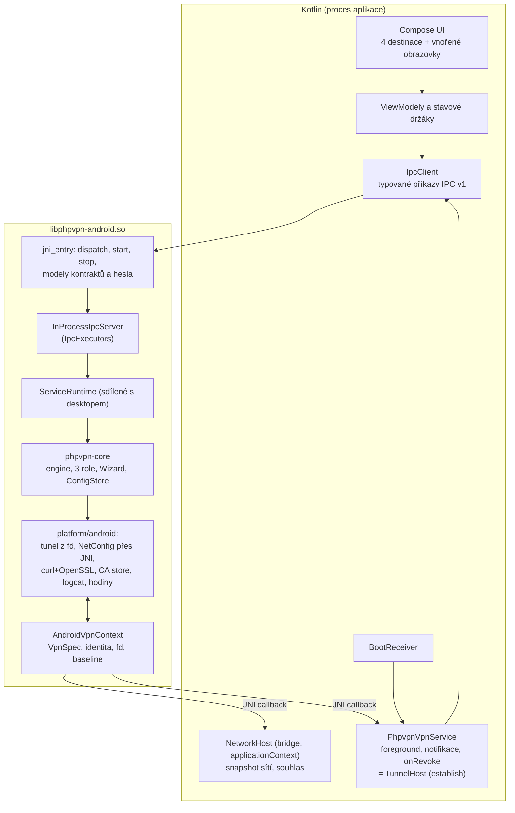

# Klient phpvpn pro Android 14+ (čtvrtá platforma nad `phpvpn-core`)

Podklady k plánu ve stejné složce:

- [android-screen-map.md](android-screen-map.md) – všech 49 obrazovek návrhu, jejich Compose cesta, zdroj dat
  (IPC příkaz nebo lokální stav), pracovní balík a pravidla, která musí implementace dodržet.

## Rozhodnutí uživatele a výchozí stav

- **Podporované verze:** Android 14 (API 34) a novější. `minSdk = 34`, `compileSdk = targetSdk = 36`
  (nainstalovaná platforma `android-36`). Starší verze se nepodporují ani netestují.
- **Chování v síti:** klient se chová jako virtuální síťová karta, ne jako VPN pro veškerý provoz. Do tunelu jde
  jen prefix `vpnCidr` (výchozí `10.99.99.0/24`). Internet, DNS, LAN a IPv6 zůstávají beze změny. Odpovídá to
  split tunnelu v1 podle [client.md](../../client.md) (Windows, Linux, macOS): jen `virtualIp` s prefixem
  `vpnCidr` a jediná routa `vpnCidr`, žádná výchozí routa, žádné DNS, žádný kill switch.
- **Vizuální podoba:** co nejvěrněji podle návrhu [assets/android-en](../../assets/android-en/README.md)
  (49 obrazovek, 4 hlavní destinace Connection, Traffic, Server, Settings). Pravidla jednotlivých obrazovek jsou
  v [RULES.md](../../assets/android-en/RULES.md) a `screens/*.md` a jsou pro implementaci závazná. Česká verze
  textů je schválená v [assets/android-cz](../../assets/android-cz).
- **Vývojové prostředí:** Android Studio 2026.2.2 v `D:\androidstudio` (JBR 25), SDK v
  `%LOCALAPPDATA%\Android\Sdk`. Nainstalováno: platforma `android-36`, build-tools 35.0.0 a 36.0.0, emulátor
  36.1.9, systémový obraz `android-36/google_apis_playstore/x86_64`. **Chybí:** NDK, CMake ze SDK, obrazy
  API 34 a 35 a jakékoli AVD. Doplní je WP00.
- **Testovací server:** lokální nginx + PHP na Windows hostu (`D:\nginx`, port 80, `html\phpvpn.php`). Emulátor
  ho vidí na adrese `http://10.0.2.2/phpvpn.php`. Druhým peerem je nainstalovaný Windows klient nebo Fedora VM
  (viz paměť projektu). Reálné zařízení s Androidem 14+ je potřeba pro akceptaci WP11. Dokud test na reálném
  zařízení neproběhne, vede se jako NOT RUN.
- **Větev:** `macos` je od 2026-10-31 sloučená do `main` (fast-forward na `12e3ac1`), takže `main` obsahuje
  sdílené POSIX soubory (`client/src/platform/posix`). Větev `android` je odvozená od `main`. Návrh
  `assets/android-en` je podle R1 v gitu (commit `d56b41b` na větvi `android`), `assets/android-cz` zůstává
  v `.gitignore` jako lokální schválená předloha českých textů.
- **Stav rozhodnutí:** otázky R1 až R9 jsou rozhodnuté (tabulka na konci). Žádná otevřená otázka nebrání
  začít.
- **Zásady z [client.md](../../client.md) platí beze změny:** tři VPN pracovní role ve vlastních vláknech,
  stavový automat, soft recovery a recovery, synchronizace času, fronty a DRR, kontrola major verze serveru,
  konfigurační dokument a jeho validace, IPC v1 smlouva a Wizard. Android je čtvrtá platforma nad stejným
  jádrem. Jádro (`client/src/core`) se mění jen tam, kde to výslovně uvádí tento plán.

## Cíl a hranice v1

Dodat instalovatelnou aplikaci (APK, později AAB), která:

1. Projde Wizardem stejné kroky jako desktop (URL, HTTP hlavičky, SERVER_SECRET, IP a Access Key, výchozí
   kontrakty, Finish) a uloží konfiguraci do soukromého úložiště aplikace.
2. Po systémovém souhlasu s VPN vytvoří přes `VpnService` rozhraní s `virtualIp` a jedinou routou `vpnCidr`,
   provede bootstrap (`health`, `info`, ověření `ACCESS_KEY`) a přenáší IPv4 pakety ostatním peerům přes relay.
3. Zobrazuje stav, čtyři kontroly připojení, deset statistik, seznam online zařízení, surová data serveru,
   HTTP diagnostiku, kontrakty, editor JSON, About a Exit podle návrhu.
4. Drží spojení i se zavřenou aktivitou (foreground služba s notifikací) a správně reaguje na odebrání VPN jinou
   aplikací (`onRevoke`).

Mimo v1 (vědomě): full tunnel, DNS přes tunel, per-app výběr, IPv6 v tunelu, lockdown režim Always-on, více
profilů, widgety a dlaždice rychlého nastavení, Android TV, Wear OS, iOS. Návrh je výslovně nepožaduje.

## Zjištěná omezení a volby

1. **Tunel bez rootu = `VpnService`.** Jinou cestu k L3 rozhraní běžná aplikace nemá. `Builder.establish()`
   vrací deskriptor, který se chová jako linuxový TUN s `IFF_NO_PI` (čistý IPv4 paket bez hlavičky). Adresu,
   routu a MTU nastavuje `Builder` atomicky **před** vytvořením rozhraní; pozdější změna znamená nové
   `establish()`. Rozhraní zanikne zavřením deskriptoru nebo smrtí procesu. To je stejná bezpečnostní
   vlastnost jako u Linuxu a macOS.
2. **Pořadí kroků jádra.** [`TunnelSession::start`](../../client/src/core/runtime/tunnel_session.cpp) volá
   `snapshot (baseline) → preflight → loadAndVerify → createAdapter → addUnicastAddress → addRoute → snapshot
   (ověření) → startSession`. Na Androidu nelze adresu a routu přidat k již existujícímu rozhraní.
   **Rozhodnutí: jádro se nemění.** Android `NetConfig` adresu a routu jen ověří a zaznamená do připravované
   specifikace `Builder` ve sdíleném `AndroidVpnContext` (bod 17). Ověřovací snapshot jádra projde triviálně,
   protože ještě nic nebylo použito. Skutečné `establish()` proběhne až v `TunnelDriver::startSession`, který
   hned potom sám zkontroluje, že se nezměnila výchozí routa a DNS podkladové sítě
   (`NetworkSnapshot::sameDefaultRouteAndDns` proti baseline z kontextu), a při neshodě rozhraní zavře a vrátí
   `netconfig_verify_failed`. `removeRoute` a `removeUnicastAddress` jsou pro vlastní rozhraní úspěch bez
   systémové operace, protože vše odstraní zavření deskriptoru v `closeAdapter`. Je to stejný typ dokumentované
   platformní odchylky jako metrika rout na macOS.
3. **Identita rozhraní a journal.** Jméno `tunN` přiděluje systém až při `establish()`. `interfaceLuid` bude
   syntetická identita `(0x414E << 48) | sessionCounter` přidělená v `createAdapter` (`0x414E` = „AN“).
   `interfaceExists` vrací `true` jen pro identitu, k níž proces právě drží deskriptor. Po pádu procesu systém
   rozhraní odstranil, takže `recoverPreviousRun` journal pouze uklidí. Journal zůstává kvůli společnému jádru
   a diagnostice.
4. **Snapshot sítě.** Aplikace s `targetSdk ≥ 30` nesmí číst routovací tabulku přes netlink (`RTM_GETROUTE`,
   `RTM_GETLINK` blokuje SELinux). `NetConfig::snapshot()` proto přes JNI volá `ConnectivityManager`: adresy,
   routy a DNS z `LinkProperties` všech sítí **bez `TRANSPORT_VPN`**. Vlastní VPN se tedy nehledá podle jména:
   vyloučí se každá VPN síť, protože cizí VPN náš `establish()` stejně nahradí a její routy nesmí shodit
   preflight. Identita podkladové sítě ve snapshotu (`interfaceLuid` adres a rout, `defaultRouteInterfaceLuid`)
   je ifindex rozhraní z `NetworkInterface.getByName(linkProperties.interfaceName).index`, bez ownerTagu
   (horních 32 bitů nula), takže nikdy nekoliduje se syntetickou identitou vlastního rozhraní z bodu 3.
   Výchozí routa je `RouteInfo.isDefaultRoute()` na `activeNetwork`, `hasDefaultRoute` podle její přítomnosti,
   `defaultRouteMetric` vždy 0 (Android metriku nevystavuje, stejná dokumentovaná odchylka jako macOS) a DNS
   jsou `dnsServers` aktivní sítě v pořadí systému. Preflight odmítne (`netconfig_preflight_conflict`) adresu
   nebo routu podkladové sítě zasahující do `vpnCidr`, například Wi-Fi, která sama používá `10.99.99.0/24`.
   Přepnutí aktivní sítě mezi baseline a ověřením po `establish()` (vzácné, Wi-Fi naskočí uprostřed Connect)
   skončí `netconfig_verify_failed` a řeší ho běžná klasifikace chyby jádra, ne výjimka na Androidu.
5. **Vlastní provoz aplikace mimo tunel.** `Builder.addDisallowedApplication(packageName)` zajistí, že HTTP
   požadavky klienta na relay server (i Wizard probe a get-server-info) nikdy nevstoupí do tunelu, ani kdyby se
   serverová adresa překrývala s `vpnCidr`. Preflight takový server stejně odmítne. Interakci s Always-on a
   lockdown režimem ověří WP11 (T-A15). Aplikace lockdown nepodporuje a jen na něj upozorní.
6. **Jedna VPN najednou.** `establish()` odebere VPN slot jiné aplikaci a naopak. `onRevoke()` znamená řádný
   Disconnect (ne chybu a ne recovery). UI to zobrazí jako odpojení kvůli jiné VPN. Pracovní profil má vlastní
   slot.
7. **Foreground služba.** Bootstrap i recovery běží v době, kdy rozhraní ještě (nebo už) neexistuje, a systém
   by proces na pozadí mohl ukončit. `PhpvpnVpnService` proto po celou dobu stavu jiného než `disconnected`
   běží jako foreground služba s typem `systemExempted` (dokumentace Androidu ho uvádí pro VPN aplikace).
   Vyžaduje oprávnění `FOREGROUND_SERVICE` a `FOREGROUND_SERVICE_SYSTEM_EXEMPTED` a deklaraci typu v Play
   Console. Přesné znění podmínek ověří WP00 proti aktuální dokumentaci. Pokud by `systemExempted` nešel použít,
   náhradou je `specialUse` s popisem.
8. **IPC se nahrazuje voláním v procesu.** UI i služba běží v jednom procesu aplikace. Lokální socket ani named
   pipe neexistuje. Zachová se ale přesná JSON smlouva IPC v1 a třídy práce: JNI metoda
   `dispatch(byte[] request, int timeoutMs) → byte[]?` předá požadavek přes existující
   [`IpcExecutors`](../../client/src/platform/iface/ipc_executors.h) (`shortControl` 16, `file` 4,
   `diagnostic` 1) do [`IpcDispatcher::handle`](../../client/src/core/ipc/ipc_dispatcher.h). Busy odpovědi,
   pořadí a vypnutí zůstávají stejné jako na desktopu. Kotlin klient používá stejné timeouty jako tray
   ([ipc_timeouts.h](../../client/apps/tray/ipc_timeouts.h): status 400 ms, příkaz 30 s, Wizard 5 s,
   průběh 500 ms, auto refresh 5 s). Vypršení timeoutu je stav „Status unavailable“ (obrazovka 08), nikdy
   úspěch. Odpadá celá útočná plocha lokálního IPC, protože žádný jiný proces se k jádru nedostane.
9. **Kryptografie a HTTP: znovu použít Linux/macOS kód.** [`crypto_openssl.cpp`](../../client/src/platform/linux/crypto_openssl.cpp)
   a [`transport_curl.cpp`](../../client/src/platform/linux/transport_curl.cpp) se přeloží beze změny logiky
   proti staticky linkované OpenSSL 3.5 LTS a libcurl 8.x sestaveným NDK. Výsledkem je stejný deadline,
   rušení, účtování bajtů a přesné zachycení HTTP hlaviček (diagnostika `http-octets-v1`) jako na Linuxu.
   Varianta s OkHttp a Java kryptografií se zamítá: měnila by chování transportu, hlavičky by byly jen
   rekonstruované a `trustAnyTlsCertificate=true` by vyžadovalo Java `TrustManager`, který bezpečnostní
   kontroly Google Play označují jako nebezpečný.
10. **Systémové certifikáty pro libcurl.** Android neposkytuje CA bundle ve formátu, který čte OpenSSL
    `CApath`: soubory v `/apex/com.android.conscrypt/cacerts` (Android 14+) a `/system/etc/security/cacerts`
    jsou pojmenované starým hashem `subject_hash_old`. Android vrstva je proto při `configure` načte do
    `X509_STORE` přes `CURLOPT_SSL_CTX_FUNCTION`: přednostně APEX adresář, záložně `/system`, uživatelem
    přidané CA ne (stejně jako výchozí politika Androidu). Při `trustAnyTlsCertificate=true` se nenačítá nic.
    Čitelnost obou adresářů pro aplikaci ověří spike ve WP01 (T-N04).
11. **Doze, spánek CPU a hodiny.** Jádro se serveru ptá v klidu nejvýš po 5 s. Při vypnuté obrazovce CPU spí
    a Doze omezuje síť. **Rozhodnutí v1:** žádný trvalý wakelock (R6). Chování se změří (T-A20: Doze,
    `dumpsys batterystats`). Aplikace nabídne odkaz na systémové nastavení optimalizace baterie
    (`ACTION_IGNORE_BATTERY_OPTIMIZATION_SETTINGS`, bez oprávnění `REQUEST_IGNORE_BATTERY_OPTIMIZATIONS`, které
    Play omezuje).
    **Hodiny po spánku.** Linuxový `monotonicMs` (`CLOCK_MONOTONIC`) se v suspendu zastaví. Na telefonu, který
    usíná mnohokrát za hodinu, by to znamenalo: první autentizovaný request po probuzení nese timestamp
    o délku spánku pozadu, server vrátí 401, soft recovery udělá obnovovací `health`, a navíc
    `TimeSync::systemClockChanged` (tolerance 2 s) vyhodnotí každý spánek jako posun hodin a vynutí další
    resync. **Rozhodnutí: Android dostane vlastní `clock_android.cpp`, kde `monotonicMs` i `leaseMonotonicMs`
    čtou `CLOCK_BOOTTIME` a `systemUtcMs` `CLOCK_REALTIME`.** Jádro se nemění, jde o jediný nový malý soubor.
    Důsledky, všechny přijaté: timestamp requestů běží i přes spánek, takže první request po probuzení je
    platný; detekce posunu wall clock po spánku nefalešně nespustí; pakety zaparkované ve frontách před spánkem
    správně expirují podle `maxQueuedPacketAgeMs`; request přerušený spánkem naměří RTT včetně spánku nebo
    vyprší deadline, což je jedna přechodná chyba a soft recovery ji zopakuje; rozpočet soft recovery 90 s
    a backoff recovery počítají i dobu spánku, takže epizoda započatá těsně před dlouhým spánkem skončí po
    probuzení plnou recovery (nové `establish()`), což je na telefonu správně, protože spojení uvnitř tunelu
    dlouhý spánek stejně nepřežijí. Ověří T-A20 na zařízení: po 10 min vypnuté obrazovky nejvýš jedna recovery
    a žádné 401 v logu.
12. **Úložiště a tajemství.** Konfigurace obsahuje `accessKey`, `payloadKey` a `SERVER_SECRET`. Leží
    v `noBackupFilesDir` (šifrované úložiště aplikace chráněné FBE, mimo zálohy). `android:allowBackup="false"`
    a `dataExtractionRules` vylučují vše. Obsah souboru je stejný JSON jako na desktopu, protože editor
    zobrazuje skutečný obsah a `ConfigStore` hashuje přesné bajty. Obalení klíčem z Android Keystore je mimo v1
    (R5). Obrazovky se zobrazenými tajemstvími (14, 15, 20, 21, 23) mají `FLAG_SECURE`.
13. **POSIX vrstva na Androidu.** `__linux__` je definované i pro Android. Bionic má `explicit_bzero` od API 28
    a `renameat2` od API 30, takže při `minSdk 34` se větve `__linux__` v
    [`secure_buffer.cpp`](../../client/src/core/base/secure_buffer.cpp) a
    [`config_files_posix.cpp`](../../client/src/platform/posix/config_files_posix.cpp) přeloží beze změny
    a `core/base` se nemění. Seznam odmítaných souborových systémů je jen negativní (síťové a FUSE), takže ext4
    i f2fs na `/data` projdou. Zbývá ověřit nebo upravit:
    - `trustedComponent` v [`paths_posix.cpp`](../../client/src/platform/posix/paths_posix.cpp) vyžaduje
      vlastníka root nebo `expectedOwner` na celé cestě, jenže `/data` patří uživateli `system`. Android politika
      bude důvěřovat cestě od kořene soukromého adresáře aplikace (izolaci zaručuje sandbox) a kontrolovat jen
      komponenty pod ním (`expectedOwner = getuid()`).
    - `linkat` (záloha při publikaci) a `fsync` adresáře v aplikačních datech pod SELinux politikou
      `untrusted_app`: ověří T-N03 na emulátoru.
14. **16 KB stránky.** Google Play vyžaduje pro nové aplikace s `targetSdk ≥ 35` nativní knihovny zarovnané
    na 16 KB. NDK r28+ to dělá ve výchozím stavu. Statické závislosti se sestaví stejným NDK. Kontrola zarovnání
    je součástí WP12 (`zipalign -c -P 16`, `llvm-readelf -l`).
15. **Hardening flagy.** Větev GCC/Clang v [CMakeLists.txt](../../client/CMakeLists.txt) přidává `-fPIE` a
    linkovací `-pie`. Ten pro sdílenou knihovnu nefunguje, takže Android větev použije `-fPIC`, ponechá
    `-fstack-protector-strong`, `-Wl,-z,relro,-z,now,-z,noexecstack` a použije `_FORTIFY_SOURCE=2`.
16. **ABI.** Jen `arm64-v8a` (zařízení) a `x86_64` (emulátor, CI). 32bitové systémy se nepodporují (R4).
17. **Vlastník sdíleného stavu: `AndroidVpnContext`.** Jádro vytváří `NetConfig` a `TunnelDriver` nezávislými
    továrnami `createPlatformNetConfig()` a `createPlatformTunnelDriver()`, a přitom si na Androidu musí předat
    připravenou specifikaci, baseline snapshot, souhlas a držený deskriptor. Vlastníkem je jeden procesní
    objekt `AndroidVpnContext` (`client/src/platform/android/vpn_context.{h,cpp}`), který vytvoří a zničí
    `jni_entry` v `nativeStart` a `nativeStop`, tedy před `ServiceRuntime::start` a po `ServiceRuntime::stop`.
    Obě továrny vrací objekty držící `std::shared_ptr<AndroidVpnContext>` z `AndroidVpnContext::current()`;
    bez nastaveného kontextu továrna vrátí objekt, jehož každá operace selže `tunnel_driver_unsupported`, nikdy
    nevznikne tichý nulový ukazatel. Kontext drží pod jedním mutexem: `VpnSpec` (adresa, prefix, routa, MTU
    1500, session name, disallowed package), stav `specAddressSet` a `specRouteSet`, syntetickou identitu
    aktuálního adaptéru a čítač relací, deskriptor právě drženého rozhraní, baseline snapshot pro ověření po
    `establish()` a ukazatele na oba JNI hosty z bodu 18. Tok: `createAdapter` přidělí identitu a vynuluje spec;
    `addUnicastAddress` a `addRoute` přijmou jen záznam s touto identitou a s hodnotami shodnými s konfigurací
    (jinak `netconfig_apply_failed`); `startSession` vyžaduje obě položky nastavené, zavolá `establish(spec)`,
    uloží deskriptor; `closeAdapter` deskriptor zavře, počká na zánik sítě a stav vynuluje; `interfaceExists`
    je pravda jen pro identitu s právě drženým deskriptorem. `VpnSpec` i přechody kontextu jsou čistý C++ kód
    bez JNI a testují se na hostu s falešnými hosty (T-N02).
18. **Dva JNI hosty s různou životností.** `recoverPreviousRun` a `ConfigStore::recover` běží při startu
    runtime z aktivity nebo z BootReceiveru, kdy žádná `VpnService` neexistuje, a potřebují `snapshot()`
    a `interfaceExists`. `establish()` naopak jde volat jen na živé instanci `VpnService`. Proto se host dělí:
    - `NetworkHost` (procesní, implementuje `bridge` nad `applicationContext`, registruje se v `nativeStart`,
      žije po celý život procesu): `snapshotNetworks()`, `isConsentGranted()` jako `VpnService.prepare(app) ==
      null`.
    - `TunnelHost` (služební, implementuje `PhpvpnVpnService`, registruje se v `onCreate`, odregistruje
      v `onDestroy`): `establish(specJson)`, `waitVpnNetworkGone(timeoutMs)`.
    `loadAndVerify` v `AndroidTunnelDriver` vrátí `tunnel_permission_missing`, když `isConsentGranted()` je
    nepravda, a `tunnel_adapter_failed` s bezpečným popisem „the VPN service is not running“, když není
    registrovaný `TunnelHost`. Druhý případ UI nikdy nevyvolá, protože Connect vždy prochází službou (životní
    cyklus, krok 1), ale chyba musí být definovaná, ne pád.

## Architektura



### Nativní část

| Soubor / cíl | Obsah | Původ |
|---|---|---|
| `client/src/platform/posix/fd_tunnel.{h,cpp}` | Třída `FdTunnel : Tunnel` (receive přes `readv` s přetokovým bajtem, send jedním `write`, `poll` s `eventfd` zastavením, omezené čekání 200 × 5 ms, počítadlo `oversized`). | Vyjmuto z `linux/tunnel_tun.cpp` (třída `TunTunnel`), Linux ji použije beze změny chování. |
| `client/src/platform/android/tunnel_android.cpp` | `AndroidTunnelDriver` nad `AndroidVpnContext`: `loadAndVerify` (souhlas přes `NetworkHost`, registrovaný `TunnelHost`, bod 18), `createAdapter` (syntetická identita, reset spec), `startSession` (JNI `establish(spec)` → fd, `O_NONBLOCK`, ověření snapshotu proti baseline, `FdTunnel`), `endSession`, `closeAdapter` (zavře fd, počká nejvýš 2 s na zánik sítě), `openAdapter` = `not_supported`. | Nové. |
| `client/src/platform/android/netconfig_android.cpp` | `AndroidNetConfig` nad `AndroidVpnContext`: `snapshot` přes `NetworkHost` (bod 4: bez `TRANSPORT_VPN`, ifindex jako identita, metrika 0), `interfaceExists`, záznam adresy a routy do `VpnSpec` se striktní kontrolou (jen `virtualIp/prefix` a `vpnCidr`, next hop 0.0.0.0, identita aktuálního adaptéru), `removeOwnedPhantomInterface` = úspěch při nepřítomnosti, `isHostReachableOutsideInterface` přes `getaddrinfo` + snapshot. | Nové. |
| `client/src/platform/android/vpn_context.{h,cpp}` | `AndroidVpnContext` (bod 17): `VpnSpec`, stavový automat spec → establish → close, identita, deskriptor, baseline, rozhraní `NetworkHost` a `TunnelHost` jako čisté C++ abstraktní třídy. Testovatelné bez JNI s falešnými hosty. | Nové. |
| `client/src/platform/android/clock_android.cpp` | `monotonicMs` a `leaseMonotonicMs` z `CLOCK_BOOTTIME`, `systemUtcMs` z `CLOCK_REALTIME` (bod 11). | Nové. |
| `client/src/platform/android/tls_trust_android.cpp` | Načtení systémových CA do `X509_STORE` (APEX, záložně `/system`), mezipaměť na dobu běhu, chyby jen kódem. | Nové. |
| `client/src/platform/linux/transport_curl.cpp` | Malý platformní hook `configureTlsTrust(CURL*)`: na Linuxu a macOS prázdný, na Androidu `CURLOPT_SSL_CTX_FUNCTION`. | Úprava. |
| `client/src/platform/linux/crypto_openssl.cpp` | Přeloží se pro Android beze změny. `clock_linux.cpp`, `dns_snapshot.cpp`, `interface_identity.cpp`, `netconfig_netlink.cpp`, `netlink_*.cpp` a `tunnel_tun.cpp` se pro Android nepřekládají. | Beze změny. |
| `client/src/platform/posix/*` | `config_files_posix`, `durable_file_posix`, `event_wait`, `paths_posix` s Android politikou důvěry (bod 13). `ipc_unix.cpp` se pro Android **nepřekládá**. | Úprava. |
| `client/src/platform/android/log_sink_android.cpp` | Výstup loggeru do `__android_log_write` (jen bezpečné zprávy, které už logger propouští) a do rotovaného souboru v `noBackupFilesDir/phpvpn/logs`. | Nové. |
| `client/apps/android-jni/` | `jni_entry.cpp` (`JNI_OnLoad`, registrace nativních metod, vytvoření a zrušení `AndroidVpnContext`), `android_host.cpp` (`ServicePlatformHost`: cesty, `ConfigFiles`, log, `createIpcServer`), `inprocess_ipc_server.cpp` (`IpcServer` nad `IpcExecutors`, čekání s timeoutem), `jni_vpn_bridge.cpp` (JNI implementace `NetworkHost` a `TunnelHost` volající Kotlin z nativních vláken, `AttachCurrentThread` a `DetachCurrentThread` vázané na život vlákna, registrace a odregistrace hostů z Kotlinu), `jni_models.cpp` (most k přenosným modelům). Cíl CMake `phpvpn-android` (SHARED) přeloží i sdílené `apps/service/service_runtime.cpp` a `startup_connect.cpp` a tray modely ze seznamu níže. | Nové. |
| `client/CMakeLists.txt`, `client/src/CMakeLists.txt`, `client/apps/CMakeLists.txt` | Větev `PHPVPN_PLATFORM=android` (`CMAKE_SYSTEM_NAME STREQUAL "Android"`), flagy podle bodu 15, `PHPVPN_ANDROID_DEPS` pro předsestavené OpenSSL a curl, vypnutí service, CLI a tray, přidání `android-jni`. | Úprava. |

Přenosné modely, které Android použije přes JNI místo přepisu do Kotlinu (stejné chování jako tray na Windows
a Linuxu): [`ContractsModel`](../../client/src/core/presentation/contracts_model.h),
[`PasswordKeyModel`](../../client/src/core/presentation/password_key_model.h),
[`ServerInfoModel`](../../client/src/core/presentation/server_info_model.h),
[`contracts_save_machine`](../../client/apps/tray/contracts_save_machine.cpp) a
[`save_response`](../../client/apps/tray/save_response.cpp). Jednoduché mapování stavu
([`status_model`](../../client/apps/tray/status_model.cpp), [`progress_model`](../../client/apps/tray/progress_model.cpp))
se přepíše do Kotlinu a jeho testy převezmou případy z `test_tray_status.cpp` a `test_tray_progress.cpp`.
Texty pocházejí výhradně z Android resources, nikdy z přijatého `description` (stejná zásada jako
`progressErrorText`).

### Kotlin část

```
client/android/                      Gradle kořen (settings.gradle.kts, gradle/libs.versions.toml, gradlew)
  bridge/                            Android library: NativeBridge (JNI), IpcClient, JSON modely, NetworkHost a TunnelHost API
  app/                               Aplikace: Compose UI, ViewModely, PhpvpnVpnService, notifikace, BootReceiver
    src/main/res/values, values-cs   Texty EN a CS z assets/android-en a assets/android-cz
  app/src/test, bridge/src/test      JVM testy (ViewModely, mapování, parsování IPC s fixturami z client/tests)
  app/src/androidTest                Compose UI testy, instrumentované VPN testy
```

- **Gradle a nativní build:** `bridge` má `externalNativeBuild { cmake { path = "../../CMakeLists.txt" } }`
  s argumenty `-DPHPVPN_BUILD_TRAY=OFF -DBUILD_TESTING=OFF -DPHPVPN_ANDROID_DEPS=<cesta>` a cílem
  `phpvpn-android`. `ndkVersion` a verze CMake jsou pevně dané. Verze aplikace se čte z `project(... VERSION)`
  v `client/CMakeLists.txt` (jeden zdroj pravdy). `versionCode = major*10000 + minor*100 + patch`.
- **Knihovny:** Jetpack Compose + Material 3, Navigation Compose, Lifecycle/ViewModel, kotlinx.serialization,
  kotlinx.coroutines. Žádná síťová knihovna (HTTP dělá nativní jádro). Verze odpovídají šabloně Android Studia
  2026.2.2 a zapíšou se do `libs.versions.toml`.
- **applicationId:** pracovní, nefinální `io.github.jaromirsivic.phpvpn` (R2). Kotlin `namespace` je
  oddělený (`phpvpn.android`), takže změna `applicationId` je jediný řádek v `app/build.gradle.kts`.
- **Proces a životnost:** jediný proces. `NativeRuntime.ensureStarted(context)` spustí `ServiceRuntime`
  při prvním použití (aktivita, služba nebo BootReceiver) a drží ho po celý život procesu. Ve stavu
  `disconnected` bez služby může systém proces ukončit, což je v pořádku. Konfigurace je na disku a obnova
  proběhne při dalším startu (`ConfigStore::recover`, `recoverPreviousRun`).
- **Stav pro UI:** `ConnectionRepository` volá `get-status` každých 500 ms během připojování a odpojování
  a jinak každých 5 s, jen když je UI viditelné (`repeatOnLifecycle(STARTED)`). Služba pro notifikaci používá
  stejný rozvrh jako tray (`kStatusIntervalMs` 5 s, `kProgressIntervalMs` 500 ms): rychlý interval jen po
  vlastním příkazu Connect nebo Disconnect a dokud status hlásí přechodový stav (`connecting`, `recovering`,
  fáze `reconnecting` nebo `stopping`), jinak 5 s. Žádný sekundový časovač, který by při zhasnuté obrazovce
  zbytečně budil CPU. Notifikace se přepíše jen při změně stavu nebo fáze. Push kanál se nezavádí.
- **Vlákna JNI z Kotlinu:** `nativeDispatch` blokuje až do timeoutu volajícího, proto ho `IpcClient` volá
  výhradně na vyhrazeném `Dispatchers.IO` limitovaném dispatcheru, nikdy na hlavním vlákně. Debug build zapne
  `StrictMode` (`detectAll` pro vlákno i VM, `penaltyDeath` pro síť a disk na hlavním vlákně), aby porušení
  spadlo hned při vývoji.

### Životní cyklus připojení na Androidu

1. **Connect z UI (02 → 03 → 04):** `VpnService.prepare(context)`. Pokud vrátí intent, zobrazí se systémový
   dialog (03). Odmítnutí vede na obrazovku 37 a nikdy se nezobrazí jako chyba serveru. Po souhlasu
   `startForegroundService(ACTION_CONNECT)` → `startForeground(notifikace „Connecting“, systemExempted)` →
   `dispatch(connect)`.
2. **Bootstrap a tunel:** engine provede `health`, `info` a kontrolu `ACCESS_KEY` na síťovém vlákně. Pak
   `TunnelSession::start` → `startSession` → JNI `TunnelHost.establish(spec)` ve službě volá
   `Builder().setSession("phpvpn").addAddress(virtualIp, prefix).addRoute(vpnCidr).setMtu(1500)
   .setUnderlyingNetworks(null).addDisallowedApplication(packageName).setBlocking(false)
   .setConfigureIntent(PendingIntent → MainActivity).establish()` a vrací `detachFd()`. Kotlin deskriptor
   nikdy nezavírá, vlastní ho výhradně nativní driver.
3. **Recovery:** teardown zavře deskriptor (systém odstraní VPN síť), služba zůstává ve foregroundu
   s notifikací „Reconnecting“ (05). Další bootstrap volá `establish()` znovu.
4. **Disconnect (01 → 07 → 02):** `dispatch(disconnect)`. Teprve potvrzený stav `disconnected` ukončí
   foreground službu (`stopForeground(STOP_FOREGROUND_REMOVE)`, `stopSelf`). Timeout vede na 38, nikdy na falešné
   potvrzení.
5. **`onRevoke()`:** `dispatch(disconnect)` a příznak „převzala jiná VPN“, který UI zobrazí na 02. Služba
   automaticky znovu nepřipojuje.
6. **Always-on:** když systém spustí službu s akcí `android.net.VpnService` a konfigurace je platná, služba
   provede Connect. `isAlwaysOn()` a `isLockdownEnabled()` se ukážou v Settings a About. Lockdown není
   podporovaný a zobrazí se upozornění.
7. **`autoConnectOnStartup`:** na Androidu znamená „po startu zařízení“. `BootReceiver`
   (`BOOT_COMPLETED`) spustí Connect jen tehdy, když `prepare()` vrátí `null` (souhlas trvá). Jinak nic
   a zapíše se do logu. Toto chování se nesmí vydávat za Always-on (pravidlo návrhu). Spuštění foreground služby
   typu `systemExempted` z `BOOT_COMPLETED` na API 35+ ověří T-A12.
8. **Exit (35):** volba „Odpojit a zavřít“ (disconnect, čekání na potvrzení, stop služby,
   `finishAndRemoveTask`) a volba „Zavřít okno, zůstat připojen“ (`finish`). Proces se nikdy násilně neukončuje.
9. **Zabití procesu při aktivním spojení (R9).** Systém může proces zabít i s foreground službou
   (LMK, správa baterie výrobce, `am kill`). S procesem zanikne deskriptor, a tedy i VPN rozhraní, bez
   `onRevoke` a bez jakéhokoli stavu v jádře. Co se stane potom, určuje návratová hodnota `onStartCommand`
   a není to odvoditelné z desktopu, kde službu restartuje SCM nebo systemd a `autoConnectOnStartup`:
   - `START_NOT_STICKY`: služba se nespustí znovu, uživatel po odemknutí najde stav disconnected bez
     vysvětlení. Jednoduché, ale VPN „tiše zmizí“.
   - `START_STICKY`: systém službu brzy spustí znovu s prázdným intentem. Služba pak musí sama rozhodnout,
     zda má připojit.
   **Rozhodnutí R9:** `START_STICKY` a automatický Connect jen při splnění všech podmínek: (a) ve
   stavovém souboru `noBackupFilesDir/phpvpn/state/intent.json` je příznak `wantConnected=true`, který služba
   zapíše atomicky (`durable_file_posix`) při přijatém Connect a smaže při potvrzeném Disconnect, `onRevoke`
   a Exit; (b) `prepare()` vrací `null`; (c) `get-config-state` hlásí platnou konfiguraci. Jinak služba
   `stopForeground(STOP_FOREGROUND_REMOVE)` a `stopSelf`, příznak smaže a UI ukáže 02 s textem, že spojení
   skončilo ukončením aplikace systémem (nový bezpečný důvod `process_restarted` v lokálním stavu Androidu,
   ne v IPC). Odlišuje se tak zabití od `onRevoke` (který příznak maže) a od uživatelského Disconnect.
   Restart s prázdným intentem a bez příznaku nic nepřipojuje. Opakované zabití nevede k nekonečné smyčce:
   po třech restartech bez potvrzeného `connected` během 10 minut služba příznak smaže a skončí s textem na 02.
   Příznak se nikdy nečte jako náhrada stavu jádra; skutečný stav je vždy `get-status`. T-A16 ověří obě větve
   (s příznakem a souhlasem připojí, bez příznaku nebo bez souhlasu skončí s vysvětlením) i limit restartů.

### Nový chybový kód

`tunnel_permission_missing`: souhlas s VPN chybí nebo byl odebrán ve chvíli, kdy engine potřebuje
`establish()` (například Connect z BootReceiveru nebo Always-on po odebrání souhlasu). Patří do
[error.h](../../client/src/core/base/error.h) do skupiny `tunnel_*`. Je neobnovitelný (stav `error`,
žádné opakování) a UI ho mapuje na obrazovku 37. Rozšiřuje slovník chyb IPC v1, takže se musí zapsat do
[client.md](../../client.md) (WP13). Ostatní platformy ho nikdy nevrací.

## Kroky

Každý balík končí sestavením, testy podle části [Testy](#testy) a krátkým záznamem výsledku do
`client/tests/android-client-report-<datum>.md`. Co se nespustilo, je NOT RUN.

### 0. Prostředí, kostra a CI (WP00, Fable)

- SDK Manager (z příkazové řádky `sdkmanager` z cmdline-tools, nebo z Android Studia): NDK (nejnovější stabilní,
  r28 nebo novější), CMake ze SDK (≥ 3.28, požadavek `client/CMakeLists.txt`), cmdline-tools, obrazy
  `system-images;android-34;google_apis;x86_64` a `android-35` (k nainstalovanému 36). AVD `phpvpn-api34`,
  `phpvpn-api35` a `phpvpn-api36` (Pixel profil, 4 GB RAM). Ověřit hardwarovou akceleraci emulátoru (WHPX nebo
  AEHD) a zapsat do paměti projektu.
- `client/android` kostra: Gradle wrapper, `settings.gradle.kts`, `libs.versions.toml`, moduly `bridge`
  a `app`, `minSdk 34`, `compileSdk/targetSdk 36`, Kotlin, Compose, prázdná aktivita, JNI „hello“ z
  `phpvpn-android`.
- CMake větev `android` (bod 15), přepínače pro vynechání service, CLI a tray, `PHPVPN_ANDROID_DEPS`.
- Ověřit v dokumentaci `foregroundServiceType="systemExempted"` pro `VpnService`, požadavky Play na deklaraci
  VPN a foreground služby a aktuální požadavek na `targetSdk`. Výsledky zapsat do reportu s odkazy a datem.
- `.github/workflows/client-android.yml`: spouští se na `push` a `pull_request` pro větve `android` a `main`
  při změně `client/android/**`, `client/src/**`, `client/apps/android-jni/**`, `client/apps/service/**`,
  `client/tools/android/**` nebo samotného workflow. Dva joby: `deps` (spustí jen při cache miss; klíč cache
  je hash `build-deps.sh`, verzí v něm a `ndkVersion`; výstup se ukládá do `actions/cache` a zároveň jako
  artefakt) a `app` (ubuntu runner, obnoví deps z cache, `assembleDebug`, JVM testy, později emulátor s KVM
  pro API 34 a 36). Bez cache hit se OpenSSL a curl nikdy nepřekládají v jobu `app`. `client-linux.yml`
  a `client-macos.yml` dál hlídají sdílené POSIX soubory.
- **Hotovo, když:** `gradlew assembleDebug` vytvoří APK, které na `phpvpn-api34` zobrazí text z nativní knihovny.
  Lokálně i v CI.

### 1. Nativní závislosti OpenSSL a curl (WP01, Opus high)

- Skript `client/tools/android/build-deps.sh` (Linux: CI runner nebo Fedora VM v podmanu, R3):
  OpenSSL 3.5 LTS a curl 8.x (≥ 8.5 jako Linux, kvůli `curl_multi_poll` a `curl_multi_wakeup`), pevné verze
  a SHA-256 tarballů, NDK z WP00, `API=34`, ABI `arm64-v8a` a `x86_64`, jen statické knihovny, curl jen
  s HTTP, HTTPS, OpenSSL a vláknovým resolverem, bez zbytečných protokolů.
- Výstup `work/android-deps/<verze>/<abi>/{include,lib}` + `manifest.json` s verzemi a hashi. CI ho publikuje
  jako artefakt. Lokální build v Android Studiu ho čte z cesty v `local.properties` (`phpvpn.androidDeps`).
- Spike T-N04: malý test v `x86_64` emulátoru načte CA z `/apex/com.android.conscrypt/cacerts`
  a `/system/etc/security/cacerts` a ověří TLS k veřejnému HTTPS serveru.
- **Hotovo, když:** obě ABI mají knihovny zarovnané na 16 KB stránky (`llvm-readelf -l`) a `curl_version_info`
  hlásí OpenSSL 3.5.

### 2. POSIX refaktor a přenositelnost jádra (WP02, Opus high)

- Vyjmout `TunTunnel` z `linux/tunnel_tun.cpp` do `posix/fd_tunnel.{h,cpp}`. Linux ho používá beze změny
  chování a Linux CI musí zůstat zelené.
- Android politika důvěry v `paths_posix` (bod 13), `expectedOwner = getuid()`.
- Přeložit `phpvpn-core` a přenosné unit testy (`PHPVPN_PORTABLE_TEST_SOURCES`) pro `x86_64` a spustit je na
  emulátoru přes `adb push` do `/data/local/tmp` (skript `client/tools/android/run-native-tests.ps1`).
- **Hotovo, když:** přenosné unit testy projdou na `phpvpn-api34`. `config_files_posix` testy projdou
  v soukromém adresáři testovací aplikace (T-N03, instrumentovaný test volá nativní test přes JNI, protože
  shell uživatel má jiné SELinux kontexty než aplikace).

### 3. Android platformní vrstva (WP03, Opus xhigh)

- `vpn_context`, `tunnel_android`, `netconfig_android`, `clock_android`, `tls_trust_android`,
  `log_sink_android`, hook v `transport_curl.cpp` (tabulka v části Architektura).
- JNI rozhraní (Kotlin interfaces v `bridge`, bod 18): `NetworkHost` s `isConsentGranted(): Boolean`
  a `snapshotNetworks(): ByteArray` (UTF-8 JSON adres, rout, DNS, ifindexů a aktivní sítě); `TunnelHost`
  s `establish(specJson: ByteArray): Int` (fd, nebo −1 a kód chyby v doprovodném poli) a
  `waitVpnNetworkGone(timeoutMs: Int): Boolean`. Registrace: `NativeBridge.registerNetworkHost` v `nativeStart`,
  `registerTunnelHost` a `unregisterTunnelHost` ze služby.
- Pravidla vláken: JNI volání jen ze síťového vlákna engine (bootstrap) a z teardown. Nikdy z tunelových rolí
  a nikdy se zamčenou frontou (client.md, Běhový model).
- Unit testy bez zařízení (T-N02): `VpnSpec` (přijme jen přesnou adresu a routu, odmítne cokoli jiného),
  stavový automat `AndroidVpnContext` s falešnými hosty (spec bez adresy nebo routy nejde establishnout,
  `interfaceExists` jen pro držený deskriptor, chybějící `TunnelHost` dává definovanou chybu), parsování
  snapshot JSON, vyloučení `TRANSPORT_VPN`, preflight konflikty (Wi-Fi v `vpnCidr`, routa podkladové sítě do
  prefixu), syntetická identita a `clock_android` (BOOTTIME nikdy neběží pozpátku).
- **Spike T-A01b, provoz ostatních aplikací (přesunuto z WP11 sem, protože na výsledku stojí premisa
  „virtuální síťovka“):** s vytvořeným rozhraním (jen `addAddress`, `addRoute(vpnCidr)`, bez `addDnsServer`,
  `addDisallowedApplication(self)`) se z jiného UID (`adb shell`, uid 2000 podléhá VPN pravidlům jako běžná
  aplikace) ověří, že `nslookup` a `curl https://` na internet fungují beze změny přes podkladovou síť, že
  `ping` na adresu ve `vpnCidr` dorazí jako paket do `FdTunnel`, a že IPv6 a LAN jdou mimo tunel. Pokud by DNS
  aplikací pod VPN bez `addDnsServer` selhalo, je záložní cesta `addDnsServer` s DNS servery aktivní sítě ze
  snapshotu: adresy leží mimo `vpnCidr`, takže dotazy stejně odejdou podkladovou sítí a pravidlo „žádné DNS
  přes tunel“ platí dál. Záložní cesta se použije jen po prokázaném selhání a zapíše do reportu.
- **Hotovo, když:** instrumentovaný test T-A01 vytvoří rozhraní se správnou adresou, routou a MTU,
  zapíše a přečte paket přes `FdTunnel`, po `closeAdapter` VPN síť zmizí do 2 s, a T-A01b projde bez záložní
  cesty, nebo je záložní cesta zdokumentovaná.

### 4. Nativní runtime, IPC v procesu a JNI most (WP04, Opus high)

- `android_host.cpp`: `prepareStorage` (`noBackupFilesDir/phpvpn/{config,state,logs}`, režim 0700,
  `ConfigFiles` z `config_files_posix` s Android politikou), `installDirectory` prázdné, adaptér `phpvpn`
  a GUID `{c2e5a8d1-7b4f-4e2a-8d3c-6f1b9e0a4d27}` (nový, jen jako vnitřní značka journalu).
- `inprocess_ipc_server.cpp`: `IpcServer` nad `IpcExecutors`. `submit` vrací `IpcJob`, JNI čeká na `done`
  s timeoutem volajícího. Odpověď busy a pořadí vypnutí jsou stejné jako `ipc_unix.cpp`. `onTick` (Wizard
  a StartupConnect) běží na vlastním vlákně každých 250 ms. `StartupConnect` se na Androidu nespouští
  automaticky při startu runtime, protože `autoConnectOnStartup` řeší BootReceiver (bod 7 životního cyklu).
- `jni_entry.cpp`: `nativeStart(paths)`, `nativeStop()`, `nativeDispatch(byte[] utf8, int timeoutMs): byte[]?`,
  `nativeStatus()` pro službu. Řetězce jen jako UTF-8 `byte[]`, ne `jstring` (modifikované UTF-8 by poškodilo
  data). Limit 4 MiB zprávy (`kIpcMaxMessageBytes`) se kontroluje před kopírováním.
- `jni_models.cpp`: handle-based API pro `ContractsModel`, `PasswordKeyModel` (UTF-16 vstup bez konverze),
  `ServerInfoModel` a `contracts_save_machine`. Tajemství se po použití mažou `secureWipe` a do Kotlinu jdou
  jen tam, kde je UI zobrazuje.
- **Hotovo, když:** JVM a instrumentované testy pošlou celou sadu příkazů IPC v1 (`get-status`, `connect`,
  `disconnect`, `get-config`, `get-config-document`, `get-config-state`, `get-default-config`,
  `create-default-config`, `set-config`, `get-info`, `get-server-info`, `get-diagnostics`,
  `dismiss-connect-diagnostic`, všechny `wizard-*`: `open`, `check-url`, `check-secret`, `check-access`,
  `finish`, `get-operation`, `get-commit`, `cancel-operation`, `cancel-attempt`, `keepalive`, `reset`,
  `resume`, `close`) a odpovědi odpovídají fixturám desktopových testů (`test_ipc.cpp`,
  `test_wizard_ipc.cpp`). `create-default-config` musí v soukromém adresáři atomicky vytvořit soubor
  a při souběžném vzniku vrátit `created:false` s existujícím dokumentem, nikdy ho nepřepsat.

### 5. Služba, souhlas, notifikace a životní cyklus (WP05, Opus high)

- `PhpvpnVpnService` (manifest: `BIND_VPN_SERVICE`, intent-filter `android.net.VpnService`,
  `foregroundServiceType="systemExempted"`), implementace `TunnelHost` ve službě a `NetworkHost` v `bridge`
  (bod 18), `onRevoke`, Always-on vstup, `BootReceiver`, `onStartCommand` vrací `START_STICKY` a restart
  s prázdným intentem řeší příznak `wantConnected` podle R9 (životní cyklus, krok 9).
- Notifikace (obrazovka 09): kanál „VPN connection“ s nízkou důležitostí, malá monochromatická ikona odvozená
  z `phpvpn.svg`, titulek se stavem, text se serverem a `virtualIp`, akce Disconnect (jen pro `connected`,
  `connecting`, `reconnecting`), klepnutí otevře Connection. Ve stavu `disconnected` se notifikace odstraní.
  Bez oprávnění `POST_NOTIFICATIONS` služba běží dál a UI to jednou vysvětlí.
- Manifest: `INTERNET`, `ACCESS_NETWORK_STATE`, `FOREGROUND_SERVICE`, `FOREGROUND_SERVICE_SYSTEM_EXEMPTED`,
  `POST_NOTIFICATIONS`, `RECEIVE_BOOT_COMPLETED`. Exportované jsou jen launcher aktivita, služba chráněná
  `BIND_VPN_SERVICE` a BootReceiver.
- **Hotovo, když:** T-A02 až T-A12 projdou na API 34 a 36.

### 6. Kotlin IPC klient a stavové modely (WP06, Opus high)

- `IpcClient`: jedna suspend funkce pro každý příkaz, kotlinx.serialization modely přesně podle IPC v1,
  neznámé členy podle pravidel smlouvy (kde desktop odmítá, Android odmítá také), timeouty podle
  `ipc_timeouts.h`.
- `ConnectionRepository`, `StatisticsRepository`, `ServerInfoRepository` (auto refresh 5 s, zachování
  posledních dat při chybě podle 45), `WizardController` (lease a `wizard-keepalive`, `sessionExpired` → 47,
  `commitUnknown` → 33 a `wizard-get-commit`), `EditorController` (včetně větve `missing` →
  `create-default-config`, viz WP10), `ContractsController` (nad JNI modely).
- Přepis `status_model` a `progress_model` do Kotlinu s převzatými testovacími případy.
- **Hotovo, když:** JVM testy pokryjí všechny stavy z `status_snapshot.h` a všechna mapování chyb. Test
  úplnosti ověří, že každý `ErrorCode` z `error.h` má text v `values` i `values-cs`.

### 7. Základ UI: téma, komponenty, navigace a texty (WP07, Opus high)

- Téma Material 3 se světlým schématem z tokenů návrhu (`styles.css`): ink `#142742`, muted `#627086`,
  line `#dce3ed`, blue `#1459da`, pale `#eaf1ff`, surface `#ffffff`, bg `#f5f7fb`, green `#087858`,
  red `#aa3040`, amber `#8a5b0d`. Písmo Inter (OFL, přibalené v `res/font`, licence v About), monospace pro
  JSON a hex. Ve v1 jen světlé téma, tmavé přibude později (R7). Komponenty proto berou barvy výhradně
  z `MaterialTheme.colorScheme` a vlastních tokenů tématu, nikdy natvrdo, aby tmavé schéma bylo jen další sada
  tokenů.
- Komponenty podle CSS tříd návrhu: `Card`, `Tag` (success, neutral, warn, error), `Hero` s „orb“ ikonou
  stavu, `InfoRow`, `MetricTile`, `CheckRow` (pending, done, fail, off), `Stepper`, `Notice` (info, warn, error,
  success), `FooterActions` (primární tlačítko min. 50 dp, mimo scrollovanou oblast), `SecretField`
  (skryté s volbou Show), `PeerRow`, `Pager`, `CodeBlock`, `Tabs`, `BottomNav` (4 destinace).
- Ikony stavu z `assets/phpvpn.svg`, `phpvpn-connected.svg`, `phpvpn-connecting.svg` a
  `phpvpn-disconnected.svg` jako VectorDrawable. Adaptivní ikona launcheru z `phpvpn.svg`.
- Navigační graf podle [android-screen-map.md](android-screen-map.md). Systémové Back na obrazovkách
  s neuloženými změnami vede na 32.
- Texty: `generate.cjs` nemá tabulku textů, řetězce jsou vložené přímo v šablonách. EN texty se proto do
  `values/strings.xml` přepisují ručně z `assets/android-en` a CS do `values-cs/strings.xml` z lokální
  `assets/android-cz`; klíče obou souborů musí být shodné (T-J01). `values-cs` je v gitu, přestože jeho
  předloha ne, a je tím jediným verzovaným zdrojem českých textů. Žádný text v kódu.
- Přístupnost: význam nikdy jen barvou (tag má vždy text), `contentDescription`, focus pro klávesnici, písmo do
  200 %, šířky 320, 360 a 412 dp bez horizontálního posuvu.
- **Hotovo, když:** katalog komponent v debug buildu (náhledy Compose) odpovídá návrhu při šířce 412 dp.

### 8. Obrazovky: Connection, Traffic, Server, Settings (WP08, Opus high)

- Connection: 00, 01, 02, 03 (systémový), 04, 05, 06, 07, 08, 37, 38, 48.
- Traffic: 26, 27, 43 (deset polí, chybějící data nejsou nula).
- Server: 28, 29, 44, 45 (ServerInfoModel přes JNI, stránkování `table_pagination`).
- Settings a ostatní: 10, 34, 35, 36.
- **Hotovo, když:** Compose UI testy projdou scénáře z `flow` v manifestu návrhu a screenshot testy jsou
  vizuálně porovnané s `assets/android-en/previews` (T-U01, T-U02).

### 9. Obrazovky: Wizard a HTTP diagnostika (WP09, Opus xhigh)

- 11, 12, 13, 14, 15, 16, 17, 18, 30, 31, 32, 33, 40, 46, 47.
- Gate odpojení (11) jen pro aktivní spojení. Výchozí secret, automatická IP a výchozí access key vypnou
  příslušné pole. Ověření mění obrazovku až po skutečném výsledku Wizardu. Chyba nikdy neopakuje tajemství.
  Request a Response jsou oddělené záložky s poznámkou o rekonstrukci nebo neúplnosti.
- **Hotovo, když:** proti lokálnímu serveru projde celá hlavní cesta `00 → 12 → 14 → 15 → 16 → 17 → 03 → 04 → 01`
  (T-A06) a všechny chybové větve z [android-screen-map.md](android-screen-map.md).

### 10. Obrazovky: kontrakty, heslo, editor (WP10, Opus high)

- 19, 20, 21, 22, 41, 23, 24, 25, 39, 42.
- Kontrakty nad `ContractsModel` (draft podle cílové IP přes stránky, lokální IP vyloučená, klíč vypnutého
  kontraktu jen pro čtení). Heslo → SHA-256, Default a Random přes `PasswordKeyModel`. Editor zobrazuje
  skutečný obsah (`get-config-document`). Reset mění jen draft (`get-default-config`). Uložení přes
  `set-config` s `save_response`. Konflikt nikdy nevede k tichému přepsání.
- Po uložení při aktivním spojení obrazovka 25 nabídne Reconnect. Disconnect se musí dokončit před novým
  Connect.
- **Chybějící konfigurace a `create-default-config`** (stejně jako Edit Config na Windows a Linuxu,
  client.md „Edit Config: skutečný obsah, vytvoření a Reset“ a `tray_application.cpp`): otevření editoru z 10,
  00 nebo 36 nejprve zavolá `get-config-document`. Při `availability == "missing"` se **nezobrazí prázdný
  editor**, ale potvrzovací dialog se skutečnou absolutní cestou ze služby (soukromý adresář aplikace):
  „No configuration exists at: <cesta>. Create the default configuration now and open the editor? The file
  will be written immediately. You can also choose No and use the setup wizard.“ Ano pošle
  `create-default-config` (bez cesty a bez obsahu, šablonu drží služba), a editor otevře **skutečný výsledek**
  (`document`, `revisionToken`); při `created:false` otevře dokument, který mezitím vznikl, bez přepsání.
  Ne nic nevytvoří a vrátí na předchozí obrazovku. Back nebo Cancel editoru po potvrzeném vytvoření soubor
  nemaže. Dialog je nová obrazovka 36a nad rámec návrhu, odpovídá pravidlu obrazovky 36 „defaults as
  a deliberate choice“ a zapíše se do [android-screen-map.md](android-screen-map.md). Reset v editoru (24,
  42) dál používá `get-default-config` a mění jen draft. Pro `config_directory_security_invalid` Android
  text neodkazuje na administrátora a restart služby, ale na restart aplikace, protože `prepareStorage`
  normalizuje adresář při každém startu runtime.
- **Hotovo, když:** T-U03, T-U04 a T-A07 projdou.

### 11. Testy na emulátorech a zařízení, měření (WP11, Opus high)

Podrobně v části [Testy](#testy). Výstupem je `client/tests/android-client-report-<datum>.md`
s maticí API 34, 35 a 36 × emulátor a reálné zařízení a s měřením baterie a Doze.

### 12. Balení, podepsání a distribuce (WP12, Opus high)

Podle R2 se zatím nedistribuuje. Ve vývojové fázi WP12 dodá jen debug podepsané APK pro obě ABI
v `work/android/` a kontroly níže. Release podepsání, výstupy v `dist`, AAB a podklady pro Google Play jsou
odložené do rozhodnutí o vydání.

- Release build: R8 pro Kotlin (pravidla pro JNI třídy a metody), `minifyEnabled`, `debuggable=false`, odebrání
  symbolů z `.so` s uložením nestripnutých kopií pro symbolizaci pádů.
- Podepsání: release keystore mimo repozitář (cestu a hesla bere build z proměnných prostředí nebo
  `local.properties`, nikdy z gitu). Volba mezi Play App Signing a vlastním klíčem se udělá při revizi R2
  před prvním vydáním, do té doby jen debug podpis.
- Výstupy `dist/client/Android/phpvpn-<verze>-<abi|universal>.apk` a `.aab` do stávající distribuční struktury.
  `tools/make-distribution.ps1` dostane volitelný krok Android. (Odloženo, R2.)
- Kontroly: `apksigner verify`, `zipalign -c -P 16`, lint bez chyb, `aapt2 dump badging` (minSdk 34,
  oprávnění odpovídají seznamu z WP05).
- Podklady pro Google Play, pokud se při revizi R2 zvolí: deklarace `VpnService` (hlavní funkcí je VPN,
  provoz šifrovaný), deklarace foreground služby, Data safety (aplikace neodesílá data nikomu kromě
  uživatelem zadaného serveru), zásady ochrany soukromí.

### 13. Dokumentace (WP13, Fable)

- [client.md](../../client.md): nová část „Android“ ve stylu částí Linux a macOS (tunel `VpnService`,
  odchylky `NetConfig`, IPC v procesu, úložiště, životní cyklus, notifikace, Doze, chybový kód
  `tunnel_permission_missing`, rozdíly oproti Windows, Linuxu a macOS).
- `documentation/` a `distribution.md`: instalace APK, souhlas s VPN, oprávnění notifikací, baterie.
- `assets/android-en/README.md` a `RULES.md`: poznámka, které obrazovky už implementace pokrývá. Návrh sám se
  nemění.
- Paměť projektu: prostředí, AVD a postup testování.

## Testy

| ID | Úroveň | Obsah | Prostředí |
|---|---|---|---|
| T-N01 | nativní unit | Přenosná sada `PHPVPN_PORTABLE_TEST_SOURCES` pro `x86_64` | emulátor API 34 přes adb |
| T-N02 | nativní unit | `VpnSpec`, stavový automat `AndroidVpnContext` s falešnými hosty, snapshot parser, vyloučení `TRANSPORT_VPN`, preflight, syntetická identita, `clock_android` | host i emulátor |
| T-N03 | nativní v aplikaci | `config_files_posix` (publikace, recovery, `linkat`, `renameat2`, `fsync`) v `noBackupFilesDir` | instrumentovaný test |
| T-N04 | nativní v aplikaci | Načtení systémových CA a TLS k veřejnému serveru, `trustAny` true i false | emulátor API 34, 36 |
| T-J01 | JVM | IPC modely, ViewModely, mapování stavů a chyb, úplnost textů EN a CS | Gradle `test` |
| T-U01 | Compose UI | Navigace podle `flow` z `manifest.json`, Back a discard (32), FLAG_SECURE na 14, 15, 20, 21, 23 | emulátor |
| T-U02 | screenshot | Snímky 49 obrazovek při 412, 360 a 320 dp, ruční porovnání s `previews/full` | emulátor API 36 |
| T-U03 | Compose UI | Kontrakty: stránkování s draftem, neplatný klíč (22), heslo (21), uložení, konflikt (46) | emulátor |
| T-U04 | Compose UI + IPC | Editor při chybějící konfiguraci: dialog 36a, Ne nic nevytvoří, Ano vytvoří a otevře skutečný dokument, `created:false` nepřepíše, Cancel po vytvoření nemaže | emulátor |
| T-A01 | instrumentovaný | `establish` se správnou adresou, routou a MTU, zápis a čtení paketu, zánik sítě po zavření | API 34, 35, 36 |
| T-A01b | instrumentovaný + `adb shell` | Spike WP03: provoz jiného UID bez `addDnsServer`: DNS a HTTPS beze změny, cíl ve `vpnCidr` dorazí do tunelu, IPv6 a LAN mimo tunel | API 34, 36 |
| T-A02 | instrumentovaný | Connect proti `http://10.0.2.2/phpvpn.php`: čtyři kontroly, stav `connected` | API 34, 36 |
| T-A03 | instrumentovaný | Peer provoz emulátor ↔ Windows klient (ping a TCP echo přes `10.99.99.0/24`) | API 34, 36 + Windows host |
| T-A04 | instrumentovaný | Plná matice T-A01b při skutečném spojení s relay: DNS a HTTPS na internet, IPv6 mimo tunel, LAN, Wi-Fi i mobilní data | API 34, 36 |
| T-A05 | instrumentovaný | Disconnect: notifikace zmizí, VPN síť zmizí, timeout vede na 38 | API 34, 36 |
| T-A06 | instrumentovaný | Celá hlavní cesta Wizardu proti lokálnímu serveru, chyby 18 (`crypto_tag_mismatch`), 30, 31 | API 36 |
| T-A07 | instrumentovaný | Uložení konfigurace při aktivním spojení a Reconnect (25) | API 36 |
| T-A08 | instrumentovaný | Soft recovery a recovery: zastavit nginx, ověřit 05, obnovit, ověřit návrat do 01 | API 34, 36 |
| T-A09 | instrumentovaný | `onRevoke`: jiná testovací VPN aplikace převezme slot, phpvpn je odpojený a neopakuje připojení | API 34, 36 |
| T-A10 | instrumentovaný | Zavření aktivity, zabití procesu (`am kill`) ve stavu disconnected a návrat: stav a journal | API 34, 36 |
| T-A16 | instrumentovaný | Zabití procesu při aktivním spojení (`am kill`): restart služby a Connect s příznakem `wantConnected` a souhlasem; bez příznaku nebo bez souhlasu 02 s vysvětlením; limit tří restartů za 10 min; journal uklizený, žádný duplicitní `establish` | API 34, 36 |
| T-A11 | instrumentovaný | Odmítnutí souhlasu (37), odebrání souhlasu v nastavení (`tunnel_permission_missing`) | API 34, 36 |
| T-A12 | instrumentovaný | `autoConnectOnStartup` po restartu emulátoru, Always-on zapnuté v nastavení | API 34, 35, 36 |
| T-A13 | instrumentovaný | Preflight konflikt: emulátorová síť s adresou v `vpnCidr` | API 36 |
| T-A14 | instrumentovaný | Server se starší major verzí → `server_version_incompatible` | API 36 |
| T-A15 | manuální | Always-on s lockdownem: chování vlastního provozu aplikace, upozornění v UI | API 36, zařízení |
| T-A20 | měření | Doze (`dumpsys deviceidle force-idle`), vypnutá obrazovka 30 min, `dumpsys batterystats`, zpoždění paketů po probuzení, hodiny `CLOCK_BOOTTIME`: po 10 min spánku žádné 401 a nejvýš jedna recovery v logu | zařízení |
| T-A21 | měření | Paměť při plných frontách (výchozí limity 128 MiB na směr), LMK | zařízení |
| T-D01 | manuální | Reálné zařízení Android 14+: hlavní cesta, peer provoz s Windows a Fedora klientem, Wi-Fi ↔ mobilní data | zařízení |

Neprovedené testy se v reportu vedou jako NOT RUN s důvodem. Žádný výsledek z emulátoru se nevydává za
výsledek z reálného zařízení.

## Rizika

| Riziko | Dopad | Opatření |
|---|---|---|
| Doze a spánek CPU zpomalí polling | Zpoždění příchozích paketů při vypnuté obrazovce | T-A20 změří, odkaz na nastavení baterie, R6 rozhodne o wakelocku |
| Hodiny `CLOCK_BOOTTIME` změní chování timeoutů přes spánek | Request přerušený spánkem vyprší, epizoda soft recovery přes dlouhý spánek skončí plnou recovery | Vědomě přijato (bod 11), T-A20 ověří nejvýš jednu recovery po spánku |
| DNS aplikací pod VPN bez `addDnsServer` nefunguje | Premisa „virtuální síťovka“ padá | Spike T-A01b hned ve WP03, záložní `addDnsServer` s DNS aktivní sítě (mimo `vpnCidr`) |
| Zabití procesu při aktivním spojení | VPN tiše zmizí, nebo se připojí bez vědomí uživatele, nebo se restartuje ve smyčce | R9: `START_STICKY` jen s příznakem `wantConnected`, souhlasem a platnou konfigurací, limit restartů, T-A16 |
| Agresivní správa baterie výrobců (Xiaomi, Samsung, Huawei) | Ukončení služby | Foreground služba, návod v dokumentaci, test na dostupném zařízení |
| Systémové CA nečitelné nebo jinak uložené | TLS selže při `trustAny=false` | Spike T-N04 ve WP01, záložní cesta, případně přibalený bundle |
| SELinux zakáže `linkat` nebo jiné POSIX operace v app datech | Publikace konfigurace selže | T-N03 hned ve WP02, náhradní cesta v `config_files_posix` pro Android |
| `systemExempted` není pro VPN dostupné nebo ho Play odmítne | Pád `startForeground` nebo zamítnutí v Play | Ověření ve WP00, náhrada `specialUse` |
| Jiná VPN odebere slot | Odpojení | `onRevoke` jako řádný Disconnect, srozumitelný stav v UI |
| Paměť: výchozí globální limity front | LMK pod zátěží | T-A21, případně doporučené menší limity v dokumentaci (konfigurace se nemění) |
| `trustAnyTlsCertificate=true` jako výchozí hodnota | Možný MITM, otázky při review | Ponechat společnou sémantiku, v UI zobrazit stav ověření certifikátu, R8 |
| JNI a vlákna (attach a detach, výjimky v callbacku) | Pád nebo únik | Callback jen ze síťového vlákna, RAII guard, test zabití procesu |

## Rozhodnutí uživatele k otázkám (2026-10-31)

| # | Otázka | Rozhodnutí |
|---|---|---|
| R1 | Přidat návrh do gitu? | **Ano, `assets/android-en`.** Odebrán z `.gitignore` a commitnut na větvi `android`. `assets/android-cz` zůstává lokální. |
| R2 | Distribuce a `applicationId`? | **Zatím se nedistribuuje, jde o vývojovou verzi.** Pracovní `applicationId` je `io.github.jaromirsivic.phpvpn`, ale není finální. Změna před prvním vydáním nic nerozbije. Na zařízeních s vývojovou verzí jen znamená novou instalaci, takže se ztratí uložená konfigurace a je potřeba znovu udělit souhlas s VPN. Po vydání na Google Play už identifikátor změnit nejde. `namespace` Kotlin balíčků se od `applicationId` oddělí, aby změna identifikátoru nevyžadovala přesun zdrojových souborů. |
| R3 | Kde sestavovat OpenSSL a curl? | **GitHub Actions a stejný skript na Fedora VM.** Windows host jen použije hotový artefakt. |
| R4 | Které ABI? | **Jen `arm64-v8a` a `x86_64`.** 32bitové systémy se nepodporují. |
| R5 | Keystore pro tajemství? | **Ne ve v1** (FBE + noBackup + FLAG_SECURE). Samostatná specifikace později. |
| R6 | Wakelock? | **Rozhodnout až po měření T-A20**, ve v1 výchozí stav bez wakelocku. |
| R7 | Tmavé téma? | **Ve v1 jen světlé, tmavé přibude později.** Proto se už ve v1 všechny barvy berou jen z tokenů tématu, žádná barva natvrdo v komponentách, a ikony stavu mají varianty připravitelné pro tmavé pozadí. |
| R8 | `trustAnyTlsCertificate=true`? | **Ano, ponechat společnou sémantiku**, s jasným stavem ověření certifikátu v UI. |
| R9 | Restart služby po zabití procesu při aktivním spojení? | **Ano, `START_STICKY`** a automatický Connect jen s příznakem `wantConnected`, trvajícím souhlasem a platnou konfigurací, s limitem restartů (životní cyklus, krok 9). Rozhodnuto 2026-10-31. |

Rozhodnutí doplněná při revizi plánu 2026-10-31 (bez otázky na uživatele, vyplývají z analýzy kódu):
`clock_android.cpp` s `CLOCK_BOOTTIME` (bod 11), `AndroidVpnContext` jako vlastník sdíleného stavu (bod 17),
rozdělení hosta na `NetworkHost` a `TunnelHost` (bod 18), identita podkladových sítí ifindexem a vyloučení
`TRANSPORT_VPN` (bod 4), spike T-A01b ve WP03, `create-default-config` s dialogem 36a (WP10).

## Pracovní balíky a paralelizace

| WP | Obsah | Model | Závislost |
|---|---|---|---|
| WP00 | SDK, NDK, AVD, Gradle a CMake kostra, CI, ověření politik | Fable | – |
| WP01 | OpenSSL, curl, CA spike | Opus high | WP00 |
| WP02 | POSIX refaktor, přenositelnost, nativní testy na emulátoru | Opus high | WP00 |
| WP03 | Android platformní vrstva (kontext, tunel, NetConfig, hodiny, TLS trust, log, spike T-A01b) | Opus xhigh | WP01, WP02 |
| WP04 | Runtime host, IPC v procesu, JNI most, JNI modely | Opus high | WP02 |
| WP05 | VpnService, souhlas, notifikace, životní cyklus | Opus high | WP03, WP04 |
| WP06 | Kotlin IPC klient a stavové modely | Opus high | WP04 (API mostu) |
| WP07 | Téma, komponenty, navigace, texty | Opus high | WP00 |
| WP08 | Obrazovky Connection, Traffic, Server, Settings | Opus high | WP06, WP07 |
| WP09 | Wizard a HTTP diagnostika | Opus xhigh | WP06, WP07 |
| WP10 | Kontrakty, heslo, editor | Opus high | WP06, WP07 |
| WP11 | Testovací matice, měření, report | Opus high | WP05, WP08–WP10 |
| WP12 | Balení, podepsání, distribuce | Opus high | WP05 |
| WP13 | Dokumentace | Fable | vše |

Kritická cesta: WP00 → WP01/WP02 → WP03 → WP05 → WP11. UI (WP07 až WP10) může běžet souběžně s nativní částí
proti falešné implementaci `NativeBridge`, která vrací fixtury z `client/tests`. Sdílené CMake a Gradle
soubory edituje jen WP00 (Fable), ostatní balíky vytvářejí pouze soubory ze své části struktury, takže dva
agenti nikdy nepíšou do stejného souboru. Změny ve sdílených souborech Linuxu (`posix/*`, `transport_curl.cpp`,
`tunnel_tun.cpp`) musí projít `client-linux.yml` a `client-macos.yml`.
