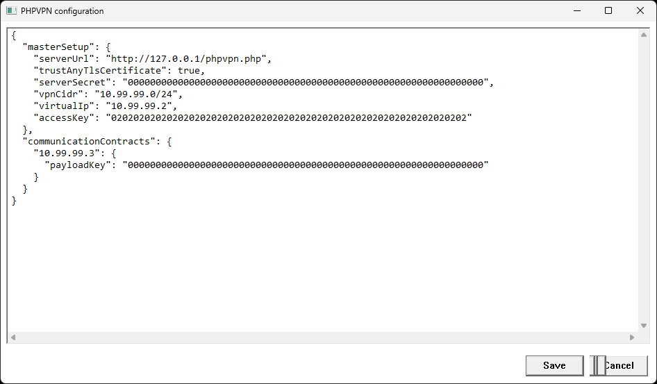

# Formální zadání změny `client.md`: Windows klient phpvpn

## Shrnutí

Upravit specifikaci `client.md` tak, aby přesně definovala čtyři změny Windows klienta phpvpn:

1. nové provedení tří stavových ikon tray aplikace,
2. širší výchozí okno **Edit Config** a bezchybné překreslování jeho prvků při změně velikosti,
3. nové průběhové okno pro připojování,
4. nové uživatelské statistiky aktuálního připojení.

Výsledný text v `client.md` bude normativním podkladem pro následnou implementaci. Toto zadání samo nepožaduje implementaci zdrojového kódu.

## Rozsah

- Změna se týká výhradně klienta pro Windows, zejména Windows Service, tray aplikace, lokální IPC smlouvy a příslušných Windows testů.
- Nemění se relay server ani drátový protokol v `protocol.md`.
- Nemění se klientské chování pro macOS a Linux.
- Windows Service nadále vlastní konfiguraci, stav připojení, síťový provoz a globální provozní čítače. Tray aplikace je pouze IPC klientem služby.
- Stávající pořadí bootstrapu zůstává `health`, `info`, prázdný autentizovaný `data` polling a následné spuštění tunelu.

## 1. Stavové ikony tray aplikace

### Funkční požadavky

- Zachovat tři významy ikony `shield_lock`:
  - šedý štít znamená odpojeno,
  - oranžový štít znamená připojování,
  - zelený štít znamená úspěšně připojeno.
- Každá ze tří ikon bude čtvercová.
- Štít bude umístěn na neprůhledném bílém pozadí.
- Bílé pozadí bude po celém obvodu uzavřeno zřetelným černým rámečkem.
- Vnitřní motiv, bílé pozadí a černý rámeček musí zůstat čitelné a ostré při běžných velikostech systémové lišty a při podporovaném škálování DPI.
- Nadále platí licenční podmínky použitého symbolu Material Symbols.

### Akceptační kritéria

- Šedá, oranžová i zelená varianta mají totožné rozměry, bílé pozadí a černé orámování.
- Při změně stavu se nemění geometrie ikony, pouze barva štítu.
- Ikona je rozpoznatelná na světlém i tmavém pozadí systémové lišty.

## 2. Okno Edit Config

### Výchozí velikost

- Výchozí šířka okna se zvětší o 50 procent proti současné hodnotě.
- Současná implementace vytváří okno o velikosti 720 × 560. Nová výchozí velikost proto bude 1080 × 560 při 100% DPI, případně její odpovídající DPI škálovaná hodnota.
- Výchozí výška zůstane beze změny.
- Okno musí zůstat celé dostupné na pracovní ploše aktuálního monitoru. Pokud se na menší pracovní plochu nevejde, smí se výchozí rozměr bezpečně omezit tak, aby zůstalo dosažitelné záhlaví i tlačítka.

### Změna velikosti a překreslování

- Při každé změně velikosti se musí správně přepočítat geometrie textového pole, posuvníků a tlačítek **Save** a **Cancel**.
- Všechny staré i nové plochy ovládacích prvků se musí korektně překreslit.
- Nesmí zůstat neinvalidované pruhy, části původních rámečků, zdvojené hrany, překryvy, ořezání ani jiné grafické artefakty.
- Tlačítka musí po celou dobu zůstat samostatná, plně viditelná a kliknutelná.
- Význam a pořadí tlačítek **Save** a **Cancel** se nemění.

### Referenční snímek vady

Následující snímek je součástí zadání a dokládá současný artefakt tlačítka **Cancel** po ručním roztažení okna:

### Implementační vodítko

Konkrétní Win32 mechanismus není normativně předepsán. Implementace však musí při obsluze změny velikosti zajistit přemístění všech potomků a invalidaci nebo překreslení dotčené klientské plochy. Výsledek se posuzuje podle akceptačních kritérií, nikoli podle použití konkrétního API.

## 3. Průběhové okno Connecting

### Otevření a obecné chování

- Volba **Connect** v tray aplikaci otevře v uživatelské relaci průběhové okno přibližně uprostřed pracovní plochy aktivního monitoru.
- Okno zobrazuje stav globální operace prováděné Windows Service. Samo neprovádí síťové požadavky ani neotevírá tunel.
- Během připojování zobrazí oranžovou variantu štítu a výrazný nadpis **Connecting**.
- Zavření průběhového okna během probíhající operace nesmí samo zrušit globální připojování ani zastavit službu.

### Tři povinné kontrolní body

Okno zobrazí vždy tyto tři položky ve stejném pořadí:

1. **Server URL**
2. **SERVER_SECRET**
3. **ACCESS_KEY**

Každá položka má alespoň stavy čeká se, úspěch a chyba:

- čekající kontrola je oranžová,
- úspěšná kontrola je zelená a může obsahovat symbol zaškrtnutí,
- neúspěšná kontrola je červená,
- dosud neprovedené pozdější kontroly zůstanou oranžové.

Význam kontrolních bodů:

- **Server URL** uspěje po navázání transportu a přijetí syntakticky použitelné odpovědi očekávaného endpointu `health`.
- **SERVER_SECRET** uspěje až po úplném kryptografickém ověření odpovědi `health` a úspěšném ověření, dešifrování a validaci následné odpovědi `info`.
- **ACCESS_KEY** uspěje po úspěšném prázdném autentizovaném `data` pollingu, kterým služba ověří přístupový klíč klienta.

Windows Service musí ve stavovém IPC snímku uchovávat dostatek bezpečných výsledků, aby tray dokázala všechny tři položky zobrazit i tehdy, když pravidelný polling přeskočí krátkou přechodovou fázi. Stav nesmí obsahovat URL, klíče, tagy, ciphertext ani detailní interní chyby.

### Úspěch

- Všechny tři kontrolní body musí být zelené.
- Text **Successfully connected** se zobrazí výrazně, tučně, větším písmem a v zelené barvě.
- Zobrazí se zelená varianta štítu.
- Úspěch se smí oznámit až ve chvíli, kdy služba hlásí skutečný stav `connected`, tunel je připraven a běží pracovní role.
- Úspěšné okno zůstane viditelné přibližně tři sekundy a potom se automaticky zavře. Číselné odpočítávání není požadováno.

### Chyba

- Při selhání se příslušný kontrolní bod zobrazí červeně a pozdější neprovedené body zůstanou oranžové.
- Ve spodní části se výrazně a červeně zobrazí **Cannot connect to the server** spolu se stručným bezpečným důvodem.
- Důvod musí rozlišit alespoň nedostupný nebo neplatný serverový endpoint, neúspěšné ověření serveru nebo `SERVER_SECRET`, odmítnutý `ACCESS_KEY` a selhání spuštění Windows tunelu.
- Při selhání tunelu po úspěšném bootstrapu smějí být všechny tři kontrolní body zelené, celkový výsledek však musí zůstat chybový a uvést bezpečný důvod selhání tunelu.
- Chybové okno se nikdy nezavírá automaticky. Zůstane otevřené, dokud je uživatel ručně nepotvrdí nebo nezavře.
- Chybová zpráva nesmí zobrazit klíče, tajné hodnoty, tagy, ciphertext, interní cestu ani neočištěný systémový chybový text.

## 4. Statistiky aktuálního připojení

### Položka menu a okno

- Do přesně definovaného menu tray aplikace přibude položka **Statistics** pod položku **Connect** nebo **Disconnect**.
- Nové pořadí menu bude:
  1. **Edit Config**
  2. **Show Info**
  3. **Connect** nebo **Disconnect**
  4. **Statistics**
- **Statistics** otevře jednoduché samostatné okno s hodnotami pouze pro čtení.
- Tray při otevření použije aktuální snímek `get-status`, případně si bezprostředně vyžádá nový jednorázový snímek. Tím se nemění pevný pětisekundový interval pravidelného stavového pollingu.

### Povinné hodnoty

Okno zobrazí nejméně tyto čítače:

- celkový počet `data` pollingů,
- počet prázdných `data` pollingů,
- počet `data` pollingů s alespoň jedním odesílaným datovým záznamem,
- celkový počet bajtů serializovaných těl `data` requestů,
- celkový počet bajtů serializovaných těl `data` responses,
- celkový počet odeslaných IPv4 paketů,
- celkový počet přijatých IPv4 paketů,
- celkový počet čistých bajtů odeslaných IPv4 paketů,
- celkový počet čistých bajtů přijatých IPv4 paketů.

Pro pole IPC se doporučují stabilní názvy:

- `dataPollsTotal`
- `dataPollsEmpty`
- `dataPollsWithPayload`
- `serializedDataRequestBodyBytes`
- `serializedDataResponseBodyBytes`
- `ipv4PacketsSent`
- `ipv4PacketsReceived`
- `ipv4BytesSent`
- `ipv4BytesReceived`

### Přesný význam čítačů

- Každý `data` polling patří právě do jedné skupiny: prázdný, nebo s payloadem.
- Vždy platí `dataPollsTotal = dataPollsEmpty + dataPollsWithPayload`.
- Prázdný bootstrap polling použitý pro ověření `ACCESS_KEY` se počítá jako prázdný `data` polling.
- Polling s payloadem obsahuje alespoň jeden odchozí záznam typu `data`. Samotný autentizační řádek z něj polling s payloadem nedělá.
- Čítače serializovaných bajtů používají přesný počet bajtů aplikačního těla předaného transportu pro `data` request a přesný počet bajtů těla přečteného z odpovídající response.
- Do serializovaných bajtů se nezapočítávají HTTP hlavičky, TLS režie ani nižší transportní vrstvy.
- `info`, `health` a jiné IPC nebo síťové operace se do počtů `data` pollingů ani do serializovaných `data` bajtů nezapočítávají.
- Čisté IPv4 bajty jsou součtem délek původních validovaných IPv4 paketů před serializací na odchozí straně a po úplném ověření, dešifrování a validaci na příchozí straně.
- Odeslaný IPv4 paket a jeho bajty se započítají právě jednou, když je paket zařazen do serializovaného `data` requestu předaného transportu.
- Přijatý IPv4 paket a jeho bajty se započítají právě jednou až po úspěšném ověření celé odpovědi a dávky a po přijetí paketu do klientské příchozí fronty.

### Životní cyklus a vlastnictví

- Čítače vlastní výhradně jediná globální Windows Service. Všechny tray a konzolové relace proto čtou stejné hodnoty.
- Všechny čítače se atomicky vynulují při zahájení nového logického pokusu `connect` z odpojeného nebo chybového stavu.
- Idempotentní opakování `connect` během stavů `connecting`, `connected` nebo `recovering` čítače nevynuluje.
- Čítače se zachovávají během obnovy stejného logického připojení.
- Po dokončení `disconnect` se všechny hodnoty zahodí a další `connect` začíná od nuly.
- Čítače existují pouze v paměti. Nesmějí se ukládat do konfigurace, souboru, registru, logu ani jiného perzistentního úložiště.
- Restart nebo pád služby je přirozeně vynuluje.

### Rozšíření get-status

- Nevznikne nový příkaz `get-statistics`.
- Stávající odpověď `get-status` se rozšíří o uvedené pevné celočíselné čítače.
- Načtení čítačů je pouze paměťová operace a nesmí spouštět síťový požadavek, měnit stav připojení ani blokovat pracovní role.
- Snímek musí být vnitřně konzistentní a hodnoty musí používat nejméně 64bitový nezáporný rozsah s definovanou ochranou proti přetečení.
- Rozšíření nesmí zásadně zvětšit režii Windows Service ani tray aplikace. Pevný počet malých celočíselných polí v lokálním IPC JSONu se považuje za přijatelnou režii.
- Stávající zákaz citlivých údajů v `get-status` zůstává beze změny.

## 5. Dotčené části client.md

Při zapracování je nutné aktualizovat alespoň:

- část **Stavový automat připojení**,
- část **Windows Service, konzole a tray**,
- seznam a přesnou smlouvu polí příkazu `get-status`,
- pravidlo pevného pětisekundového pollingu a povolený jednorázový dotaz při otevření statistik,
- popis tray ikon,
- přesné pořadí a chování položek tray menu,
- popis chyb bootstrapu,
- povinné Windows integrační a lifecycle testy.

## 6. Povinné testy a akceptace

### Ikony

- Ověřit všechny tři barevné varianty na světlém a tmavém pozadí a při podporovaném DPI.
- Ověřit shodný čtvercový rozměr, bílé pozadí a úplný černý rámeček.

### Edit Config

- Ověřit výchozí šířku 1080 proti původním 720 při 100% DPI a nezměněnou výšku 560.
- Opakovaně zvětšovat a zmenšovat okno tažením za každou hranu a roh.
- Ověřit, že textové pole, posuvníky, **Save** a **Cancel** nemají artefakty a zůstávají správně rozmístěné.
- Zahrnout regresní kontrolu vady zachycené v přiloženém snímku.

### Connecting

- Ověřit úspěšný průchod všech tří bodů, zelený výsledek a automatické zavření přibližně po třech sekundách.
- Samostatně simulovat chybu URL, ověření `SERVER_SECRET`, autorizace `ACCESS_KEY` a spuštění tunelu.
- Ověřit, že správný bod zčervená, pozdější body zůstanou oranžové a chybové okno se samo nezavře.
- Ověřit, že zavření okna během připojování nezastaví globální operaci služby.
- Ověřit, že žádná zobrazovaná chyba neobsahuje tajné nebo interní údaje.

### Statistiky

- Ověřit, že bootstrap polling zvyšuje celkový i prázdný čítač.
- Ověřit prázdný běžný polling a polling s jedním i více datovými záznamy.
- Po každé operaci ověřit invariant celkového, prázdného a datového počtu.
- Porovnat serializované čítače s přesnou délkou těl requestů a responses v bajtech.
- Ověřit, že HTTP hlavičky a TLS režie hodnoty neovlivní.
- Porovnat počty a čisté bajty IPv4 paketů s validovaným vstupem a výstupem.
- Ověřit nulování při novém logickém připojení, zachování během recovery a odstranění po disconnectu nebo restartu služby.
- Ověřit shodný globální snímek ve dvou souběžných tray relacích a v konzolovém klientovi.
- Ověřit, že rozšířený `get-status` zůstává pouze čtecí, neobsahuje citlivé údaje a nezpůsobuje měřitelné blokování síťových pracovníků.

## 7. Výslovně mimo rozsah

- Změna serverového endpointu nebo wire formátu.
- Perzistentní historie statistik.
- Statistiky endpointů `health` a `info`.
- Započítávání HTTP hlaviček, TLS režie nebo nižších síťových vrstev.
- Změny klienta pro macOS nebo Linux.
- Automatické zavření chybového okna.
- Číselné odpočítávání před zavřením úspěšného okna.
