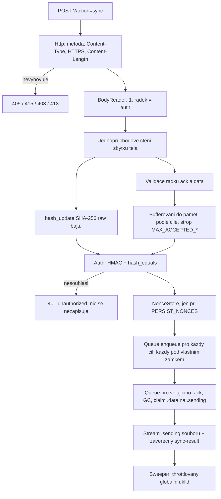

# Implementační plán serverové části `phpvpn.php`

> Vstup: [design2.md](design2.md) (cílová architektura) a [problems.md](problems.md) (analýza nasaditelnosti a povinné mitigace).
>
> Rozsah tohoto plánu: **pouze serverová část**. Klientská virtuální síťová karta se neřeší, plán ale dodává závaznou specifikaci drátového protokolu, aby ji šlo implementovat nezávisle.
>
> Cíl: jediný distribuovatelný soubor `phpvpn.php` na PHP 8.2+, bez databáze, bez Composeru, bez cronu a bez nepovinných rozšíření, provozovatelný na běžném sdíleném hostingu.

---

## 1. Klíčová rozhodnutí a odchylky od `design2.md`

Následující rozhodnutí byla potvrzena před zahájením plánu a jsou pro implementaci závazná.

### 1.1 Potvrzená rozhodnutí

1. **Žádná dlouhá spojení.** Platí architektura `design2.md` §1 a §4, tedy krátký obousměrný `POST ?action=sync`. Bod původního zadání o dvou dlouhých streamovaných spojeních (`old/notes.txt`) je zastaralý a **neimplementuje se**. Server nikdy nečeká na data, nepoužívá `sleep`, polling ani streaming s čekáním.
2. **Všechny mitigace z `problems.md` se zapracují**, zejména `QUEUE_ROOT` mimo webroot, nonce v rotovaných časových bucketech, `flock` s `LOCK_NB` a pevným časovým rozpočtem, snížené výchozí limity, globální byte a inode strop, oportunistický globální GC a preflight.
3. **Testy jsou součástí dodávky.** Vlastní test runner v čistém PHP CLI bez Composeru a bez PHPUnit, plus zabudovaný `?action=selftest` pro preflight na cílovém hostingu.

### 1.2 Odchylky od `design2.md` a jejich odůvodnění

Každá odchylka je vědomá, zapíše se do hlavičky `phpvpn.php` a do `PROTOCOL.md`.

| Odchylka | `design2.md` | Plán | Důvod |
|---|---|---|---|
| Částečné uložení dávky | §7: jedna neúspěšná cílová fronta znamená chybu celého požadavku | Uložené pakety se vrátí v `acceptedPacketUuids`, neuložené v `deferredPacketUuids` a odpověď je `200`. `429` nebo `503` jen když neuspěje **žádný** cíl. | Splňuje pravidlo „server nesmí tvrdit, že přijal dávku, kterou neuložil“ a navíc odstraňuje zbytečné duplicity při retry. Je to přirozené rozšíření mechanismu `deferredPacketUuids` z §6. |
| Název claimnutého souboru | §8: `.sending.<náhodné-id>` | `{batchId}.sending` bez náhodné přípony | Claim je vždy serializovaný per-frontovým zámkem a `batchId` je globálně unikátní, takže náhodná přípona nic nepřidává. Zpracování `ack` se tím mění z `glob()` na jediný `unlink()`, což je v horké cestě měřitelný rozdíl. |
| Obsah souboru fronty | §8: server obalí paket typem `delivery` až při odpovědi | Soubor se ukládá **rovnou** ve tvaru `delivery` řádků | Čtecí cesta se zredukuje na kopii bajtů (`fpassthru`) bez `json_decode` a `json_encode`. Toto je největší jednotlivá výkonová optimalizace celé odpovědi. |
| Velikost v `batchId` | §8: `…_random-id` | `batchId` je `{čas}_{náhoda}.{velikost}` s pevnou délkou 50 znaků, soubor je `{batchId}.data` | Výběr dávek do `MAX_RESPONSE_BYTES` nepotřebuje ani jeden `stat` na soubor. Pevná délka identifikátoru navíc umožní spočítat velikost dávky ještě před jeho vygenerováním, takže odpadá kruhová závislost mezi obsahem řádku `delivery` a názvem souboru. Stáří se i nadále určuje přes `filemtime` podle §10, čas v názvu slouží jen jako horní mez, která životnost nikdy neprodlouží. |
| Umístění fronty | §2: adresář vedle `phpvpn.php` | Konfigurovatelný `QUEUE_ROOT`, doporučeně mimo document root, s `__DIR__ . '/phpvpn'` jako fallbackem | `problems.md` bloker č. 2. Práva 0700 nezabrání webserveru vydat statický soubor. |
| Nonce úložiště | §5 a §10: soubor na nonce | Fixní záznamy v rotovaných minutových bucketech na klienta | `problems.md`, sekce Inode. Jeden soubor na nonce znamená asi 480 inode na aktivního klienta. |
| Výchozí limity | §3: 8 MiB | 1 MiB request i response, viz sekce 5 | Výchozí `post_max_size` je 8M, takže 8 MiB není „pod“ tímto limitem. |
| Ověření konfigurace | §3: `validateConfiguration()` při každém požadavku | `Cfg::assertRuntime()` je O(1) kontrola secretu a vzájemné konzistence limitů při každém požadavku. Formát tokenu se ověřuje jen u toho jediného, který se skutečně použije. Plná diagnostika celé tabulky běží na výchozí stránce a v preflightu. | Validace 253 tokenů regexem v každém z desítek požadavků za sekundu je zbytečná zátěž a pro bezpečnost nepřináší nic, protože se stejně použije jediný token. Řešení nepotřebuje žádný cache soubor, takže v horké cestě nepřidává ani jednu diskovou operaci. |
| Význam `acceptedBytes` | §8 neurčuje jednotku | Počet **bajtů požadavku**, které byly zařazené, nikoli počet uložených bajtů | Klient podle `recommendedRequestBytes` škáluje velikost příští dávky, takže `acceptedBytes` musí být měřené stejnou jednotkou. Uložená dávka je vždy větší o obálku `delivery`, což by klientskou heuristiku systematicky mátlo. |
| Časování reklamace | §10: „po bezpečné rezervě vrátit atomicky na `.data`“ | Claim navíc provede `touch()`, takže `SENDING_RECLAIM_SECONDS` běží od předání dávky, ne od jejího vzniku | `rename()` zachovává `filemtime`. Bez `touch()` by dávka vyzvednutá těsně před vypršením rezervy byla okamžitě reklamovatelná, což by generovalo zbytečné duplicity. |

### 1.3 Portabilita má přednost před lokálním prostředím

**Závazné pravidlo: `phpvpn.php` se navrhuje pro typický hosting, nikoli pro konkrétní testovací stroj.** Lokální nginx s PHP 8.5.9 v `d:\nginx` slouží výhradně k ověření, že server funguje. Z jeho `php.ini` se nesmí odvodit ani jedna výchozí hodnota a nesmí se na jeho vlastnosti spoléhat.

Implementace proto vychází z tohoto konzervativního profilu typického hostingu.

| Vlastnost | Předpoklad pro typický hosting | Důsledek pro implementaci |
|---|---|---|
| Verze PHP | 8.2 jako jazykový základ | Žádná syntaxe ani funkce z 8.3, 8.4 nebo 8.5, i když lokálně běží 8.5.9 |
| `post_max_size` | výchozích `8M` | `MAX_REQUEST_BYTES` je 1 MiB, tedy s velkou rezervou |
| `memory_limit` | `128M`, ale může být i `64M` | Špičková paměť požadavku pod 2 MiB, žádné načtení těla ani dávky celé do paměti |
| `max_execution_time` | `30`, nikdy neomezené | Žádné čekání, `LOCK_TIMEOUT_MS` v řádu stovek milisekund, `set_time_limit()` jen jako pokus |
| `output_buffering` | může být zapnuté, například `4096` | Na startu se defenzivně uzavřou všechny zděděné buffery |
| OPcache | **může být vypnutá** | Konstantní pole `ACCESS_TOKENS` je jen výkonová optimalizace, nikdy podmínka správnosti |
| `fastcgi_finish_request()` | **existuje jen v PHP-FPM** | Sweeper se volá přes `function_exists()` a při absenci se buď přeskočí, nebo běží s ještě menším rozpočtem |
| `disable_functions` | může zakazovat libovolnou funkci | Každá volitelná funkce se ověřuje přes `function_exists()`, preflight ji hlásí |
| `open_basedir` | může být nastaven | `QUEUE_ROOT` se ověřuje zápisem, ne domněnkou. Selhání je srozumitelná chyba, ne fatální |
| `ini_set()` | může být zakázaný | Volá se jen jako best effort a návratová hodnota se nikdy nevyžaduje |
| Webserver | Apache s `.htaccess` i nginx bez uživatelské konfigurace | Dodají se vzory pro obojí, ale funkčnost serveru na nich nezávisí |
| Filesystem | lokální disk, POSIX i Windows | Selhání `unlink()` a `rename()` se ošetřuje jako běžný stav, ne jako výjimka |
| Rozšíření | pouze `hash`, `json`, `pcre`, `random`, `standard`, `SPL`, `date` | Nic dalšího se nesmí použít |

Když se profil hostingu od tohoto předpokladu liší k lepšímu, může jej administrátor využít v pokročilém bloku konfigurace. Výchozí hodnoty v repozitáři ale musí být bezpečné na tom nejskromnějším prostředí.

---

## 2. Cílová struktura projektu

```text
c:\git\phpvpn\
    phpvpn.php                  jediný distribuovatelný soubor serveru
    PROTOCOL.md                 závazná specifikace drátového protokolu pro klienta
    README.md                   instalace, preflight, ladění limitů, provoz
    deploy\
        gen-credentials.php     generátor SERVER_SECRET a tabulky tokenů
        apache.htaccess         vzorová konfigurace pro Apache
        nginx.conf              vzorový server blok pro nginx
    tests\
        run.php                 test runner (PHP CLI, bez Composeru a PHPUnit)
        lib\Assert.php          aserce, přeskočení testu a reportér
        lib\Suite.php           registr testů jednoho souboru
        lib\HttpClient.php      HTTP klient nad stream_socket_client, včetně paralelních requestů
        lib\SignRequest.php     referenční podepisovač požadavků, psaný podle PROTOCOL.md
        lib\Harness.php         renderování instancí a start vestavěných PHP serverů
        lib\Vpn.php             zkratky pro řeč protokolu přes HTTP
        compat\*_test.php       statické kontroly jazykového základu a sady rozšíření
        unit\*_test.php         jednotkové testy vnitřních tříd
        integration\*_test.php  router, autorizace, cyklus, kapacita a preflight přes HTTP
        concurrency\*_test.php  souběh nad více procesy a zátěž sítě dvaceti klientů
        fault\*_test.php        injektované pády, poškozený stav a zotavení
```

Testovací instance vzniká přepsáním konfiguračního bloku ve zdroji, nikoli hookem v `phpvpn.php`. Dodávaný soubor tak neobsahuje jedinou konstrukci, která by existovala kvůli testům, a zároveň se průběžně ověřuje, že konfigurační blok zůstává snadno strojově i ručně editovatelný.

`design2.md` a `problems.md` zůstávají beze změny. `plan.md` je tento dokument.

---

## 3. Architektura `phpvpn.php`

Soubor je jeden, ale vnitřně striktně rozdělený na pojmenované sekce s bannerovými komentáři a s obsahem v hlavičce. Odhad 1600 až 2000 řádků včetně komentářů.

```text
phpvpn.php
 01  hlavička, popis, seznam odchylek, obsah
 02  declare(strict_types=1)
 03  KONFIGURACE - administrátorský blok           (design2 §3)
 04  KONFIGURACE - pokročilé ladění                (mitigace z problems.md)
 05  final class Cfg          validace konfigurace a runtime prostředí
 06  final class Http         hlavičky, chybové odpovědi, HTTPS, abort handling
 07  final class Log          bounded strukturované logování
 08  final class Wire         validace polí protokolu, kanonický řetězec, serializace
 09  final class BodyReader   streamovaný NDJSON čtenář s tvrdými limity
 10  final class Auth         HMAC ověření, timing-safe lookup
 11  final class NonceStore   bucketovaná replay ochrana
 12  final class QueuePath    bezpečné sestavení cest z ověřeného oktetu
 13  final class QueueLock    flock LOCK_NB s časovým rozpočtem
 14  final class QueueStat    per-frontové účetnictví a GC razítko
 15  final class Queue        enqueue, claim, ack, gc, reclaim
 16  final class Sweeper      throttlovaný globální úklid a kvóty
 17  final class SyncHandler  celý cyklus sync
 18  final class SelfTest     preflight kontrola prostředí
 19  final class Router       routování, metody, HTML stránka, health
 20  bootstrap a main()
```

Žádný namespace se nepoužívá, aby soubor zůstal vložitelný do libovolného prostředí. Všechny třídy jsou `final`, metody převážně `static`, žádná globální proměnná mimo jeden `RequestContext`.

### 3.1 Tok jednoho `sync` požadavku



Klíčové vlastnosti toku: na disk se nesáhne dříve, než je ověřen podpis, zámek se nikdy nedrží během odesílání odpovědi a v jeden okamžik je držen vždy nejvýše jeden zámek, takže deadlock je konstrukčně vyloučen.

---

## 4. Konfigurační blok

### 4.1 Administrátorský blok

```php
// ---------------------------------------------------------------------------
// KONFIGURACE - toto je jediná část, kterou upravuje administrátor.
// ---------------------------------------------------------------------------

/** Náhodný secret, minimálně 32 znaků. Bez něj server neobsluhuje sync. */
const SERVER_SECRET = '';

/**
 * Kořen diskové fronty. Silně doporučeno umístit MIMO document root,
 * například '/home/ucet/private/phpvpn-queue'. Prázdná hodnota znamená
 * fallback na __DIR__ . '/phpvpn', který vyžaduje funkční deny pravidlo.
 */
const QUEUE_ROOT = '';

/** Tvrdý strop celého těla požadavku. Musí být bezpečně pod post_max_size. */
const MAX_REQUEST_BYTES = 1024 * 1024;

/** Tvrdý strop jedné odpovědi. */
const MAX_RESPONSE_BYTES = 1024 * 1024;

/** Nejdelší přípustný jeden NDJSON řádek. 128 KiB pokryje i 65535B IP paket v base64. */
const MAX_PACKET_LINE_BYTES = 128 * 1024;

/** Protokolový strop počtu paketů v požadavku. Překročení je chyba 413. */
const MAX_REQUEST_PACKETS = 2000;

/** Provozní strop skutečně zařazených bajtů v jednom cyklu. Nad ním se odkládá. */
const MAX_ACCEPTED_REQUEST_BYTES = 768 * 1024;

/** Provozní strop skutečně zařazených paketů v jednom cyklu. */
const MAX_ACCEPTED_REQUEST_PACKETS = 1000;

/** Maximální počet dávek (.data + .sending) v jedné cílové frontě. */
const MAX_BUFFERS = 128;

/** Po této době je nevyzvednutá dávka zahozena. */
const QUEUE_TTL_SECONDS = 60;

/** Ochrana proti replay. false vědomě připouští replay uvnitř časového okna. */
const PERSIST_NONCES = false;

/** VPN IP klienta => 64 malých hex znaků. Uvádět jen skutečně používané klienty. */
const ACCESS_TOKENS = [
    '10.99.99.2' => 'replace-with-64-lowercase-hex-characters',
];
```

### 4.2 Pokročilý blok

```php
// ---------------------------------------------------------------------------
// POKROČILÉ LADĚNÍ - měnit jen po zátěžovém testu daného hostingu.
// ---------------------------------------------------------------------------

const CLOCK_SKEW_SECONDS        = 60;    // přípustná odchylka timestampu v auth
const LOCK_TIMEOUT_MS           = 200;   // rozpočet na získání jednoho flock
const LOCK_RETRY_MAX_SLEEP_US   = 8000;  // strop exponenciálního backoffu se jitterem
const GC_INTERVAL_SECONDS       = 5;     // throttling per-frontového GC
const SENDING_RECLAIM_SECONDS   = 30;    // po této době se .sending vrací na .data
const WRITING_STALE_SECONDS     = 60;    // po této době se .writing maže
const MAX_RECLAIMS_PER_BATCH    = 3;     // pojistka proti nekonečnému ping-pongu
const MAX_ACKS_PER_REQUEST      = 256;
const MAX_TOTAL_QUEUE_BYTES     = 128 * 1024 * 1024;
const MAX_TOTAL_QUEUE_FILES     = 4096;  // ochrana inode kvóty hostingu
const GLOBAL_STAT_TTL_SECONDS   = 10;    // platnost cachované globální statistiky
const GLOBAL_SWEEP_INTERVAL_SEC = 60;    // interval oportunistického globálního úklidu
const GLOBAL_SWEEP_MAX_DIRS     = 8;     // kolik front smí jeden request uklidit
const NONCE_BUCKET_SECONDS      = 60;
const NONCE_WINDOW_BUCKETS      = 3;     // pokrývá okno delší než 2 minuty
const MAX_NONCES_PER_BUCKET     = 4096;
const FSYNC_ON_PUBLISH          = false; // true je bezpečnější a výrazně pomalejší
const REQUIRE_HTTPS             = true;
const TRUST_PROXY_HEADERS       = true;  // důvěřovat X-Forwarded-Proto
const SEND_CONTENT_LENGTH       = true;
const LOG_LEVEL                 = 'error'; // 'off' | 'error' | 'info'
const LOG_RETENTION_DAYS        = 3;
const SELFTEST_ENABLED          = false;   // zapnout jen na dobu preflightu
```

### 4.3 Validace konfigurace

`Cfg::assertRuntime()` běží v každém požadavku a je O(1):

- `SERVER_SECRET` má alespoň 32 znaků a není výchozí prázdný řetězec,
- číselné invarianty: `MAX_ACCEPTED_REQUEST_BYTES <= MAX_REQUEST_BYTES`, `MAX_PACKET_LINE_BYTES <= MAX_REQUEST_BYTES`, `MAX_ACCEPTED_REQUEST_PACKETS <= MAX_REQUEST_PACKETS`, všechny limity kladné,
- `MAX_REQUEST_BYTES` je menší než `ini_get('post_max_size')` a než `memory_limit` s rezervou.

`Cfg::assertTokenTable()` je plná kontrola tabulky `ACCESS_TOKENS`, tedy klíče přesně v rozsahu `10.99.99.2` až `10.99.99.254`, hodnoty přesně 64 malých hex znaků, žádný duplicitní ani výchozí token. Běží při `health`, na výchozí HTML stránce, v `selftest` a jednou po změně konfigurace. Výsledek se cachuje do `_state/config.ok`, jehož obsahem je `hash('xxh128', serialize(...))` otisku konfiguračního bloku. Když otisk sedí, plná kontrola se přeskočí.

Neplatná konfigurace vrací pro `sync` HTTP `503` s `{"status":"error","error":"server_misconfigured"}`. Výchozí HTML stránka vždy zobrazí `Server is running` a při slabém secretu přidá červené varování podle původního zadání.

---

## 5. Router a HTTP vrstva

| Cesta | Metody | Odpověď |
|---|---|---|
| bez `action` | `GET`, `HEAD` | `text/html`, `<h1>Server is running</h1>`, případné červené varování |
| `?action=health` | `GET`, `POST` | `{"status":"OK","serverTime":"2026-08-08T14:20:00Z"}` |
| `?action=sync` | `POST` | `application/x-ndjson; charset=utf-8` |
| `?action=selftest` | `POST` | jen při `SELFTEST_ENABLED = true` a s platným HMAC podpisem |
| cokoli jiného | | `404` |
| špatná metoda | | `405` s hlavičkou `Allow` |

Společné hlavičky každé API odpovědi: `Cache-Control: no-store`, `Pragma: no-cache`, `X-Content-Type-Options: nosniff`, `Referrer-Policy: no-referrer`, `Vary: Accept-Encoding`. Na startu se volá `header_remove('X-Powered-By')`. HTML stránka navíc dostane restriktivní `Content-Security-Policy: default-src 'none'; style-src 'unsafe-inline'`.

Vstupní kontroly `sync` v tomto pořadí, protože každá další je dražší:

1. metoda je `POST`, jinak `405`,
2. `REQUIRE_HTTPS` a schéma není HTTPS, jinak `403`,
3. `Content-Type` začíná na `application/x-ndjson` nebo `application/jsonl`, jinak `415`,
4. `Content-Length`, pokud je uvedena, není větší než `MAX_REQUEST_BYTES`, jinak `413` **před** čtením těla,
5. `Cfg::assertRuntime()`, jinak `503`.

Chybové odpovědi mají jednotný minimalistický tvar `{"status":"error","error":"<kategorie>"}` s `Content-Type: application/json`. Povolené kategorie jsou pouze `bad_request`, `unauthorized`, `payload_too_large`, `unsupported_media_type`, `queue_busy`, `queue_full`, `queue_unavailable`, `server_misconfigured`, `not_found`, `method_not_allowed`. Odpověď nikdy neprozradí existenci jiného klienta, důvod selhání podpisu ani stav cizí fronty.

Bootstrap dále nastaví `ignore_user_abort(true)`, `set_time_limit(30)`, vypne veškeré zděděné output buffery a zaregistruje `set_exception_handler` plus `register_shutdown_function`, který uklidí případný rozepsaný `.writing` soubor a uvolní zámky.

---

## 6. Specifikace protokolu

Tato sekce je zdrojem pravdy pro pozdější klienta a přesně se zkopíruje do `PROTOCOL.md`.

### 6.1 Tělo požadavku

NDJSON, jeden kompaktní JSON objekt na řádek, každý řádek zakončený jedním `\n`. První řádek je vždy přesně jeden objekt `auth`. Samotný `auth` řádek je platný prázdný `sync`.

```json
{"type":"auth","client":"10.99.99.4","timestamp":"2026-08-08T14:20:00Z","nonce":"Zm9vYmFyMTIzNA","signature":"<64 hex>"}
{"type":"ack","batchId":"20260808T142000.123456Z_9f2c1ab7d4e60518"}
{"type":"data","uuid":"550e8400-e29b-41d4-a716-446655440000","src":"10.99.99.4","dst":"10.99.99.2","data":"BASE64"}
```

### 6.2 Validace polí

| Pole | Pravidlo |
|---|---|
| `auth` objekt | přesně klíče `type`, `client`, `timestamp`, `nonce`, `signature`, žádný navíc |
| `client` | musí být klíčem v `ACCESS_TOKENS` |
| `timestamp` | `^\d{4}-\d{2}-\d{2}T\d{2}:\d{2}:\d{2}Z$`, odchylka od času serveru nejvýše `CLOCK_SKEW_SECONDS` |
| `nonce` | `^[A-Za-z0-9_-]{16,64}$` |
| `signature` | `^[0-9a-f]{64}$` |
| `ack.batchId` | `^\d{8}T\d{6}\.\d{6}Z_[0-9a-f]{16}$` |
| `data.uuid` | `^[0-9a-f]{8}-[0-9a-f]{4}-[0-9a-f]{4}-[0-9a-f]{4}-[0-9a-f]{12}$` |
| `data.src` | musí být přesně rovno ověřené `client` adrese |
| `data.dst` | `10.99.99.2` až `10.99.99.254`, ověřuje se přes předpočítanou mapu povolených řetězců |
| `data.data` | `^[A-Za-z0-9+/]+={0,2}$`, neprázdné, délka nejvýše `MAX_PACKET_LINE_BYTES - 256` |

Přísná validace znakových tříd u `uuid`, `src`, `dst` a `data` je zároveň bezpečnostní základ optimalizace v sekci 8.3, protože zaručuje, že tyto hodnoty nikdy nepotřebují JSON escapování.

### 6.3 Podpis

```php
$derivedKey = hash_hmac('sha256', $clientIp . "\n" . $accessToken, SERVER_SECRET, true); // raw 32 B

$canonical  = "POST\n"
            . "sync\n"
            . $clientIp . "\n"
            . $timestamp . "\n"
            . $nonce . "\n"
            . $sha256HexOfBodyAfterAuthLine;

$signature  = hash_hmac('sha256', $canonical, $derivedKey); // 64 malých hex znaků
```

`bodyAfterAuthLine` jsou **verbatim bajty** těla za prvním znakem `\n`, včetně koncového `\n` posledního řádku. Pro prázdný `sync` je to prázdný řetězec, jehož SHA-256 je `e3b0c44298fc1c149afbf4c8996fb92427ae41e4649b934ca495991b7852b855`. Kanonický řetězec nemá koncový `\n`.

### 6.4 Odpověď

```json
{"type":"delivery","batchId":"20260808T142000.123456Z_9f2c1ab7d4e60518","packet":{"type":"data","uuid":"…","src":"10.99.99.2","dst":"10.99.99.4","data":"BASE64"}}
{"type":"sync-result","acceptedPacketUuids":["…"],"deferredPacketUuids":["…"],"acceptedPackets":120,"acceptedBytes":82000,"responseTruncated":true,"recommendedRequestBytes":65536,"recommendedRequestPackets":100}
```

`sync-result` je vždy poslední řádek každé úspěšné odpovědi.

---

## 7. Streamované čtení těla a jednoprůchodové zpracování

Toto je jádro výkonu i bezpečnosti serveru.

### 7.1 Proč jeden průchod

`design2.md` §5 vyžaduje ověřit podpis před zpracováním těla, ale podpis obsahuje SHA-256 celého těla za `auth` řádkem. Naivní řešení tělo nejprve uloží. `problems.md` proto zakazuje neomezený řetězec v RAM a připouští omezený dočasný soubor.

Plán volí lepší variantu: **jeden průchod bez dočasného souboru**. Server čte tělo po blocích, průběžně jej hashuje přes `hash_update()` a zároveň parsuje a validuje řádky. Přijaté pakety drží v paměti seskupené podle cílové IP, s tvrdým stropem `MAX_ACCEPTED_REQUEST_BYTES`. Podpis se ověří až po dočtení těla a **teprve pak** se sáhne na disk. Vlastnosti:

- žádný I/O dočasného souboru, tedy méně inode a méně zápisů,
- do ověření podpisu se nezapíše ani jeden bajt na disk,
- spotřeba paměti je shora omezena `MAX_ACCEPTED_REQUEST_BYTES` plus jeden řádek,
- při 768 KiB stropu je špičková paměť pod 2 MiB, tedy pod výchozím `memory_limit`.

### 7.2 Čtečka

```php
$in = fopen('php://input', 'rb');
stream_set_read_buffer($in, 0);          // vlastní bufferování, žádná dvojitá kopie
$ctx = hash_init('sha256');
```

Čte se po 64 KiB blocích do string bufferu. Hranice řádků se hledají přes `strpos($buf, "\n", $offset)`. Zkonzumovaná část se odřezává až při doplnění bufferu, nikoli po každém řádku, aby nevznikla kvadratická složitost `substr`. Jakmile je nalezen konec prvního řádku, všechny **další** bajty jdou průběžně do `hash_update()`, včetně bajtů, které ještě čekají v bufferu na zpracování jako neúplný řádek.

Tvrdé limity kontrolované za běhu:

- celkově přečtené bajty nikdy nepřekročí `MAX_REQUEST_BYTES`, jinak `413` a čtení se ukončí,
- žádný řádek nesmí být delší než `MAX_PACKET_LINE_BYTES`, kontroluje se **před** `json_decode`,
- počet `data` řádků nesmí přesáhnout `MAX_REQUEST_PACKETS`, jinak `413`,
- počet `ack` řádků nesmí přesáhnout `MAX_ACKS_PER_REQUEST`,
- druhý `auth`, chybějící `auth` nebo `auth` mimo první pozici je `400`.

### 7.3 Odložení místo chyby

Po dosažení `MAX_ACCEPTED_REQUEST_PACKETS` nebo `MAX_ACCEPTED_REQUEST_BYTES` server řádky dále **plně validuje**, protože chybný řádek zůstává chybou celého požadavku podle §6, ale jejich `data` nebufferuje. Zaznamená si pouze `uuid` do `deferredPacketUuids`. Paměť tak zůstává omezená i u požadavku o velikosti `MAX_REQUEST_BYTES`.

### 7.4 Odolnost proti oracle úniku

Chyba parsování nebo validace nastalá **před** ověřením podpisu se pouze zapamatuje jako první chyba. Server pokračuje ve čtení a hashování zbytku těla, ale už neparsuje. Po dočtení nejprve ověří podpis. Když podpis nesouhlasí, vrátí `401`. Až když podpis souhlasí, vrátí uloženou chybu `400`. Neautentizovaný útočník tak nemůže z odpovědí zjišťovat, jak přesně server parsuje.

---

## 8. Autentizace, replay ochrana a serializace

### 8.1 Ověření

1. Rozparsovat a přesně zvalidovat první řádek podle 6.2.
2. Ověřit časovou odchylku. `timestamp` se převádí regexem plus `gmmktime()`, nikoli přes `DateTimeImmutable`, protože to je v horké cestě několikanásobně rychlejší.
3. Vyhledat token: `ACCESS_TOKENS[$client] ?? null`. Díky opcache je konstantní pole zkompilované a vyhledání je O(1) bez rekonstrukce.
4. Pro **neznámou** klientskou IP se stejně provede HMAC výpočet s fixním dummy tokenem a výsledek se zahodí, aby doba odpovědi neprozrazovala, které IP jsou nakonfigurované.
5. Porovnání přes `hash_equals()`.

### 8.2 Nonce buckety

Aktivní jen při `PERSIST_NONCES = true`.

```text
{QUEUE_ROOT}/_nonce/004/1786147740.bin
```

Bucket je binární soubor s pevnou šířkou záznamu 8 bajtů, kde záznam je prvních 8 bajtů `hash('sha256', $nonce, true)`. Kolize 64 bitů je při maximálně několika tisících záznamech v okně zanedbatelná.

Postup pod `flock(LOCK_EX)` přímo nad souborem aktuálního bucketu, tedy bez sdílení zámku s frontou:

1. spočítat `bucket = intdiv($now, NONCE_BUCKET_SECONDS)`,
2. načíst aktuální a `NONCE_WINDOW_BUCKETS - 1` předchozích bucketů, celkem nejvýše `3 * 4096 * 8 B = 96 KiB`,
3. hledat `strpos($blob, $key)` s krokem kontroly zarovnání na 8 bajtů,
4. při nálezu vrátit `401`,
5. jinak připojit záznam. Při překročení `MAX_NONCES_PER_BUCKET` vrátit `429`, tedy fail-closed.

Buckety starší než `NONCE_WINDOW_BUCKETS * NONCE_BUCKET_SECONDS + 60` maže globální sweeper. Inode náklad je nejvýše 3 soubory na klienta místo asi 480.

### 8.3 Serializace bez escapování

Protože `uuid`, `src`, `dst` i `data` prošly přísnou znakovou validací, nemůže žádná z nich obsahovat znak vyžadující JSON escapování. Řádek se proto skládá přímou konkatenací, nikoli přes `json_encode()`:

```php
$line = '{"type":"delivery","batchId":"' . $batchId
      . '","packet":{"type":"data","uuid":"' . $uuid
      . '","src":"' . $src
      . '","dst":"' . $dst
      . '","data":"' . $data . '"}}' . "\n";
```

Toto je nejrychlejší možná cesta a je **prokazatelně** bezpečná právě díky validaci ze 6.2. Implementace musí mít u této funkce komentář s tímto invariantem a test, který se pokusí propašovat `"` a `\` do každého pole.

---

## 9. Disková fronta

### 9.1 Rozvržení

```text
{QUEUE_ROOT}/
    .htaccess                      Deny from all, obrana do hloubky
    index.html                     prázdný, brání výpisu adresáře
    10_99_99_0/
        004/
            queue.lock             prázdný zámkový soubor, nikdy se nemaže
            queue.stat             files, bytes, lastGcAt, reclaims
            20260808T142000.123456Z_9f2c1ab7d4e60518.83214.data
            ….writing
            ….sending
            ….error
    _nonce/004/1786147740.bin
    _state/global.stat             agregovaná kvóta, TTL GLOBAL_STAT_TTL_SECONDS
    _state/sweep.lock              zámek globálního úklidu
    _state/sweep.cursor            round-robin pozice
    _state/config.ok               otisk ověřené konfigurace
    _logs/2026-08-08.log
```

Služební adresáře začínají podtržítkem, takže nikdy nekolidují s `10_99_99_0`.

`QueuePath::forOctet(int $octet)` je jediná funkce, která smí sestavit cestu, a přijímá pouze celé číslo z rozsahu 2 až 254, ověřené proti mapě povolených cílů. Z HTTP vstupu se nikdy neskládá cesta ani její část. Adresáře se vytvářejí `@mkdir($path, 0700, true)` a při neúspěchu se ověří `is_dir()`, aby souběžné vytvoření nebylo chybou.

`batchId` má tvar `Ymd\THis` plus mikrosekundy plus `Z` plus podtržítko plus 16 hex znaků z `random_bytes(8)`. Formát je lexikograficky seřaditelný podle času, což čtecí cesta využívá k FIFO pořadí bez parsování.

### 9.2 Zámky

`QueueLock::acquire()` používá výhradně `flock($fh, LOCK_EX | LOCK_NB)` v cyklu s rozpočtem `LOCK_TIMEOUT_MS` měřeným přes `hrtime(true)`. Backoff je exponenciální od 250 mikrosekund se stropem `LOCK_RETRY_MAX_SLEEP_US` a s náhodným jitterem, aby se souběžní zapisovatelé rozešli. Po vyčerpání rozpočtu server vrací `503 queue_busy` s hlavičkou `Retry-After: 1`. Blokující `flock` se nepoužije nikde, protože podle `problems.md` by request mohl čekat až do `max_execution_time`.

Pravidla, která implementace nesmí porušit:

- v jednu chvíli je držen nejvýše jeden zámek, cílové fronty se zpracovávají postupně ve vzestupném pořadí oktetu,
- zámek se nikdy nedrží při odesílání HTTP odpovědi ani při čtení obsahu dávek do výstupu,
- doba držení zámku je omezená prací nad jednou frontou, tedy nejvýše jeden zápis a jeden throttlovaný GC,
- `queue.lock` se otevírá režimem `c+b`, nikdy se nezkracuje a nikdy nemaže.

### 9.3 Účetnictví fronty

`queue.stat` je jeden krátký soubor čtený a zapisovaný pod již drženým zámkem. Obsahuje počet souborů, součet bajtů, čas posledního GC a čítač reclaimů. Díky němu:

- kapacitní kontrola proti `MAX_BUFFERS` nepotřebuje výpis adresáře, což je hlavní úspora v zapisovací cestě do cizí fronty,
- GC se throttluje bez dalšího souboru,
- globální kvóta se počítá jako součet shardů, takže neexistuje globální hot lock.

Když `queue.stat` chybí nebo je nečitelný, přepočte se plným výpisem adresáře a přepíše.

### 9.4 Zápis dávky

Pro každý cílový oktet, postupně:

1. získat zámek podle 9.2,
2. načíst `queue.stat`, při zastaralém `lastGcAt` nebo při dosažení `MAX_BUFFERS` spustit lokální GC (sekce 10),
3. ověřit kapacitu proti `MAX_BUFFERS` a globální kvótu z `_state/global.stat`,
4. `fopen($dir . '/' . $batchId . '.' . $bytes . '.writing', 'x+b')`, výhradní vytvoření,
5. zapsat celý blok ve smyčce, která korektně řeší částečný `fwrite`, poté `fflush()` a při `FSYNC_ON_PUBLISH` také `fsync()`,
6. `rename()` na `.data` ve stejném adresáři, tedy atomicky,
7. aktualizovat `queue.stat`,
8. uvolnit zámek.

Selhání kdykoli mezi kroky 4 a 6 vede k `unlink()` rozepsaného `.writing`. Když ani to neprojde, soubor se přejmenuje na `.error`. Cíl je pak označen jako neúspěšný a jeho pakety jdou do `deferredPacketUuids`. Když neuspěje žádný cíl, vrací se `429 queue_full` u plné fronty a `503 queue_unavailable` u chyby disku nebo inode.

Čtenář nikdy nevidí `.writing`, protože ho odfiltruje přípona a protože publikace je atomický `rename` ve stejném filesystemu.

### 9.5 Vyzvednutí, doručení a `ack`

Pod zámkem vlastní fronty volajícího, jednou:

1. zpracovat všechny `ack` řádky, tedy pro každý validovaný `batchId` provést `unlink($dir . '/' . $batchId . '.sending')`. Neexistující soubor není chyba, jde o očekávaný důsledek at-least-once,
2. spustit throttlovaný GC,
3. jedním průchodem `opendir()` a `readdir()` posbírat jména `.data`, velikost přečíst z názvu souboru,
4. seřadit lexikograficky přes `sort()`, což díky formátu `batchId` znamená FIFO,
5. vybírat od nejstaršího, dokud by součet nepřekročil `MAX_RESPONSE_BYTES`. Když se nevejde ani první dávka, vzít ji samotnou, aby nevznikl deadlock hladovění,
6. každou vybranou přejmenovat na `{batchId}.sending`,
7. aktualizovat `queue.stat`, nastavit `responseTruncated` podle toho, zda zbyly nevybrané `.data`,
8. uvolnit zámek.

Teprve po uvolnění zámku se odešle odpověď. Každý `.sending` soubor se streamuje přes `fpassthru()`, tedy bez parsování a bez kopie do PHP paměti, protože obsah je už uložený v cílovém tvaru `delivery` řádků. Nakonec se připojí `sync-result`.

Při `SEND_CONTENT_LENGTH = true` se `Content-Length` spočítá předem jako součet velikostí vybraných souborů plus délka `sync-result` řádku, protože oba jsou v tu chvíli přesně známé. Tím se vyhneme chunked kódování. Když se během streamu ukáže nesoulad, spojení se ukončí a událost se zaloguje, klient dávku dostane znovu.

`.sending` se po odpovědi **nemaže**. Maže ho až `ack` v některém dalším cyklu, nebo ho GC vrátí zpět na `.data`. Doručení je tím at-least-once a klient deduplikuje podle `uuid`.

Během streamu se pravidelně kontroluje `connection_aborted()`. Při odpojení se stream ukončí, `.sending` soubory zůstanou a vrátí je reclaim.

### 9.6 Adaptivní doporučení

`recommendedRequestBytes` a `recommendedRequestPackets` se počítají z `MAX_ACCEPTED_REQUEST_*` vynásobených nejmenším z těchto koeficientů:

| Signál | Koeficient |
|---|---|
| naplnění nejplnější dotčené cílové fronty | `1 - fill` zaokrouhleno dolů na 1, 0.5, 0.25 nebo 0.125 |
| naplnění globální kvóty bajtů nebo inode | totéž |
| doba čekání na zámky v tomto requestu vůči `LOCK_TIMEOUT_MS` | 1, 0.5 nebo 0.25 |
| celková doba zpracování requestu vůči rozpočtu 250 ms | 1, 0.5 nebo 0.25 |

Výsledek se kvantuje na mocniny dvou, aby klient nedostával roztřesené hodnoty a aby se choval stabilně. Server tím podle §8 signalizuje přetížení dříve, než musí vracet `429`.

---

## 10. Garbage collection, zotavení a kvóty

### 10.1 Lokální GC

Běží vždy jen nad jednou frontou, vždy pod jejím zámkem a je throttlovaný přes `lastGcAt` v `queue.stat` na `GC_INTERVAL_SECONDS`. Vynutí se navíc při dosažení `MAX_BUFFERS`. Stáří se určuje výhradně přes `filemtime()`, nikdy podle názvu, přesně podle §10.

| Přípona | Podmínka | Akce |
|---|---|---|
| `.writing` | `filemtime` starší než `WRITING_STALE_SECONDS` | `unlink`, při selhání přejmenovat na `.error` |
| `.data` | `filemtime` starší než `QUEUE_TTL_SECONDS` | `unlink` |
| `.sending` | `filemtime` starší než `SENDING_RECLAIM_SECONDS` | `rename` zpět na `.data`, čítač reclaimů +1 |
| `.sending` | čas z `batchId` starší než `QUEUE_TTL_SECONDS` nebo reclaimů více než `MAX_RECLAIMS_PER_BATCH` | `unlink` |
| `.error` | starší než 1 hodina | `unlink` |

Pojistka proti nekonečnému ping-pongu je záměrně dvojitá. Reclaim resetuje `filemtime`, takže absolutní stáří se bere z časové části `batchId`, která se při přejmenování nemění.

### 10.2 Globální oportunistický úklid

`problems.md` upozorňuje, že bez cronu se uklízí jen při requestech, takže fronta klienta, který se už nikdy neozve, drží artefakty navždy. Řešení:

- `Sweeper::maybeRun()` se volá až **po** odeslání odpovědi, ideálně po `fastcgi_finish_request()`, když je funkce dostupná,
- spouští se nejvýše jednou za `GLOBAL_SWEEP_INTERVAL_SEC`, což hlídá `filemtime` souboru `_state/sweep.lock` chráněného `flock(LOCK_EX | LOCK_NB)`. Když zámek nedostane, jiný worker už uklízí a request nic nedělá,
- jeden běh zpracuje nejvýše `GLOBAL_SWEEP_MAX_DIRS` front podle round-robin kurzoru v `_state/sweep.cursor`, takže práce na request je shora omezená,
- kromě lokálního GC nad těmito frontami maže staré nonce buckety, rotuje logy podle `LOG_RETENTION_DAYS` a přepočítá `_state/global.stat`.

### 10.3 Globální kvóta

`_state/global.stat` obsahuje součet bajtů a souborů přes všechny fronty a čas přepočtu. Čtenář jej považuje za platný `GLOBAL_STAT_TTL_SECONDS`. Při překročení `MAX_TOTAL_QUEUE_BYTES` nebo `MAX_TOTAL_QUEUE_FILES` server odmítne nové zápisy s `429 queue_full` a agresivně sníží doporučení v `sync-result`. Toto je přímá odpověď na inode kvótu popsanou v `problems.md` §11 a v sekci Inode.

### 10.4 Scénáře pádu

| Kdy nastal pád | Stav na disku | Zotavení |
|---|---|---|
| před vytvořením `.writing` | žádný | nic se nestalo, klient retryuje |
| během zápisu `.writing` | osiřelý `.writing` | shutdown handler jej smaže, jinak GC po `WRITING_STALE_SECONDS` |
| po `rename` na `.data` | kompletní `.data` | doručí se v příštím cyklu |
| po claimu, před odesláním | `.sending` | reclaim po `SENDING_RECLAIM_SECONDS` vrátí na `.data` |
| během odesílání odpovědi | `.sending` | totéž, klient dostane duplicitu a deduplikuje podle `uuid` |
| po odeslání, před `ack` | `.sending` | totéž, jde o normální stav protokolu |

---

## 11. Bezpečnost

1. **Nic na disk před ověřením podpisu.** Plyne přímo z jednoprůchodového návrhu v sekci 7.
2. **Podpis váže secret i token klienta.** Odvozený klíč je HMAC z `clientIp` a `accessToken` pod `SERVER_SECRET`, takže kompromitace jednoho tokenu nedává možnost podepsat za jiného klienta.
3. **Zákaz spoofingu zdroje.** `data.src` se porovnává s ověřenou adresou z `auth`. Neshoda je `401`.
4. **Konstantní porovnání.** Výhradně `hash_equals()`. Pro neznámou IP se provádí dummy HMAC.
5. **Žádné tajemství v URL.** URL obsahuje pouze `?action=sync`, protože se může zapsat do logů hostingu, proxy nebo WAF.
6. **Fronta nedostupná přes HTTP.** Primárně `QUEUE_ROOT` mimo document root. Sekundárně `.htaccess` s `Deny from all` a vzorová nginx konfigurace v `deploy/`. Preflight tuto nedostupnost aktivně ověřuje.
7. **Práva.** Adresáře `0700`, soubory `0600`. Před prvním použitím se ověří, že `QUEUE_ROOT` je zapisovatelný a že v něm existuje `.htaccess` a `index.html`.
8. **Logování.** Nikdy se neloguje `SERVER_SECRET`, access token, podpis, nonce ani obsah paketů. Loguje se čas, akce, klientská IP podle provozní politiky, kategorie chyby, počty a náhodné request ID.
9. **HTTPS.** Při `REQUIRE_HTTPS = true` se `sync` bez HTTPS odmítne. `X-Forwarded-Proto` se čte jen při `TRUST_PROXY_HEADERS = true`.
10. **Path traversal.** Cesty se skládají výhradně z celočíselného oktetu a z `batchId` ověřeného přísným regexem. Žádný `glob()`, žádná neověřená konkatenace.
11. **DoS před autentizací.** `Content-Length` se kontroluje před čtením, tělo má tvrdý strop a jeho hashování je jediná práce, kterou neautentizovaný požadavek vyvolá. Aplikace nemůže zabránit saturaci linky před PHP, což `README.md` výslovně uvádí jako provozní riziko.
12. **Uložení tajemství.** `README.md` popíše, jak `SERVER_SECRET` a tokeny načíst z prostředí nebo ze souboru mimo webroot, pokud to hosting umožňuje.
13. **Selftest je vypnutý** a i po zapnutí vyžaduje platný HMAC podpis.

---

## 12. Rozpočet výkonu

Cílový profil je desítky klientů, řádově 100 až 200 požadavků za sekundu, tedy 5 až 10 ms CPU na požadavek.

### 12.1 Počet souborových operací na jeden `sync`

| Fáze | Operace |
|---|---|
| runtime validace konfigurace | 0, jen paměť |
| autentizace bez nonce | 0 |
| autentizace s nonce | 1 open a lock, 1 až 3 read, 1 append |
| zápis do jedné cílové fronty | 1 lock, 1 read `queue.stat`, 1 create, 1 až N write, 1 rename, 1 write `queue.stat` |
| vlastní fronta | 1 lock, 1 `opendir` a `readdir`, K rename, 1 write `queue.stat` |
| odpověď | K `fpassthru` |
| kvóta | 1 read `_state/global.stat` |
| sweeper | 0 ve většině requestů, práce je throttlovaná a shora omezená |

Prázdný `sync` bez čekajících dat stojí přibližně 4 souborové operace. To je klíčové, protože při adaptivním intervalu je prázdný cyklus nejčastější případ.

### 12.2 Konkrétní optimalizace

1. Uložení dávek přímo v cílovém `delivery` tvaru, takže odpověď je čistá kopie bajtů.
2. Skládání JSON konkatenací místo `json_encode()`, umožněné přísnou validací znakových tříd.
3. Velikost v názvu souboru, takže výběr do `MAX_RESPONSE_BYTES` nepotřebuje žádný `stat`.
4. `queue.stat` místo výpisu adresáře v zapisovací cestě.
5. Kapacitní a GC informace v jednom souboru místo tří.
6. `ACCESS_TOKENS` jako konstantní pole, tedy sdílené přes opcache bez rekonstrukce na request.
7. Plná validace tabulky tokenů cachovaná přes otisk konfigurace.
8. `gmmktime()` s regexem místo `DateTimeImmutable` v horké cestě.
9. Jedno volání `random_bytes(32)` na request, ze kterého se krájí request ID i `batchId`.
10. `opendir` a `readdir` se `str_ends_with()` místo `glob()` a `scandir()`.
11. `LOCK_NB` s krátkým rozpočtem, takže worker nikdy neblokuje dlouho.
12. Sweeper až po `fastcgi_finish_request()`, takže latenci klienta neovlivní.
13. Odřezávání zkonzumované části vstupního bufferu po blocích, nikoli po řádcích.
14. Bez output bufferingu, `Content-Length` známý dopředu.

### 12.3 Co je zakázáno

Žádné `sleep` čekání na data, žádný blokující `flock`, žádné rekurzivní procházení celého `QUEUE_ROOT` v požadavku, žádné `file_get_contents` nad tělem požadavku ani nad dávkou, žádná regulární výrazová validace base64 obsahu delší než nutná jednorázová kontrola, žádné `json_decode` v čtecí cestě.

---

## 13. Logování a diagnostika

`Log` zapisuje jednou funkcí `file_put_contents($path, $line, FILE_APPEND | LOCK_EX)`, protože krátký append pod zámkem je na běžném filesystemu atomický. Výchozí `LOG_LEVEL = 'error'` znamená, že úspěšný provoz negeneruje žádné I/O.

Formát je jeden řádek NDJSON s poli `ts`, `rid`, `action`, `client`, `category`, `httpStatus`, `inPackets`, `inBytes`, `outBatches`, `outBytes`, `lockWaitMs`, `elapsedMs`. Nikdy neobsahuje klíče, podpisy, nonce ani obsah paketů. Rotace probíhá v globálním sweeperu podle `LOG_RETENTION_DAYS`.

---

## 14. Preflight `?action=selftest`

Implementuje minimální preflight z `problems.md`, aby bylo možné hosting posoudit bez ručního testování. Endpoint je vypnutý a i po zapnutí vyžaduje platný HMAC podpis. Vrací JSON se seznamem kontrol a výsledkem `pass`, `warn` nebo `fail`.

1. `PHP_VERSION` je alespoň 8.2, `sha256` je v `hash_algos()`, `random_bytes()` funguje.
2. `function_exists()` pro `hash_hmac`, `hash_equals`, `flock`, `rename`, `fopen`, `fwrite`, `fflush`, `filemtime`, `mkdir`, `unlink`, `opendir` a kontrola `disable_functions`.
3. Zapisovatelnost `QUEUE_ROOT`, vytvoření souboru režimem `x+b`, úplný zápis, `fflush`, atomický `rename`, `unlink`.
4. Test `flock` v rámci procesu plus instrukce, jak spustit souběžný test ze dvou workerů, protože jednoprocesový test podle `problems.md` nestačí.
5. Porovnání `MAX_REQUEST_BYTES` s `post_max_size` a `memory_limit`, `MAX_RESPONSE_BYTES` s `memory_limit`, `max_execution_time` alespoň 30 sekund.
6. Kontrola, že `QUEUE_ROOT` leží mimo document root, nebo že existuje `.htaccess`. Když ani jedno, výsledek je `fail`.
7. Odhad volného místa přes `disk_free_space()` a aktuální počet souborů fronty proti `MAX_TOTAL_QUEUE_FILES`.
8. Rozdíl mezi časem serveru a `timestamp` v podepsaném požadavku, aby se odhalil drift.

`README.md` navíc popíše kroky, které z PHP ověřit nelze, tedy HTTPS zvenčí, doručení `Content-Type` a NDJSON těla přes WAF, HTTP nedostupnost fronty z externího klienta a souběžnou viditelnost souborů mezi workery.

---

## 15. Testovací strategie

Runner je `php tests/run.php`, případně `php tests/run.php unit` nebo `--filter`. Bez Composeru a bez PHPUnit, vlastní `Assert` a TAP-like výstup s nenulovým exit kódem při selhání.

Aby šly testovat vnitřní třídy, `phpvpn.php` spustí `main()` jen když není definována konstanta `PHPVPN_TEST_MODE`. Test tak soubor bezpečně `require`ne.

Integrační a souběžné testy používají vestavěný PHP server. Na Windows není `PHP_CLI_SERVER_WORKERS` k dispozici, protože je založený na `fork`. Harness proto spustí **N nezávislých vestavěných serverů na různých portech nad stejným `QUEUE_ROOT`**, což dává skutečný víceprocesový souběh na obou platformách. HTTP klient je postavený na `stream_socket_client` s neblokujícími sockety, takže nevyžaduje ani cURL.

### 15.1 Mapování na `design2.md` §12

| § | Oblast | Testy |
|---|---|---|
| 12.1 | Router | výchozí HTML a varování u slabého secretu, `health` přes GET i POST, `405` s `Allow`, `404`, `415`, povinné hlavičky `no-store` a `nosniff` |
| 12.2 | Autorizace | platný podpis, pozměněná akce, tělo, timestamp, nonce a klient, neznámá IP, mimo skew, `hash_equals`, s `PERSIST_NONCES = true` odmítnutí replay a rotace bucketů, s `false` ověření, že se nic nezapisuje a stejný požadavek projde |
| 12.3 | Dávky | prázdný `sync`, jeden paket, tisíc paketů, náhodné hranice TCP chunků, chybějící koncový `\n`, druhý `auth`, chybný JSON, řádek nad limit, spoofovaný `src`, pokus o injektáž `"` a `\` do každého pole |
| 12.4 | Obousměrný cyklus | A pošle pro B, prázdný `sync` klienta B jej doručí, `ack` v dalším cyklu smaže `.sending` |
| 12.5 | Kapacita | částečné přijetí s přesným rozdělením na `acceptedPacketUuids` a `deferredPacketUuids`, `responseTruncated` a dočerpání v dalších cyklech, plná fronta vrací řízenou chybu bez poškození starších dávek, globální kvóta a inode strop |
| 12.6 | Souběh | N procesů zapisuje do jednoho cíle, dva souběžné `sync` téhož příjemce nesmí odeslat stejný batch dvakrát, čtenář nikdy nevidí `.writing`, vyčerpání `LOCK_TIMEOUT_MS` vrací `503` a neblokuje |
| 12.7 | Zotavení | injektované pády po `.writing`, po `.data` a po claimu, reclaim `.sending`, pojistka `MAX_RECLAIMS_PER_BATCH`, přerušené spojení během odpovědi, poškozený `queue.stat` |
| 12.8 | Zátěž | `tests/load.php` s desítkami simulovaných klientů, různé adaptivní intervaly, měření latence, paměti, lock contention, růstu inode a podílu `429` a `503` |

### 15.2 Invarianty ověřované napříč testy

1. Žádný požadavek nedrží zámek déle než `LOCK_TIMEOUT_MS` plus doba jednoho zápisu.
2. Součet `acceptedPacketUuids` a `deferredPacketUuids` se přesně rovná počtu platných `data` řádků v požadavku.
3. Žádné `uuid` se neobjeví současně v obou seznamech.
4. Žádný paket se neztratí jinak než expirací TTL nebo řízeným `429`.
5. Špičková paměť požadavku nepřekročí `MAX_ACCEPTED_REQUEST_BYTES` plus `MAX_PACKET_LINE_BYTES` plus fixní režie.
6. Po skončení testu nezůstane v `QUEUE_ROOT` žádný `.writing` ani `.error`.

### 15.3 Testovací prostředí

K dispozici je lokální nginx s PHP v `d:\nginx`. Slouží **výhradně k ověření funkčnosti**, nikoli k odvození výchozích hodnot, viz pravidlo 1.3.

| Položka | Zjištěný stav |
|---|---|
| PHP | 8.5.9 NTS x64, `D:\nginx\php8.5.9\php.exe` a `php-cgi.exe` |
| nginx | 1.30.4, `worker_processes 1`, root `D:/nginx/html`, `fastcgi_pass 127.0.0.1:9000` |
| Načtená rozšíření | bcmath, calendar, ctype, date, dom, filter, hash, iconv, json, lexbor, libxml, mysqlnd, pcre, PDO, Phar, random, readline, Reflection, session, SimpleXML, SPL, standard, tokenizer, uri, xml, OPcache, zlib |
| Nenačtená rozšíření | **openssl, curl, mbstring, sockets, FFI, APCu, sqlite3** a další, DLL jsou jen v `ext/` |
| Klíčové ini | `post_max_size = 8M`, `memory_limit = 128M`, `output_buffering = 0`, `disable_functions` prázdné, `open_basedir` prázdné, OPcache zapnutá |
| SSL | nginx je sestavený s OpenSSL 3.5.7, HTTPS server blok lze doplnit |

Sada rozšíření je pro tento projekt mimořádně užitečná, protože **chybí právě ta rozšíření, která `design2.md` §2 zakazuje vyžadovat**. Prostředí tak samo o sobě dokazuje splnění akceptačního kritéria §13.8. Rozšíření se proto záměrně nezapínají.

Zjištěné `post_max_size = 8M` navíc přímo potvrzuje výhradu z `problems.md`, tedy že výchozích 8 MiB z `design2.md` §3 není pod tímto limitem.

#### Dva testovací profily

1. **Rychlý profil, výchozí pro `tests/run.php`.** N nezávislých vestavěných serverů `php.exe -S 127.0.0.1:81xx phpvpn.php` nad jedním sdíleným `QUEUE_ROOT`. Je self-contained, nevyžaduje nginx a dává skutečný víceprocesový souběh i na Windows, kde `PHP_FCGI_CHILDREN` a `PHP_CLI_SERVER_WORKERS` nefungují, protože jsou postavené na `fork`.
2. **Věrný profil, spouštěný explicitně přes `tests/run.php --nginx`.** Skutečný nginx s FastCGI, deny pravidly a volitelně HTTPS. Ověřuje to, co vestavěný server ověřit neumí, tedy chování za reverzní proxy, doručení `Content-Type` a NDJSON těla, hlavičku `X-Forwarded-Proto`, HTTP nedostupnost `QUEUE_ROOT` a `Content-Length` versus chunked kódování.

#### Co je pro věrný profil potřeba doplnit

Tyto úpravy se týkají **jen testovacího stroje**, nikoli dodávaného souboru. Změny v `d:\nginx` si vyžádám samostatným potvrzením, protože jde o zásah mimo adresář projektu.

- **Více php-cgi procesů.** Nyní běží jediný `php-cgi.exe`, takže nginx požadavky serializuje a souběh podle §12.6 nelze prokázat. Je nutné spustit čtyři instance na portech 9000 až 9003 a doplnit nginx blok `upstream`.
- **`PHP_FCGI_MAX_REQUESTS=0`.** Výchozí hodnota 500 znamená, že `php-cgi.exe` se po 500 požadavcích ukončí a zátěžový test podle §12.8 začne dostávat `502`.
- **Samostatný server blok pro phpvpn** s vlastním rootem mimo `D:/nginx/html`, aby se testovaly obě varianty umístění `QUEUE_ROOT`, tedy mimo document root i uvnitř s deny pravidlem.
- **Volitelně HTTPS** se self-signed certifikátem, který lze vygenerovat jednorázově přes `php.exe -d extension=openssl`, aniž by se měnil trvalý `php.ini`.

#### Windows specifika, která musí kód snést

Produkční cíl je běžný Linux hosting, ale testy poběží na Windows a odhalí tam chování, které je nutné ošetřit i kvůli robustnosti na Linuxu.

1. **`unlink()` a `rename()` selhávají nad souborem otevřeným jiným procesem.** Na Windows to platí prakticky vždy, na Linuxu jen v jiných situacích. Kód proto nesmí považovat neúspěšné smazání za fatální chybu. Použije se pořadí operací, kdy se soubor nejprve pod zámkem přejmenuje a teprve pak otevře ke čtení, a při selhání se operace odloží na příští GC nebo se soubor označí `.error`.
2. **PHP cachuje výsledky `stat`.** `filemtime()` a `filesize()` v rámci jednoho požadavku vracejí zastaralé hodnoty poté, co soubor sami přejmenujeme. GC proto volá `clearstatcache(true, $path)` cíleně nad dotčenými cestami, nikdy globálně v cyklu.
3. **Práva `0700` jsou na Windows fakticky ignorována.** Test práv adresářů je smysluplný jen na POSIX, na Windows se přeskočí s výsledkem `skip`, nikoli `pass`.
4. **`flock()` s `LOCK_NB` funguje mezi procesy** přes `LockFileEx`, takže testy vzájemného vyloučení jsou platné.

#### Pokrytí verzí PHP

`design2.md` §12 požaduje testy na 8.2, 8.3, 8.4 i 8.5. Lokálně je k dispozici pouze 8.5.9. Řešení:

- kód se píše proti jazykovému základu **PHP 8.2** podle pravidla 1.3, žádná novější syntaxe ani funkce,
- do `tests/run.php` se přidá statická kontrola, která projde zdroj a ohlásí použití funkcí zavedených až po 8.2,
- doplnění dalších verzí PHP je zásah mimo adresář projektu, takže si jej vyžádám samostatným potvrzením, až bude implementace hotová.

---

## 16. Fáze implementace

| Fáze | Obsah | Hotovo, když |
|---|---|---|
| F0 | Kostra `tests/run.php`, `Assert`, `Harness` nad `D:\nginx\php8.5.9\php.exe`, statická kontrola jazykového základu 8.2 | `php tests/run.php` proběhne a nahlásí nula testů |
| F1 | Kostra `phpvpn.php`, oba konfigurační bloky, `Cfg`, `Http`, `Log`, `Router`, HTML stránka, `health` | testy 12.1 procházejí |
| F2 | `Wire`, `BodyReader`, `Auth`, `NonceStore` | testy 12.2 a 12.3 procházejí, `sync` zatím vrací prázdný `sync-result` |
| F3 | `QueuePath`, `QueueLock`, `QueueStat`, `Queue::enqueue` | dávky se atomicky publikují, testy zápisu a kapacity procházejí |
| F4 | `Queue::claim`, `Queue::ack`, streamování odpovědi, `sync-result` a doporučení | testy 12.4 a 12.5 procházejí |
| F5 | Lokální GC, reclaim, `Sweeper`, globální kvóta | testy 12.7 procházejí |
| F6 | `SelfTest`, doladění logování, bezpečnostní hardening podle sekce 11 | preflight vrací kompletní report |
| F7 | Souběžné a zátěžové testy, věrný nginx profil s více `php-cgi` procesy, profilace, doladění konstant | testy 12.6 a 12.8 procházejí, splněn rozpočet ze sekce 12 |
| F8 | `PROTOCOL.md`, `README.md`, `deploy/` | dokumentace umožní implementovat klienta bez čtení PHP kódu |

Pořadí je zvolené tak, aby každá fáze byla samostatně testovatelná a aby se korektnost souběhu ověřovala od chvíle, kdy vznikne první zápis na disk.

### 16.1 Stav

Fáze F0 až F8 jsou hotové. `php tests/run.php` spouští 110 testů ve skupinách `compat`, `unit`, `integration`, `concurrency` a `fault` a všechny procházejí, opakovaně a bez nestability. Zbývá jediná položka z F7, totiž věrný profil nad skutečným nginx s více `php-cgi` procesy. Ten vyžaduje zásah do `d:\nginx`, tedy mimo adresář projektu, takže si jej vyžádám samostatným potvrzením. Rychlý profil nad čtyřmi vestavěnými servery souběh prokazuje už teď.

Fragmentace TCP se testuje jen na těle požadavku. Rozebrání hlavičky je věcí webserveru, ne `phpvpn.php`, a vestavěný vývojový server hlavičku rozloženou do sedmibajtových zápisů odmítne jako `Malformed HTTP request`. Apache, nginx ani PHP-FPM tímto omezením netrpí.

---

## 17. Rizika a jejich řešení

| Riziko | Zdroj | Řešení v plánu |
|---|---|---|
| Filesystem bez spolehlivého `flock` nebo více uzlů | `problems.md` bloker 1 | preflight plus povinný souběžný test ze dvou workerů, `README.md` prostředí explicitně odmítá |
| Fronta dosažitelná přes HTTP | `problems.md` bloker 2 | `QUEUE_ROOT` mimo webroot, `.htaccess`, `index.html`, kontrola v preflightu s výsledkem `fail` |
| Chybějící HTTPS nebo WAF blokující NDJSON | `problems.md` bloker 3 | `REQUIRE_HTTPS`, preflight, dokumentovaný externí test |
| Kvóta inode | `problems.md` sekce Inode | nonce buckety, `MAX_TOTAL_QUEUE_FILES`, dávkové zápisy, globální sweeper |
| Lock contention při desítkách klientů | `problems.md` sekce Lock contention | `LOCK_NB` s rozpočtem, jitter, `queue.stat` místo výpisu adresáře, `429` s `Retry-After` |
| Nepřenositelné 8 MiB limity | `problems.md` sekce Limity | výchozí 1 MiB, kontrola proti `post_max_size` v preflightu |
| Nekonečný ping-pong `.sending` | vlastní analýza | absolutní stáří z `batchId` a `MAX_RECLAIMS_PER_BATCH` |
| Tajemství ve zdrojovém souboru | `problems.md` sekce Tajemství | dokumentovaná varianta načtení z prostředí nebo ze souboru mimo webroot |

---

## 18. Mapování na akceptační kritéria `design2.md` §13

| Kritérium | Kde je splněno |
|---|---|
| 1. Žádné dlouhé spojení | sekce 1.1 a 5, zákaz `sleep` a pollingu v 12.3 |
| 2. Prázdný `sync` vyzvedne data od více odesílatelů | 9.5, jedna odpověď streamuje více `.sending` souborů od různých zdrojů |
| 3. Neautorizovaný ani replayovaný požadavek nic nevloží ani nevyzvedne | 7.1, 8.1, 8.2 |
| 4. Nelze podvrhnout `src` | 6.2 a 11.3 |
| 5. Žádný částečně zapsaný batch, žádné dvojí odeslání | 9.2, 9.4, 9.5 |
| 6. Explicitní limity paměti i disku | 4.1, 4.2, 7.3, 10.3 |
| 7. Po přerušení duplicita, ne tichá ztráta | 9.5, 10.1, 10.4 |
| 8. PHP 8.2+ bez databáze, Composeru, shellu, cronu a nepovinných rozšíření | 14, 15, 16 |
| 9. Přesné určení přijatých a odložených paketů | 7.3, 9.4, 9.6, invariant 15.2.2 |
