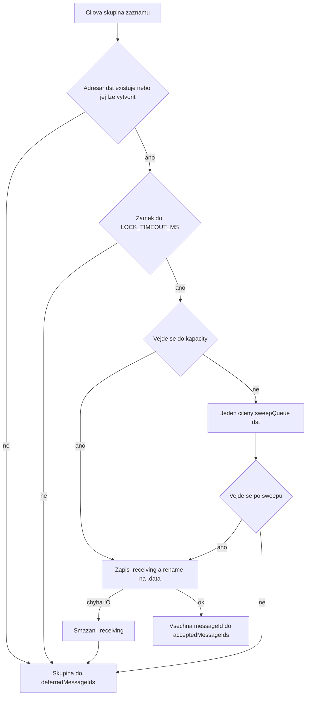
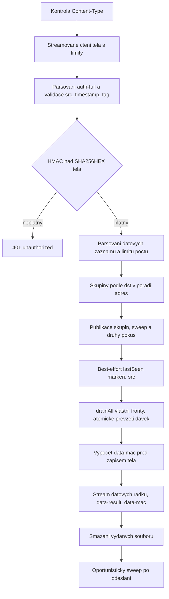

# Implementační plán serverové části phpvpn v1

Plán popisuje kompletní implementaci relay serveru podle [protocol.md](protocol.md) do jediného nasaditelného souboru `phpvpn.php` pro PHP 8.2+ bez jakéhokoli nepovinného rozšíření. Doplňkově vzniká samostatný `tests.php`, který se na produkci nenasazuje.

## 1. Potvrzená rozhodnutí

- **Selhání storage pro konkrétní `dst`** (timeout zámku, chyba zápisu, nelze vytvořit adresář cíle) neshazuje request. Celá cílová skupina jde do `deferredMessageIds`, HTTP status zůstává `200` a příchozí fronta volajícího se stejně vyprázdní. `503 queue_unavailable` se vrací jen tehdy, když je nepoužitelný celý `BUFFER_DIRECTORY`.
- **Časové značky mají milisekundovou přesnost všude**, tedy přesně 24 ASCII znaků `YYYY-MM-DDTHH:MM:SS.sssZ` v `auth-semi.timestamp`, `auth-full.timestamp`, `health.timestamp`, `info.generatedAt` i `lastSeen`. Odchylka se porovnává v milisekundách, hranice ±60000 ms je inkluzivní.
- **Testy jsou v samostatném souboru `tests.php`** mimo `phpvpn.php`. Uvnitř `phpvpn.php` zůstává pouze povinný known-answer test AES-256-GCM při inicializaci kryptografie.

## 2. Dokumentovaná rozhodnutí implementace

Body, které protokol nechává na implementaci. Každý z nich je v kódu okomentovaný odkazem na kapitolu protokolu.

- **Formát souboru dávky.** Dávka na disku začíná jednou interní indexovou řádkou, po ní následují přesné bajty datových řádků. Index nese dvojice `messageId` a base64url GCM tag, takže sestavení `data-mac` nevyžaduje parsování ciphertextu, a odpověď se streamuje jedním `stream_copy_to_stream`. Index je interní režie backendu, do logické kapacity fronty se nezapočítává, do odpovědi se nikdy nedostane (kapitola 10.1 a 10.5 protokolu).
- **Rozpoznání dávky výhradně podle regexu jména.** Vše, co neodpovídá `YYYY-MM-DDTHH-MM-SS.sssZ_<bytes>_<src>_<uuid>.(receiving|data|sending)`, je pro operace fronty neviditelné. Pokrývá to `info.json`, `.lock` i `.sweep`.
- **Expirace a velikost se čtou z názvu souboru,** nikoli přes `stat()`. Jeden `readdir` průchod tak stačí pro `usage`, `drainAll` i `sweepQueue`.
- **Zámek je per fronta,** soubor `.lock` v adresáři cíle, `flock` v neblokujícím režimu s rozpočtem `LOCK_TIMEOUT_MS`. Zamyká se pouze publikace a s ní spojený kapacitní výpočet. `drainAll` zámek nepotřebuje, protože atomicitu zajišťuje `rename`. Statistický marker se podle kapitoly 10.6 nezamyká nikdy.
- **JSON těla akcí `health` a `info` nesmí obsahovat žádné bajty navíc,** tedy ani závěrečný LF. Kapitola 5.2 a 8.1 to říkají výslovně.
- **Escape sekvence v hodnotách požadavků se odmítají.** Všechny protokolové hodnoty jsou ASCII bez potřeby escapování, takže `\uXXXX` nebo `\/` je `400 bad_request`. Zjednodušuje to kanonizaci a odstraňuje nejednoznačnost bajtů vstupujících do HMAC.
- **UUIDv4 se validuje včetně verze a variant nibblu** (`4` na pozici 14, znak `8`, `9`, `a` nebo `b` na pozici 19), protože protokol mluví výslovně o UUID verze 4.
- **Content-Type se porovnává jen na úrovni media typu,** parametry se tolerují, přítomný `charset` musí být `utf-8` bez ohledu na velikost písmen. Jinak `415 unsupported_media_type`.
- **Odpověď `data` se posílá bez `Content-Length`.** Velikost je sice po převzetí dávek známá, ale chunked přenos je odolnější vůči poškozenému souboru dávky a nezpůsobí zablokování webserveru čekajícího na chybějící bajty.
- **Selhání known-answer testu AES-GCM vede na `500 internal_error`.** Jde o vadný runtime, nikoli o konfiguraci, a protokol zakazuje jakoukoli náhradní větev.
- **Pořadí zpracování cílových skupin je vzestupně podle číselné hodnoty `dst`,** což naplňuje požadavek na deterministické pořadí z kapitoly 10.2.
- **Pořadí vydávaných dávek je vzestupně podle názvu souboru.** Protože prvním polem názvu je expirace v pevné šířce a TTL je společné, jde o FIFO podle času publikace.

## 3. Rozvržení souboru `phpvpn.php`

Jeden soubor, `declare(strict_types=1)`, `namespace PhpVpn;`, žádný autoload, žádné `include`. Pořadí sekcí odpovídá pořadí definic, spuštění je až posledním řádkem.

| Pořadí | Sekce | Obsah |
|---|---|---|
| 1 | Konfigurační hlavička | Komentované konstanty, jediné místo pro administrátora |
| 2 | `Runtime` | Zpevnění běhu, handlery chyb, výjimek a shutdownu |
| 3 | `Config` a `ConfigValidator` | Normalizace `SERVER_SECRET`, dekódování `ACCESS_KEYS`, invarianty limitů |
| 4 | `Clock` a `Iso8601` | Serverový čas v ms, striktní parser a formátovač |
| 5 | `Base64Url` | Kanonická validace, kódování, dekódování |
| 6 | `Validators` | VPN adresa, UUIDv4, desítkové číslo |
| 7 | `JsonWire` | Skener plochých JSON objektů, detekce duplicit a neznámých polí |
| 8 | `NdjsonReader` | Limitované streamované čtení těla, dělení na řádky, hash těla |
| 9 | `AesGcm` | Softwarová AES-256-GCM v čistém PHP a její KAT |
| 10 | `KeyDerivation` | `semiKey`, `fullAuthKey`, `healthKey`, `infoKey` |
| 11 | `Authenticator` | Kanonizace, HMAC, konstantní porovnání, dummy klíč |
| 12 | `Storage` (interface) | `enqueue`, `drainAll`, `usage`, `sweepQueue`, `sweep`, statistiky |
| 13 | `DiskStorage` | Povinný ovladač `disk` |
| 14 | `ClientStats` | Best-effort `mtime` markeru `info.json` |
| 15 | `Fs` | Obalené filesystem operace, které nikdy nevyhodí výjimku |
| 16 | `Http` a `ResponseWriter` | Hlavičky, chybové odpovědi, streamovaný výstup |
| 17 | `StatusPageHandler`, `HealthHandler`, `InfoHandler`, `DataHandler` | Endpointy |
| 18 | `Maintenance` | Cílený a oportunistický sweep s rozpočtem |
| 19 | `Router` a `Application` | Směrování, sestavení závislostí |
| 20 | Spuštění | `Application::runFromGlobals()` pod podmínkou, že soubor není načten testem |

Poslední bod je důležitý pro testovatelnost. Spuštění se provede pouze při běhu přes web SAPI nebo při přímém CLI volání. `tests.php` soubor načte přes `require` s předdefinovanou konstantou `PHPVPN_NO_AUTORUN`, takže získá všechny třídy bez odeslání odpovědi.

Pro testy bez HTTP serveru se zavádějí dva injektovatelné šev body:

- `RequestInput` s metodou `stream(): mixed`, produkčně `php://input`, v testech `php://temp`.
- `ResponseWriter` s metodami `header()`, `status()`, `write()`, `copyFrom()`, produkčně STDOUT a `header()`, v testech paměťový buffer.

## 4. Konfigurační hlavička

```php
const SERVER_VERSION = '1.0.0';

const SERVER_SECRET = '00000000000000000000000000000000';
const ACCESS_KEYS = [
    '10.99.99.2' => '0000000000000000000000000000000000000000000000000000000000000000',
];

const STORAGE_DRIVER   = 'disk';
const BUFFER_DIRECTORY = './phpvpn';

const VPN_ADDRESS_PREFIX = '10.99.99.';
const VPN_HOST_MIN = 2;
const VPN_HOST_MAX = 254;

const MAX_DATA_RECORDS_PER_REQUEST = 16;
const MAX_AUTH_RECORD_BYTES        = 4096;
const MAX_REQUEST_BODY_BYTES       = 4198400;
const MAX_INFO_PLAINTEXT_BYTES     = 262144;
const MAX_QUEUE_BYTES_PER_CLIENT   = 16777216;
const AUTH_TIMESTAMP_SKEW_SECONDS  = 60;
const QUEUE_TTL_SECONDS            = 60;
const LOCK_TIMEOUT_MS              = 200;
const MIN_DATA_POLL_INTERVAL_MS    = 80;
const MAX_DATA_POLL_INTERVAL_MS    = 1000;

const CLIENT_STATS_MIN_UPDATE_SECONDS = 30;
const SWEEP_MIN_INTERVAL_SECONDS      = 5;
const SWEEP_MAX_DIRECTORIES           = 8;
const SWEEP_MAX_FILES                 = 256;
const SWEEP_MAX_MILLISECONDS          = 20;
const PROTECT_BUFFER_DIRECTORY        = true;
```

`ConfigValidator` při startu ověří:

- `SERVER_SECRET` se normalizuje přesně testem `$s === ''`, nikdy přes `empty()` (kapitola 15).
- Každý klíč `ACCESS_KEYS` je platná VPN adresa, každá hodnota přesně 64 malých hexadecimálních znaků, dekódovaná na 32 bajtů. Chyba je `503 server_misconfigured`.
- `MAX_REQUEST_BODY_BYTES >= MAX_AUTH_RECORD_BYTES + MAX_DATA_RECORDS_PER_REQUEST * minimální velikost záznamu`, `0 < MIN_DATA_POLL_INTERVAL_MS <= MAX_DATA_POLL_INTERVAL_MS`, kladné TTL a skew.
- `STORAGE_DRIVER === 'disk'`, jinak `503 server_misconfigured`.
- `PHP_INT_SIZE >= 8`, jinak `503 server_misconfigured`. Aritmetika GHASH a časů předpokládá 64bitový integer.

Validace se provádí líně pro autentizované endpointy. Provozní stránka podle kapitoly 5.1 se validací neblokuje a prázdné nebo nulové tajemství nikdy nevede na `503`.

## 5. Fault-proof vrstva

Cílem je, aby žádná chyba prostředí nezpůsobila pád, prázdnou odpověď ani únik diagnostiky. Postup:

1. `ini_set('display_errors', '0')`, `ini_set('html_errors', '0')`, `error_reporting(E_ALL)`, `ignore_user_abort(true)`, `@set_time_limit(30)`.
2. `set_error_handler` pohltí veškeré varování a notice, zaznamená pouze krátký interní kód pro `error_log` a vrátí `true`. Do těla odpovědi se nikdy nedostane.
3. `set_exception_handler` vrátí `500 internal_error`, pokud výstup ještě nezačal. Pokud už začal, spojení se jen ukončí, klient si chybu vyhodnotí z chybějícího `data-mac`.
4. `register_shutdown_function` zachytí fatální chyby přes `error_get_last()` a chová se stejně.
5. Před zápisem těla se zruší všechny úrovně output bufferingu a zapne se implicitní flush.
6. Třída `Fs` obaluje `mkdir`, `fopen`, `fwrite`, `rename`, `unlink`, `touch`, `stat`, `opendir` a `flock` s potlačením chyb a návratem `false` nebo `null`. Nikde v kódu není holé volání filesystem funkce.
7. Každá chyba diskového ovladače má definované nefatální chování podle matice v kapitole 11 tohoto plánu.

## 6. Wire vrstva

### 6.1 `Iso8601`

```php
Iso8601::parseMs(string $text): ?int   // null pro neplatný vstup
Iso8601::formatMs(int $epochMs): string
Iso8601::formatFileNameMs(int $epochMs): string  // YYYY-MM-DDTHH-MM-SS.sssZ
```

Parser vyžaduje přesně 24 znaků a tvar `\d{4}-\d{2}-\d{2}T\d{2}:\d{2}:\d{2}\.\d{3}Z`, ověří kalendář včetně přestupných roků, hodinu do 23, minutu a sekundu do 59, milisekundy 000 až 999, odmítne přestupnou sekundu 60. Převod na epochu používá celočíselný algoritmus days-from-civil, tedy bez `DateTime`, bez výjimek a bez závislosti na časové zóně procesu. Formátovač vytvoří čas přes `gmdate` a doplní tři číslice milisekund.

Serverový čas: `(int) round(microtime(true) * 1000)`, jednou za request, uložený v `Clock`. Všechna porovnání i názvy souborů používají tuto jedinou hodnotu.

### 6.2 `Base64Url`

```php
Base64Url::isCanonical(string $text): bool
Base64Url::isCanonicalWithByteLength(string $text, int $bytes): bool
Base64Url::decode(string $text): ?string
Base64Url::encode(string $raw): string
```

`isCanonical` provádí normativně povolenou ekvivalentní kontrolu: `strspn` proti abecedě, délka modulo 4 různá od 1, a kontrola nevyužitých bitů posledního znaku tabulkou. Tím projdou `_w` a `__8` a propadnou `_x`, `__9`, `=`, whitespace, `+` i `/`. Pro krátká pole se navíc provede decode a reencode jako obrana do hloubky. U ciphertextu, který může mít megabajty, se decode nedělá vůbec, protože relay dekódovaná data nepotřebuje.

Délky: 12 bajtů odpovídá 16 znakům, 16 bajtů 22 znakům, 32 bajtů 43 znakům. Kontrola délky je tedy konstantní bez dekódování.

### 6.3 `JsonWire`

Dvě metody místo `json_decode`, protože protokol vyžaduje detekci duplicitních členů, uzavřenou sadu polí a u záznamu `data` i pevné pořadí a nulový whitespace.

```php
JsonWire::parseFlatStringObject(string $line, array $allowedKeys): ?array
JsonWire::parseDataRecord(string $line, string $expectedSrc): ?DataRecord
```

`parseFlatStringObject` je jednoprůchodový skener plochého objektu s výhradně řetězcovými hodnotami. Povoluje nevýznamný whitespace, odmítá vnořené struktury, čísla, `null`, escape sekvence, duplicitní klíče, neznámé klíče, chybějící klíče a jakékoli bajty za uzavírací složenou závorkou. Vrací asociativní pole nebo `null`.

`parseDataRecord` je specializovaný skener s doslovnými prefixy `{"type":"data","messageId":"`, `","src":"`, `","dst":"`, `","iv":"`, `","tag":"`, `","ciphertext":"` a závěrečným `"}`. Ověří přesné pořadí, nulový whitespace, kanonickou base64url u `iv`, `tag` i `ciphertext`, délky 16 a 22 znaků, neprázdný ciphertext, platnost `dst`, shodu `src` s `auth-full` a UUIDv4 `messageId`. Rozlišuje návratové chyby na `400 bad_request` a `401 unauthorized`, protože podvržené `src` je podle kapitoly 9.3 neautorizované.

### 6.4 `NdjsonReader`

```php
NdjsonReader::readAuthLine($stream, int $maxBytes): array{line:string, ok:bool, tooLarge:bool}
NdjsonReader::readRestHashed($stream, int $maxBytes): array{bytes:string, sha256hex:string, tooLarge:bool}
```

První řádek se čte po blocích a hledá se první LF v rámci `MAX_AUTH_RECORD_BYTES` včetně LF. Zbytek se čte po 64 KiB blocích do `MAX_REQUEST_BODY_BYTES` minus délka prvního řádku, průběžně přes `hash_update` počítá `SHA256HEX(body)`. Překročení limitu je `413 payload_too_large` a k žádné změně storage nedojde, protože ta začíná až po ověření HMAC. Pokud `Content-Length` už sám překračuje limit, vrátí se `413` bez čtení těla.

## 7. Kryptografie

### 7.1 `AesGcm` v čistém PHP

Rozsah přesně podle kapitoly 7.4: dopředná AES-256 transformace, GCTR, GHASH, 96bitové IV, 128bitový tag, prázdný plaintext pro GMAC. Žádná větev na OpenSSL nebo Sodium v souboru neexistuje.

```php
final class AesGcm {
    public function __construct(string $key32);              // rozvoj klíče a tabulky H
    public function seal(string $iv12, string $plaintext, string $aad): array;  // [ciphertext, tag]
    public function open(string $iv12, string $ciphertext, string $tag, string $aad): ?string;
    public function mac(string $iv12, string $aad): string;  // GMAC, prázdný plaintext
    public static function selfTest(): bool;                 // KAT, výsledek v static cache
}
```

Návrh:

- Stav bloku jsou čtyři 32bitové hodnoty v PHP integeru, převod přes `unpack('N4')` a `pack('N4')`.
- Rozvoj klíče pro Nk 8 a Nr 14 podle FIPS 197.
- Šifrování používá jednu tabulku `te0` o 256 položkách, vytvořenou jednou za proces ze statické S-boxové konstanty. Zbylé tři tabulky se nahrazují rotací, což zkracuje inicializaci a pro objem dat tohoto protokolu je optimální. Poslední runda používá S-box přímo.
- GHASH používá tabulku 16 násobků `H` v konvenci se čtyřmi 32bitovými slovy a redukční tabulku pro nibble posun. Tabulky se počítají jednou na instanci, takže jedna odpověď `info` je počítá jednou.
- `open` sestaví tag nad ciphertextem a AAD, porovná jej přes `hash_equals` a plaintext vrátí až po úspěchu. Server jej v praxi nepoužívá, protože relay payload nedešifruje, ale kapitola 7.4 kompletní operaci vyžaduje.
- `selfTest` prověří jeden vektor s AAD i plaintextem a jeden GMAC vektor s prázdným plaintextem. Výsledek se ukládá do statické proměnné, aby se v rámci jednoho procesu neopakoval. Selhání znamená `500 internal_error`.

Objem práce je malý. `health` počítá jeden blok GMAC, `info` řádově tisíc bloků při 253 klientech. Akce `data` nepoužívá AES vůbec, protože server payload jen přeposílá.

### 7.2 `KeyDerivation`

Pro HKDF se používá vestavěná funkce `hash_hkdf` z rozšíření hash, které je součástí jádra PHP a protokol jej v kapitole 15 výslovně povoluje.

```php
semiKey    = hash_hkdf('sha256', $secret, 32, 'phpvpn/auth-semi/key',
                       hash('sha256', 'phpvpn/auth-semi/salt', true));

$fullSalt  = hash_hmac('sha256', "phpvpn/auth-full/salt\x00" . $src, $secret, true);
fullAuthKey= hash_hkdf('sha256', $accessKeyRaw32, 32, "phpvpn/auth-full/key\x00" . $src, $fullSalt);

$healthSalt= hash('sha256', "phpvpn/health-response/salt\x00" . $requestId, true);
healthKey  = hash_hkdf('sha256', $secret, 32, "phpvpn/health-response/key\x00" . $requestId, $healthSalt);

infoKey    = hash_hkdf('sha256', $secret, 32, 'phpvpn/info-response/' . $requestId, $salt32);
```

Normalizace prázdného tajemství proběhne dříve, takže `hash_hkdf` nikdy nedostane prázdný klíč a nevznikne `ValueError`.

### 7.3 `Authenticator`

Kanonické řetězce se skládají přesně podle kapitol 8.1, 9.2 a 9.5. Porovnání vždy přes `hash_equals`. Pro neznámé `src` se použije pevný 32bajtový dummy klíč definovaný jako konstanta a provede se identická posloupnost operací, aby doba odpovědi neprozradila existenci klienta. Výsledek je vždy `401 unauthorized`.

`data-mac` se počítá inkrementálně přes `hash_init('sha256', HASH_HMAC, $fullAuthKey)`. Pořadí je doménový řetězec, akce, `requestId`, desítkový `recordCount` bez vodicích nul, potom dvojice `messageId` a base64url GCM tag každého řádku, a nakonec `SHA256HEX(dataResultLine)` bez závěrečného LF.

## 8. Storage

### 8.1 Rozhraní

```php
interface Storage {
    public function isUsable(): bool;
    public function enqueue(string $dst, array $lines, int $expiresAtMs, string $src): EnqueueResult;
    public function drainAll(string $client, int $nowMs): DrainHandle;
    public function usage(string $client, int $nowMs): int;
    public function sweepQueue(string $dst, int $nowMs): void;
    public function sweep(int $nowMs, int $budgetMs): void;
    public function readLastSeenMs(string $client): ?int;
    public function touchLastSeenBestEffort(string $client, int $nowMs): void;
}
```

`EnqueueResult` nese pouze `published: bool`. Rozlišení příčiny se neloguje ani neposílá klientovi.

### 8.2 Rozvržení na disku

```
BUFFER_DIRECTORY/
    .htaccess, web.config, index.html      // best-effort ochrana, vytvořeno s rootem
    .sweep                                 // marker rychlosti oportunistické údržby
    10_99_99_2/
        .lock
        info.json                          // prázdný marker lastSeen
        2026-08-12T14-37-05.123Z_2048_10.99.99.4_<uuid>.data
```

Cesta klienta vzniká jen z už validované adresy náhradou tří teček podtržítky. Do cest nikdy nevstupuje neověřený vstup.

Obsah souboru dávky:

```
{"v":1,"bytes":2048,"records":[["<messageId>","<gcmTagBase64Url>"], ...]}\n
{"type":"data","messageId":"...","src":"...","dst":"...","iv":"...","tag":"...","ciphertext":"..."}\n
...
```

`bytes` v indexu i v názvu souboru je součet délek datových řádků včetně LF, tedy logická velikost pro kapacitu fronty. Indexová řádka je interní režie a do kapacity se nepočítá.

### 8.3 Publikace



Na jednu frontu připadá nejvýše jeden kapacitně vyvolaný sweep a nejvýše dva pokusy o publikaci, což odpovídá kapitole 10.2. `usage` se počítá jedním `readdir` průchodem jako součet `<bytes>` neexpirovaných souborů ve stavu `.data` a `.receiving`. Soubory `.sending` jsou už převzaté a do kapacity se nepočítají.

Zámek: `fopen($dir . '/.lock', 'cb')` a smyčka `flock(LOCK_EX | LOCK_NB)` s prodlužovanou pauzou 1, 2, 4, 8, 16 ms až do 25 ms, celkově do `LOCK_TIMEOUT_MS`. Po vyčerpání rozpočtu se skupina odloží.

Zápis: `fopen('xb')` s unikátním UUID v názvu, jeden `fwrite` indexu a potom bloky datových řádků, kontrola návratových hodnot každého zápisu, `fflush`, `fclose`, teprve pak `rename` na `.data`. Krátký zápis nebo `false` znamená okamžité `unlink` rozepsaného souboru a odložení skupiny. Tím je pokryt i nedostatek místa na disku.

### 8.4 Vyprázdnění

`drainAll` neblokuje a nezamyká:

1. Jeden `readdir` průchod adresáře volajícího, filtr regexem, vynechání expirovaných a vynechání všeho, co není `.data`.
2. Setřídění názvů vzestupně.
3. Pro každý název `rename` z `.data` na `.sending`. Neúspěch znamená, že soubor mezitím převzal jiný worker nebo zmizel, a pokračuje se dalším.
4. U převzatého souboru se otevře handle, přečte indexová řádka a zapamatuje se pozice začátku dat. Poškozený nebo nečitelný index znamená přeskočení souboru a jeho smazání, protože bez indexu jej nelze bezpečně autentizovat.
5. Vrací se seznam otevřených handlů, dvojic pro `data-mac` a celkový počet záznamů.

Souběžně publikovaná dávka, kterou průchod nezastihl, zůstává pro další poll. Po pádu mezi převzetím a odesláním zůstane `.sending`, který smaže TTL sweep, a dávka se podle kapitoly 10.3 znovu nevydává.

### 8.5 Sweep

`sweepQueue(dst, now)` maže v jedné frontě všechny soubory dávek expirované k času requestu bez ohledu na stav `.receiving`, `.data` nebo `.sending`. Marker `info.json`, `.lock` a nerozpoznané soubory neodstraňuje. Volá se výhradně kapacitně, nejvýše jednou na cíl a request.

`sweep(now, budget)` je oportunistická údržba po odeslání odpovědi. Spouští se jen když je `mtime` markeru `BUFFER_DIRECTORY/.sweep` starší než `SWEEP_MIN_INTERVAL_SECONDS`, marker se nejdříve dotkne, aby souběžní workeři neúklízeli současně. Rozpočet je `SWEEP_MAX_DIRECTORIES` adresářů, `SWEEP_MAX_FILES` souborů a `SWEEP_MAX_MILLISECONDS` času, začátek průchodu je náhodný, aby se postupně pokryly všechny fronty. Pokud je k dispozici `fastcgi_finish_request`, zavolá se před úklidem, takže klient nečeká.

### 8.6 Statistiky

`ClientStats` implementuje kapitolu 10.6 doslova:

- Po platném a normálně zpracovaném `data` se jednou zavolá `clearstatcache` pro konkrétní cestu a jednou `stat` markeru `src`.
- Aktualizace se provede jediným pokusem o `touch` jen tehdy, když marker chybí, `mtime` nelze získat, nebo je stáří v milisekundách větší než 30000. Přesně 30 sekund ani čas v budoucnosti aktualizaci nespustí.
- Adresář `src` se před tím zkusí jednou vytvořit, také best-effort.
- Marker se nikdy nečte, neparsuje ani do něj nezapisuje obsah, nezamyká se, neopakuje se pokus a žádné selhání nemění HTTP status, `data-result`, `data-mac`, publikaci ani drain.
- `info` čte jen `mtime` markerů nakonfigurovaných klientů a klienty bez adresáře nebo bez čitelného markeru vynechá. Sekundová přesnost filesystému se vyjádří milisekundami `000`.

## 9. Endpointy

### 9.1 Router

| Podmínka | Výsledek |
|---|---|
| `action` chybí a metoda je `GET` nebo `HEAD` | HTML provozní stránka, u `HEAD` bez těla |
| `action` chybí a metoda je jiná | `405 method_not_allowed`, `Allow: GET, HEAD` |
| `action` je `health`, `info` nebo `data` a metoda je `POST` | Příslušný handler |
| `action` je známá a metoda je jiná | `405 method_not_allowed`, `Allow: POST` |
| `action` je neznámá nebo není řetězec | `404 not_found` |

### 9.2 Povinné hlavičky odpovědi

Kapitola 4.1 protokolu vyžaduje tři hlavičky na každé odpovědi bez výjimky. Jsou to:

- `Cache-Control: no-store, no-cache, must-revalidate`
- `Pragma: no-cache`
- `X-Content-Type-Options: nosniff`

Platí pro všechny odpovědi bez rozdílu, tedy pro provozní stránku, `health`, `info`, `data`, pro každou chybu od `400` po `503` i pro odpověď na `HEAD`. K nim se podle situace přidává:

- `Content-Type`, u chyb vždy `application/json; charset=utf-8`, u provozní stránky `text/html; charset=utf-8`, u `health` a `info` `application/json; charset=utf-8`, u `data` `application/x-ndjson; charset=utf-8`
- `Allow` u každé odpovědi `405 method_not_allowed`, s hodnotou `GET, HEAD` pro provozní stránku a `POST` pro akce
- `Retry-After: 1` u každé odpovědi `503`

Vynucení je konstrukční, nikoli disciplinární. Trojici povinných hlaviček zapisuje `ResponseWriter` ve svém jediném privátním bodě `beginResponse()`, kterým prochází každá odpověď, a to dřív, než smí kdokoli zapsat první bajt těla. Žádný handler, router, chybová větev, `set_exception_handler` ani `register_shutdown_function` nesmí sestavit odpověď jinudy, tedy ani přímým voláním `header()` nebo `echo`. Kód mimo `Http` a `ResponseWriter` proto nikdy nevolá `header()`, `http_response_code()` ani neposílá výstup přímo. Statusové cesty pro fatální chyby používají stejný zapisovač, takže i `500 internal_error` z shutdown handleru nese kompletní sadu hlaviček.

Naopak na příjmu se žádná z těchto hlaviček nevyžaduje ani nekontroluje. Z požadavku se zkoumá pouze `Content-Type`, který může skončit `415`, a volitelně `Content-Length` jako zkratka k `413` bez čtení těla. Hlavičky `X-Forwarded-For`, `X-Forwarded-Proto` a `Forwarded` se nečtou vůbec.

Chybové tělo má vždy tvar `{"type":"error","code":"..."}`.

### 9.3 Provozní stránka

Vrací `text/html; charset=utf-8` s `<h1>Server is running</h1>`. Červený `<h2>Server is not secure. Please modify SERVER_SECRET in the phpvpn.php</h2>` se přidá, pokud byla nakonfigurovaná hodnota prázdná, nebo je efektivní hodnota tvořena pouze bajty `0x00`, nebo pouze ASCII znaky `0`. Stránka nespouští validaci konfigurace, nikdy nevrací `503` a nic dalšího neprozrazuje.

### 9.4 `health`

1. Content-Type musí být `application/json`, jinak `415`.
2. Tělo do 4096 bajtů, jinak `413`.
3. `parseFlatStringObject` s povolenou sadou přesně `type` a `requestId`. Cokoli navíc, chybějícího nebo duplicitního je `400`. Přítomnost `timestamp`, `src` nebo `tag` je také `400`.
4. `type` musí být `auth-none`, `requestId` platné UUIDv4.
5. Odpověď se sestaví v pořadí `serverVersion`, `status`, `description`, `timestamp`, `requestId`, `iv`, `tag`. `iv` je 12 nových bajtů z `random_bytes`.
6. AAD podle kapitoly 7.3 nad přesnými hodnotami odpovědi, `tag` je 16bajtový GMAC s `healthKey`.
7. Žádný persistentní stav, replay se zpracuje jako nový požadavek.

### 9.5 `info`

1. Content-Type `application/json`, jinak `415`. Tělo do 4096 bajtů, jinak `413`.
2. Objekt s přesnou sadou `type`, `timestamp`, `requestId`, `tag`.
3. Timestamp přesně 24 znaků a platný kalendář, jinak `400`. `tag` kanonická base64url o 43 znacích, tedy 32 bajtů, jinak `400`.
4. Odchylka v ms nad 60000 znamená `401`.
5. HMAC podle kapitoly 8.1 se `semiKey`, porovnání konstantním časem, neshoda `401`.
6. Plaintext se sestaví v pořadí `serverVersion`, `generatedAt`, `clients`, `limits`. Klienti se procházejí vzestupně podle číselné hodnoty adresy, `lastSeen` vzniká z `mtime` markeru ve tvaru s milisekundami.
7. Pokud plaintext přesáhne `MAX_INFO_PLAINTEXT_BYTES`, odeberou se položky `clients` od konce, dokud se nevejde. Pokud to nestačí ani bez klientů, vrátí se `503 server_misconfigured`.
8. Odpověď se šifruje AES-256-GCM s novým 32bajtovým saltem a 12bajtovým IV, AAD podle kapitoly 8.3, výstupní objekt má pořadí `type`, `requestId`, `salt`, `iv`, `ciphertext`, `tag`.

### 9.6 `data`



Podrobnosti kroků:

1. Content-Type musí být `application/x-ndjson`, jinak `415`.
2. První řádek se čte s limitem 4096 bajtů včetně LF. Chybějící LF v limitu je `413`, konec těla bez LF je `400`.
3. Zbytek těla se čte s limitem `MAX_REQUEST_BODY_BYTES` minus délka prvního řádku a průběžně se hashuje. Překročení je `413`.
4. `auth-full` musí mít přesnou sadu `type`, `src`, `timestamp`, `requestId`, `tag`. Syntakticky neplatné `src` je `400`, platné ale neznámé `src` pokračuje s dummy klíčem a končí `401`.
5. Timestamp a tag se validují stejně jako u `auth-semi`. Odchylka nad 60000 ms je `401`.
6. HMAC se počítá podle kapitoly 9.2 nad kanonickým řetězcem se `SHA256HEX(body)`. Do tohoto okamžiku se storage nedotkne.
7. Teprve po ověření se dělí zbytek těla na řádky. Poslední bajt neprázdného zbytku musí být LF, prázdné řádky a CR jsou `400`. Počet nad 16 je `413` bez jakékoli změny storage.
8. Každý řádek prochází `parseDataRecord`. Duplicitní `messageId` uvnitř requestu je `400`.
9. Skupiny podle `dst` se publikují postupem z kapitoly 8.3 tohoto plánu. Expirace je `now + QUEUE_TTL_SECONDS`.
10. Best-effort statistika `src`.
11. `drainAll` vlastní fronty se provede vždy, i když byly všechny skupiny odloženy nebo byla fronta cíle nedostupná.
12. `data-result` se sestaví v pořadí `type`, `requestId`, `acceptedMessageIds`, `deferredMessageIds`, `acceptedRecords`, `acceptedBytes`. `acceptedBytes` je součet délek přijatých řádků včetně LF. Obě pole beze zbytku a bez průniku pokrývají všechna `messageId` requestu v pořadí výskytu.
13. `data-mac` se počítá ještě před zápisem těla, protože `recordCount`, dvojice i `data-result` jsou v tu chvíli známé.
14. Tělo se streamuje: pro každou převzatou dávku `stream_copy_to_stream` od pozice za indexem, potom `fclose` a `unlink`. Následuje `data-result` a `data-mac`, každý ukončený LF.
15. Selhání čtení souboru uprostřed streamu ukončí odpověď bez `data-mac`, takže klient celou odpověď zahodí a nic nepovažuje za doručené.
16. Po odeslání se spustí oportunistický sweep s rozpočtem.

## 10. Paměť a výkon

- Tělo requestu je nejvýše zhruba 4 MiB v paměti. Alternativní streamované ukládání do dočasného souboru není potřeba a přineslo by další diskovou zátěž.
- Odpověď se nikdy nedrží v paměti celá. Datové řádky jdou přímo ze souborů na výstup.
- Pro `data-mac` se drží pouze dvojice `messageId` a tag, tedy zhruba 60 bajtů na záznam. Při zaplnění fronty na 16 MiB nejmenšími záznamy jde řádově o jednotky MB. Doporučený `memory_limit` je 128 MB. Volitelnou optimalizací na konstantní paměť je dvoufázové čtení indexových řádek, kdy se v prvním průchodu sečte jen počet záznamů a ve druhém se dvojice rovnou vkládají do HMAC kontextu.
- Žádný `stat` na dávku, žádný `glob`, žádný `scandir` s tříděním v horké cestě.
- Validace base64url ciphertextu využívá `strspn` bez alokace a bez dekódování.
- AES-GCM v čistém PHP se v datové cestě nepoužije vůbec.
- Konfigurace klientů se dekóduje líně a jen pro potřebné adresy, kromě `info`, které je prochází všechny.

## 11. Matice odolnosti

| Situace | Chování |
|---|---|
| `BUFFER_DIRECTORY` chybí a nelze jej vytvořit | `503 queue_unavailable` s `Retry-After` |
| Adresář `dst` nelze vytvořit | Skupina do `deferredMessageIds`, odpověď `200`, drain proběhne |
| Zámek fronty se nezíská do 200 ms | Skupina do `deferredMessageIds`, odpověď `200` |
| Disk je plný nebo zápis selže | `unlink` rozepsaného `.receiving`, skupina do `deferredMessageIds` |
| `rename` na `.data` selže | Totéž, skupina odložena |
| Vlastní adresář nelze číst | Drain vrátí nula záznamů, odpověď je platná `200` |
| `rename` na `.sending` selže | Dávku přeskočíme, patří jinému workeru |
| Soubor dávky má poškozený index | Soubor se přeskočí a smaže, ostatní se vydají |
| `unlink` po vydání selže | Ignorováno, soubor odstraní TTL sweep |
| Marker `info.json` nelze načíst nebo vytvořit | Tiše ignorováno, žádný vliv na výsledek |
| Sweep narazí na chybu | Ignorováno, rozpočet ukončí průchod |
| Neočekávaná výjimka před výstupem | `500 internal_error` bez detailu |
| Neočekávaná výjimka během streamu | Ukončení bez `data-mac`, klient odpověď zahodí |
| KAT AES-GCM selže | `500 internal_error`, žádná náhradní kryptografická větev |

## 12. Bezpečnost

- Konstantní porovnání přes `hash_equals` u všech tagů.
- Neznámý klient prochází identickou posloupností odvození s dummy klíčem.
- Do logu se nikdy nedostane tajemství, HMAC tag, GCM tag, ciphertext, cesta ani celý request. `error_log` dostane jen krátký interní kód.
- Chybová těla neobsahují cestu, existenci klienta ani výpis výjimky.
- Cesty vznikají výhradně z validované VPN adresy, žádná konkatenace neověřeného vstupu.
- Při vytvoření kořene bufferu se best-effort založí `.htaccess` se syntaxí pro Apache 2.2 i 2.4, `web.config` pro IIS a prázdný `index.html`. Do dokumentace se doplní i konfigurace pro nginx, protože ta se ze souboru ovlivnit nedá.
- Server nezakládá session, nečte cookies a nepoužívá `$_SERVER` hlavičky proxy.
- Náhodnost výhradně z `random_bytes`.

## 13. Soubor `tests.php`

Samostatný CLI skript, který odmítne běžet přes web SAPI. Načte `phpvpn.php` s konstantou `PHPVPN_NO_AUTORUN`, takže získá třídy bez odeslání odpovědi. Pracuje v dočasném adresáři, který po sobě uklidí.

Rozsah podle kapitoly 16 protokolu:

1. **Kryptografie.** Known-answer testy AES-256-GCM včetně varianty s prázdným plaintextem, HMAC-SHA-256 podle RFC 4231, HKDF-SHA-256 podle RFC 5869, odvození `semiKey`, `fullAuthKey`, `healthKey`, klíče `info` a výpočet `data-mac`. Testy citlivosti na změnu jednoho bajtu tajemství, `src`, timestampu i těla.
2. **Normalizace tajemství.** Prázdná hodnota a 32 znaků `0` dávají shodné výsledky, `"0"` a 32 nulových bajtů se nenormalizují.
3. **Wire formát.** Kanoničnost `_w`, `__8`, odmítnutí `_x`, `__9`, zbytku 1 modulo 4, `=`, whitespace, `+` a `/`. Duplicitní klíč, neznámé pole, CRLF, prázdný řádek, chybějící závěrečný LF, whitespace v záznamu `data`, jiné pořadí členů a člen za `ciphertext`.
4. **Čas.** Hranice odchylky `-60.000`, `0`, `+60.000` projdou, `-60.001` a `+60.001` selžou. Odmítnutí chybějícího zlomku, jiné délky zlomku, offsetu, malých písmen a sekundy 60.
5. **Limity.** 16 záznamů projde, 17. je `413`, hrany těla na `limit-1`, `limit` a `limit+1`.
6. **Kontrakt storage.** Publikace a atomické převzetí, souběh dvou workerů nad stejnou frontou, TTL, cílený sweep ve všech třech stavech, kapacita s jedním sweepem a dvěma pokusy, přesné rozdělení na accepted a deferred, přežití markeru při sweepu, vyloučení expirovaných dávek z kapacity.
7. **Statistiky.** Stáří 30 s neaktualizuje, 31 s ano, budoucí `mtime` neaktualizuje, selhání markeru nemění výsledek.
8. **Endpointy end to end** přes injektované `RequestInput` a `ResponseWriter`, tedy bez HTTP serveru. Doplňkově volitelný běh proti `php -S` pro ověření chování na skutečném HTTP.
9. **Povinné hlavičky odpovědi.** Viz níže, jde o plošnou kontrolu nad celou testovací sadou.
10. **Replay.** Dvojí odeslání stejného requestu uvnitř okna projde dvakrát, po 61 s selže, po testech nevznikne žádný soubor nebo adresář sloužící jako nonce cache.

### 13.1 Plošný test hlaviček

Test není volitelný a neběží jen nad vybranými případy. Testovací harness zachytává hlavičky přes injektovaný `ResponseWriter`, takže je má k dispozici u každé odpovědi, kterou kterýkoli test vytvoří. Po každé jednotlivé odpovědi se automaticky uplatní tato tvrzení:

- přítomnost `Cache-Control: no-store, no-cache, must-revalidate`, `Pragma: no-cache` a `X-Content-Type-Options: nosniff` s přesnými hodnotami a bez duplicit
- přítomnost `Content-Type` odpovídajícího typu odpovědi
- u statusu `405` přítomnost `Allow` se správnou hodnotou, tedy `GET, HEAD` u provozní stránky a `POST` u akcí
- u každého statusu `503` přítomnost `Retry-After`
- absence hlavičky, která by prozrazovala cestu, verzi PHP nebo interní stav

Kontrola se spouští jako společný hook harnessu, ne jako jednotlivé volání v každém testu. Nový test tedy nemůže na hlavičky zapomenout. Sada explicitně pokrývá i cesty, kde se na hlavičky zapomíná nejsnáz: provozní stránku, `HEAD`, `404` u neznámé akce, `405` u nepovolené metody, `415`, `413` při překročení limitu těla, `401` u neznámého `src`, `503 queue_unavailable` při nepoužitelném kořeni bufferu a `500 internal_error` vyvolané ze shutdown handleru.

## 14. Postup prací

1. Kostra souboru, konfigurační hlavička, `Runtime`, `Fs`, `Http`, `Router`, provozní stránka.
2. `Iso8601`, `Base64Url`, `Validators`, `JsonWire`, `NdjsonReader` a jejich testy.
3. `AesGcm` v čistém PHP včetně KAT a testů, potom `KeyDerivation` a `Authenticator`.
4. `HealthHandler` a `InfoHandler` bez storage, s dočasně prázdným seznamem klientů.
5. `Storage`, `DiskStorage`, `ClientStats`, `Maintenance` a kontraktní testy nad dočasným adresářem.
6. `DataHandler` v plném rozsahu včetně publikace, drainu, `data-result` a `data-mac`.
7. Doplnění `clients` do `info`, dopsání zbytku `tests.php`, měření výkonu a doladění rozpočtů sweepu.
8. Provozní dokumentace v komentářové hlavičce souboru: požadavky na `post_max_size`, `memory_limit`, zákaz přístupu k `BUFFER_DIRECTORY` pro Apache, nginx i IIS.

## 15. Otevřené body k potvrzení během implementace

- Přesné znění a zdroj KAT vektorů AES-256-GCM se zafixují v `tests.php` a v komentáři u `AesGcm::selfTest`.
- Hodnoty rozpočtů oportunistického sweepu se po měření mohou upravit, výchozí čísla v konfiguraci jsou konzervativní.
- Pokud by se v praxi ukázala paměťová náročnost dvojic pro `data-mac` jako problém, přepne se `drainAll` na dvoufázové čtení indexů s konstantní pamětí.
