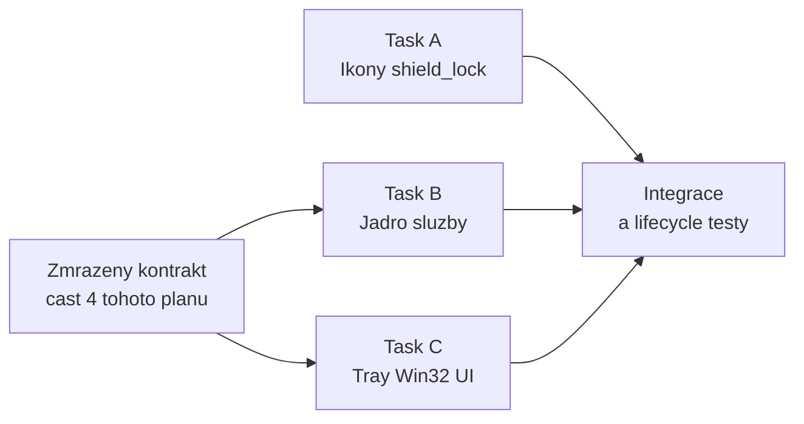

# Implementační plán 2: Windows Service a tray aplikace phpvpn

Historický plán. Překonané požadavky této etapy, včetně defaultů a vytvoření konfigurace, nahrazuje [plan3_client.md](plan3_client.md). Aktuální normativní pravidla jsou v [client.md](client.md) a [protocol.md](protocol.md).

Plán pokrývá změny Windows klienta zavedené commitem `11b2e29` a následná schválená upřesnění podle [formálního zadání](notes/2026-09-04-22-20-52_notes.processed.md). Navazuje na [plan_client.md](plan_client.md). Normativním zdrojem je vždy [client.md](client.md), oba plány jej konkretizují. Tento dokument popisuje požadovanou implementaci, nikoli potvrzení jejího dokončení.

Cílem je doplnit pět funkčně oddělených celků, které commit zavádí, a to tak, aby tři z nich mohly být implementovány paralelně samostatnými agenty.

## 1. Co commit přidává

1. **Tři bootstrap kontrolní body** `Server URL`, `SERVER_SECRET`, `ACCESS_KEY` s trvalými výsledky `pending`, `success` nebo `failed`, které vlastní Windows Service ([client.md](client.md), příslušné části Windows klienta).
2. **Devět globálních provozních čítačů** vedených pouze v paměti služby, s přesně definovanými okamžiky přírůstku, nulováním a invariantem pollingů ([client.md](client.md), příslušné části Windows klienta).
3. **Rozšířený `get-status`** jako jeden vnitřně konzistentní snímek obsahující kontrolní body i všech devět čítačů ([client.md](client.md), příslušné části Windows klienta).
4. **Nový vzhled tří tray ikon** `shield_lock`: čtvercové, neprůhledné bílé pozadí, souvislý černý rámeček, shodná geometrie, liší se pouze barvou štítu ([client.md](client.md), Windows tray a testovací scénář 19).
5. **Nová a opravená okna tray aplikace**: Connecting progress window, okno Statistics jako čtvrtá položka menu a oprava velikosti i překreslování okna Edit Config ([client.md](client.md), příslušné části Windows klienta).

## 2. Potvrzená rozhodnutí

Rozhodnutí z původního plánu a následné revize podle formálního zadání. Položka Exit a rozdělení implementace na tasky jsou převzaté z původního plánu.

1. **Rozsah je delta.** Plán neřeší znovu již hotové části služby a tray aplikace, pouze výše uvedených pět celků a jejich nezbytné důsledky.
2. **Tři paralelní tasky.** Task A jsou ikony, Task B je jádro služby, Task C je tray UI. Task A je zcela nezávislý. Task C se vyvíjí proti zmrazenému JSON kontraktu z části 4 tohoto dokumentu, nikoli proti běžící službě.
3. **Connecting progress window má vlastní rychlejší polling.** Dokud je okno otevřené, posílá vlastní `get-status` jednou za 500 ms. Pevný pětisekundový interval tray ikony tím zůstává nedotčený, neposunutý a nezměněný.
4. **Okno Statistics se aktualizuje průběžně.** Při otevření provede jeden okamžitý `get-status` a dále se překresluje z každého pravidelného pětisekundového snímku, dokud je otevřené.
5. **Pole `packetsSent` a `packetsReceived` se v `get-status` ruší.** Nahrazuje je devět nových polí. Snímek bude obsahovat přesně výčet z [client.md](client.md).
6. **Testy oken jsou postavené na čistých funkcích.** Výpočet rozložení, výpočet překreslované oblasti a stavový automat okna se vyčlení do funkcí bez `HWND`, které pokryjí unit testy. Skutečné překreslení doplní ruční kontrolní seznam.
7. **Položka Exit v tray menu zůstává.** Čtyři normativní položky budou v předepsaném pořadí na začátku, Exit bude až za oddělovačem jako pátá.

## 3. Doplňující implementační rozhodnutí

Implementační konkretizace pravidel [client.md](client.md), včetně schválených upřesnění. Komentáře v kódu odkážou na příslušné kapitoly specifikace.

1. **Nový logický pokus vzniká pouze ve stavu `disconnected` nebo `error`.** Současná smyčka v [vpn_engine.cpp](client/src/core/runtime/vpn_engine.cpp) spouští `runConnectSequence` pro každý příkaz `connect` mimo stav `connected`, takže `connect` přijatý během `recovering` zakládá nový pokus. To se opraví: příkaz `connect` ve stavech `connecting`, `connected` a `recovering` pouze nastaví `connectRequested_` a vrátí aktuální stav bez nulování čítačů a kontrolních bodů.
2. **Kontrolní body patří úvodnímu bootstrapu logického spojení.** Nový logický connect je atomicky nastaví na `pending`. Recovery je nemaže ani nepřepisuje výsledky dalších běhů. Průběh obnovy se publikuje ve stavu, fázi a bezpečné chybě. Start služby a dokončený disconnect vracejí všechny body na `pending`.
3. **Bezpečnou příčinu i anglický popis vytváří služba.** Tray pouze přebírá `lastError.code`, `description` a `recoverable`. Kontrolní body nejsou zdrojem klasifikace. Mapování v části 4.4 rozlišuje autorizační odmítnutí, timeout a ostatní komunikační chyby.
4. **`serializedDataResponseBodyBytes` zahrnuje i částečné tělo při selhání.** Transport sčítá přečtené bloky lokálně a předá součet i při chybě. Služba jej započítá právě jednou po dokončení pokusu, včetně timeoutu, zrušení, chyby čtení, přečteného bloku přes limit, neúspěšného HTTP statusu a pozdějšího odmítnutí validací. Probíhající čtení se průběžně nepublikuje.
5. **Devět čítačů vlastní výhradně síťový pracovník.** Jsou jediným zapisovatelem, takže postačí prostá struktura `std::uint64_t` chráněná krátkým `std::mutex`. Zámek se nikdy nedrží přes HTTP, kryptografii ani zápis do tunelu, takže `get-status` čte konzistentní snímek se zanedbatelnou režií a bez měřitelného blokování pracovních rolí.
6. **JSON DOM dostane bezznaménkové celé číslo.** Do [json.h](client/src/core/protocol/json.h) přibude `JsonType::unsignedInteger` a `JsonValue::makeUnsignedInteger(std::uint64_t)`, aby čítače prošly na drát v plném 64bitovém rozsahu. Stávající `asCounter` s ořezem na `int64` se pro těchto devět polí přestane používat.
7. **`get-diagnostics` přebírá stejnou devítici.** V jeho objektu `counters` nahradí dosavadní `packetsSent` a `packetsReceived` a ponechá `packetsDropped`, `batchesRejected`, `responsesRejected` a `peakResponseCiphertextBytes`.
8. **Verze IPC smlouvy zůstává 1.** [client.md](client.md) i po této změně popisuje smlouvu v1 a pevný název pipe se nemění. Rozšíření je aditivní až na dvě odstraněná pole, jejichž jediným konzumentem je konzolová aplikace, která odpověď pouze formátuje.

## 4. Zmrazený kontrakt `get-status` v1

Tato část je **rozhraní mezi Taskem B a Taskem C**. Oba tasky ji berou jako zadání a nesmějí ji jednostranně změnit. Task C proti ní píše parser a testovací fixtures, aniž by potřeboval běžící službu.

### 4.1 Přesný tvar odpovědi

```json
{
  "ipcVersion": 1,
  "requestId": "3f2a7c1e-9b44-4b0e-8d2f-5c6a1e7b9d03",
  "status": {
    "state": "connecting",
    "phase": "info",
    "stateChangedAt": "2026-09-04T18:52:31.412Z",
    "serverUrlCheck": "success",
    "serverSecretCheck": "pending",
    "accessKeyCheck": "pending",
    "serverReachable": "yes",
    "serverVerified": "unknown",
    "tunnelReady": "unknown",
    "lastError": null,
    "recoveryCount": 0,
    "dataPollsTotal": 0,
    "dataPollsEmpty": 0,
    "dataPollsWithPayload": 0,
    "serializedDataRequestBodyBytes": 0,
    "serializedDataResponseBodyBytes": 0,
    "ipv4PacketsSent": 0,
    "ipv4PacketsReceived": 0,
    "ipv4BytesSent": 0,
    "ipv4BytesReceived": 0,
    "clientVersion": "1.0.0",
    "ipcVersion": 1
  }
}
```

Pořadí členů objektů není závazné. Parser vyhledává pole podle názvu, testy porovnávají strukturu a hodnoty. Stabilní serializace je pouze pro čitelnost. Pravidlo nemění pořadí prvků polí ani kanonizaci síťových zpráv VPN. `lastError` je `null` nebo objekt `code`, `description`, `recoverable` vytvořený službou podle části 4.4. Pole `packetsSent` a `packetsReceived` v objektu `status` nesmějí existovat.

### 4.2 Sémantika tří kontrolních bodů

| Pole | Hodnota `success` nastane | Hodnota `failed` nastane |
|---|---|---|
| `serverUrlCheck` | po navázání transportu a přijetí syntakticky použitelné odpovědi `health`, tedy **před** jejím kryptografickým ověřením | při nedostupném transportu, timeoutu, nepoužitelném stavovém kódu nebo syntakticky nepoužitelné odpovědi `health` |
| `serverSecretCheck` | až po kryptografickém ověření odpovědi `health` **a** po úspěšném ověření, dešifrování a úplné validaci odpovědi `info` | při selhání ověření GMAC odpovědi `health` nebo kroku `info`, včetně timeoutu, ověření, dešifrování a validace |
| `accessKeyCheck` | až po úspěšném prázdném autentizovaném pollingu `data` | při selhání tohoto pollingu |

Tabulka platí pro úvodní bootstrap. Recovery uchované výsledky nemění. `failed` znamená nedokončenou nebo neúspěšnou kontrolu, příčinu určuje služba zvlášť. Pozdější neprovedené body zůstávají `pending`. Selhání spuštění tunelu nastává až po všech třech bodech, takže všechny tři mohou být `success`, zatímco celkový stav je `error`. Při startu služby a po dokončeném `disconnect` mají všechny tři hodnotu `pending`.

### 4.3 Sémantika devíti čítačů

| Čítač | Přírůstek nastane | Hodnota přírůstku |
|---|---|---|
| `dataPollsTotal` | v okamžiku předání úplného serializovaného těla requestu `data` transportu | 1 |
| `dataPollsEmpty` | tamtéž, neobsahuje-li tělo žádný odchozí řádek `data` | 1 |
| `dataPollsWithPayload` | tamtéž, obsahuje-li tělo alespoň jeden odchozí řádek `data` | 1 |
| `serializedDataRequestBodyBytes` | tamtéž | přesná délka těla v bajtech |
| `serializedDataResponseBodyBytes` | jednou při dokončení pokusu, i při chybě | přesný součet skutečně přečtených bajtů těla včetně částečné odpovědi |
| `ipv4PacketsSent` | při zařazení původního validovaného IPv4 paketu do requestu předaného transportu | 1 na paket |
| `ipv4BytesSent` | tamtéž | přesná délka původního IPv4 paketu před zabalením, šifrováním a kódováním |
| `ipv4PacketsReceived` | až po ověření celé odpovědi a dávky, dešifrování, úplné validaci paketu a jeho přijetí do příchozí fronty | 1 na paket |
| `ipv4BytesReceived` | tamtéž | přesná délka přijatého původního IPv4 paketu |

Povinný invariant každého snímku: `dataPollsTotal = dataPollsEmpty + dataPollsWithPayload`.

Samotný povinný řádek `auth-full` payload netvoří, takže bootstrap prázdný autentizovaný polling se počítá jako `empty`. Žádný z čítačů nezahrnuje HTTP hlavičky, TLS režii, nižší vrstvy ani provoz `health` a `info`. Neověřený, odmítnutý nebo do fronty nepřijatý paket se jako přijatý nepočítá. Nulují se atomicky při vzniku nového logického `connect`, po dokončeném `disconnect` vrací snímek nuly, restart i pád služby začínají od nul a nikde se neukládají trvale.

### 4.4 Bezpečné chyby vytvářené službou

Služba mapuje vnitřní chybu a skutečně selhanou operaci do následující smlouvy. Jde o kódy veřejného stavového snímku, nikoli o přímé vystavení interního ErrorCode. Timeout se vyhodnotí před obecnou kategorií endpointu nebo ověřovacího kroku. `recoverable` vyjadřuje možnost automatického opakování podle konkrétního výsledku, není odvozován tray aplikací.

| Veřejný `code` | Skutečná příčina | Anglický `description` | `recoverable` |
|---|---|---|---|
| `endpoint_unavailable_or_invalid` | nedostupný endpoint nebo syntakticky nepoužitelný health, kromě timeoutu | `The server endpoint is not reachable or not valid.` | true pro dočasnou nedostupnost, false pro neplatnou konfiguraci endpointu |
| `server_verification_failed` | kryptografické ověření health nebo ověření, dešifrování či validace info | `The server could not be verified with the configured SERVER_SECRET.` | false |
| `access_key_rejected` | autorizační odmítnutí ověřovacího data requestu | `The server rejected the configured ACCESS_KEY.` | false |
| `tunnel_start_failed` | selhání přípravy adaptéru, session, adresy, rout nebo spuštění rolí | `The local tunnel could not be started.` | podle skutečné obnovitelnosti operace |
| `communication_timeout` | timeout komunikace | `The server did not respond in time. Verification could not be completed.` | true |
| `communication_failed` | ostatní nedokončené ověření nebo komunikace, zejména neautorizační data chyba | `Communication with the server could not be completed.` | podle skutečné obnovitelnosti výsledku |

Žádný text ani veřejný kód neobsahuje raw DNS/TLS detail, URL, klíč, obsah paketu ani interní cestu. Pro jinou bezpečně neklasifikovatelnou příčinu se použije obecný `connection_failed` s popisem `The connection attempt failed.` bez dalších interních detailů a s pravdivým příznakem obnovitelnosti. Toto obecné selhání nepředstírá odmítnutí klíče ani selhání tunelu.

Při timeoutu úvodního bootstrapu právě prováděná kontrola selže a pozdější neprovedené body zůstanou pending. Recovery mění pouze aktuální stav, fázi a chybu. Tři historické úspěchy a recovering samy neurčují žádnou příčinu. Stejnou klasifikaci používá poslední chyba v diagnostice. Validační chyby jiných IPC příkazů nadále dodržují svou bezpečnou příkazovou smlouvu.

## 5. Rozdělení na paralelní tasky



Task A se nedotýká žádného souboru Tasku B ani C kromě generovaných `.ico`, které Task C pouze načítá jako prostředky. Task B se nedotýká složky [client/apps/tray](client/apps/tray). Task C se nedotýká složky [client/src/core](client/src/core) s jedinou výjimkou popsanou v části 7.1, kterou dodává Task B. Konflikty ve stejném souboru vzniknou pouze v [client/tests/CMakeLists.txt](client/tests/CMakeLists.txt) a [client/apps/CMakeLists.txt](client/apps/CMakeLists.txt), kde jde o přidání řádků na konec seznamu.

## 6. Task A: tři varianty ikony `shield_lock`

Zcela nezávislý task. Nevyžaduje C++ toolchain ani běžící službu.

### 6.1 Dotčené soubory

- [client/tools/make_icons.py](client/tools/make_icons.py), přepracovaný generátor.
- Nový `client/tools/check_icons.py`, ověřovací skript.
- `client/assets/icons/shield_lock_grey.ico`, `shield_lock_orange.ico`, `shield_lock_green.ico`, přegenerované.
- [client/assets/icons/LICENSE-material-symbols.txt](client/assets/icons/LICENSE-material-symbols.txt) a soubor NOTICE, kontrola úplnosti požadovaných oznámení.
- [client/tools/make-dist.ps1](client/tools/make-dist.ps1), kontrola, že licenční oznámení Material Symbols je součástí distribučního balíčku.

### 6.2 Požadovaný výsledek

Dnešní generátor vytváří průhledné pozadí a žádný rámeček. Nová podoba každé ze tří ikon:

- čtvercový rastr pro velikosti 16, 20, 24, 32, 40, 48, 64 a 256 pixelů,
- **neprůhledné bílé pozadí**, tedy alfa 255 v každém pixelu,
- **souvislý černý rámeček po celém obvodu**, jehož šířka se odvodí z velikosti rámce, minimálně jeden pixel u 16 pixelů a proporcionálně více u větších velikostí, aby zůstal zřetelný,
- štít vykreslený uvnitř rámečku se shodnou geometrií, shodným odsazením a shodnou velikostí ve všech třech variantách,
- jediný rozdíl mezi variantami je barva štítu, dnešní hodnoty šedé, oranžové a zelené zůstávají.

Rasterizace zůstává supersamplovaná s even-odd výplní, jak ji dnešní skript používá. Přibude podkladová vrstva a rámeček kreslené před štítem.

### 6.3 Ověření

Skript `check_icons.py` spouštěný přes `uv run` musí pro každý soubor a každou velikost prokázat:

- alfa kanál je všude 255,
- pixely na všech čtyřech okrajích jsou černé v celé šířce rámečku,
- uvnitř rámečku existuje bílé pozadí,
- maska nebílých a nečerných pixelů, tedy samotný štít, je pixelově shodná mezi všemi třemi variantami,
- barva štítu odpovídá očekávané hodnotě dané varianty.

Tím je automatizovaná podstatná část scénáře 19. Ostrost a čitelnost na světlém i tmavém pozadí při různých DPI zůstává v ručním kontrolním seznamu.

### 6.4 Akceptační kritéria

- `uv run client/tools/make_icons.py` vygeneruje tři soubory a `uv run client/tools/check_icons.py` skončí bez chyby.
- Do worktree nepřibude žádný screenshot ani jiný binární soubor kromě tří `.ico`.
- Licenční text Apache 2.0 a požadovaná oznámení Material Symbols jsou v repozitáři i ve složce `dist`.

## 7. Task B: jádro Windows Service

Vlastní kontrakt z části 4. Nedotýká se tray aplikace.

### 7.1 Rozšíření sdíleného JSON DOM

Soubory [json.h](client/src/core/protocol/json.h) a [json.cpp](client/src/core/protocol/json.cpp).

- Přidat `JsonType::unsignedInteger`, `JsonValue::makeUnsignedInteger(std::uint64_t)`, `isUnsignedInteger()` a `unsignedValue()`.
- Serializace vypíše hodnotu v plném rozsahu bez znaménka.
- Parser přiřadí typ `unsignedInteger` celému číslu, které je kladné a nevejde se do `std::int64_t`. Ostatní chování zůstává beze změny, aby konfigurace a `set-config` fungovaly stejně jako dnes.
- Pomocná funkce `std::uint64_t jsonUnsignedOrZero(const JsonValue*)`, kterou využije Task C i testy. Přijme nezáporný `integer` i `unsignedInteger`, zápornou nebo jinou hodnotu vrátí jako nulu. Celá neplatná stavová odpověď se označí jako neplatná, nesmí se vydávat za nový autoritativní nulový snímek.

Tuto část je vhodné dodat jako první commit Tasku B, protože ji potřebuje i Task C.

### 7.2 Nová komponenta čítačů

Nové soubory `client/src/core/runtime/traffic_counters.h` a `.cpp`.

```cpp
struct TrafficCountersSnapshot {
    std::uint64_t dataPollsTotal = 0;
    std::uint64_t dataPollsEmpty = 0;
    std::uint64_t dataPollsWithPayload = 0;
    std::uint64_t serializedDataRequestBodyBytes = 0;
    std::uint64_t serializedDataResponseBodyBytes = 0;
    std::uint64_t ipv4PacketsSent = 0;
    std::uint64_t ipv4PacketsReceived = 0;
    std::uint64_t ipv4BytesSent = 0;
    std::uint64_t ipv4BytesReceived = 0;
};

class TrafficCounters {
public:
    // Jeden atomicky zaznamenany polling: telo predane transportu.
    void recordRequest(bool hasPayload, std::uint64_t bodyBytes,
                       std::uint64_t packets, std::uint64_t packetBytes);
    void recordResponseBody(std::uint64_t bodyBytes);
    void recordAcceptedPacket(std::uint64_t packetBytes);
    void reset();
    TrafficCountersSnapshot snapshot() const;
};
```

- Vše chrání jeden `std::mutex`. Zámek se nikdy nedrží přes kryptografii, HTTP ani zápis do tunelu.
- Každý přírůstek používá kontrolovanou saturující aritmetiku. Při dosažení nejvyšší reprezentovatelné hodnoty čítač saturuje a nikdy se nevrátí k nižší hodnotě.
- Trojice pollingových čítačů se zvyšuje uvnitř jednoho zamknutí. Pokud by kterýkoli z nich přetekl, celá trojice se zmrazí na poslední reprezentovatelné kombinaci splňující invariant.
- `recordRequest` je jediné místo, kde se trojice pollingů, bajty requestu a odchozí IPv4 čítače mění, takže invariant platí v každém snímku.

### 7.3 Rozšíření stavového snímku

Soubory [status_snapshot.h](client/src/core/runtime/status_snapshot.h) a [status_snapshot.cpp](client/src/core/runtime/status_snapshot.cpp).

- Nový `enum class CheckpointResult { pending, success, failed }` a `const char* checkpointResultName(CheckpointResult) noexcept`.
- Do `StatusSnapshot` přidat `serverUrlCheck`, `serverSecretCheck`, `accessKeyCheck` a `TrafficCountersSnapshot counters`.
- Ze `StatusSnapshot` odstranit `packetsReceived` a `packetsSent`.
- V `DiagnosticsSnapshot` nahradit `packetsReceived` a `packetsSent` polem `TrafficCountersSnapshot counters`.

### 7.4 Dvoufázový výsledek health

Soubory `response_parser.h/.cpp`, `network_worker.h/.cpp` a `vpn_engine.h/.cpp`.

- `parseHealth` a `performHealth` dostanou nepovinný callback `onSyntaxUsable`, zavolaný právě jednou po úplné syntaktické validaci použitelné health odpovědi, ještě před odvozením klíče a GMAC ověřením.
- Callback úvodního bootstrapu pod krátkým `stateMutex_` publikuje `serverUrlCheck_ = success` a vrátí se. Kryptografie pak běží bez tohoto zámku. Nestačí výstupní bool vyhodnocený až po návratu funkce.
- Lokální příznak, zda callback proběhl, umožní rozlišit syntaktické selhání od selhání kryptografie. Bezpečný kód a popis se přesto určují podle skutečné chyby, timeout má samostatnou kategorii.
- Recovery, periodická synchronizace a jednorázové `get-info` callback měnící uchované kontrolní body nepoužijí. Nevkládá se žádné umělé zpoždění.

### 7.5 Zapojení čítačů do síťového pracovníka

Soubor [network_worker.cpp](client/src/core/runtime/network_worker.cpp), metoda `exchangeData`.

- `NetworkWorker` dostane ukazatel na `TrafficCounters`, nastavený z enginu při `configure`. Když ukazatel chybí, například v jednorázovém `fetchInfoOnce`, čítače se nemění.
- Bezprostředně **před** `transport_.post(HttpAction::data, bodyResult.value())` zavolat `recordRequest` s příznakem `!plan.records.empty()`, s `body.size()`, s celkovým počtem paketů ve všech plánovaných záznamech a s jejich celkovou délkou v bajtech. Do té doby se nesmí započítat nic, aby request neúspěšně sestavený nebo zrušený před předáním nezvýšil žádný čítač.
- Rozhraní `Transport::post` vrátí výsledek operace spolu se samostatným `responseBodyBytesRead`, který existuje i při chybě. Windows transport jej saturujícím způsobem lokálně zvýší po každém úspěšném `WinHttpReadData`, před kontrolou limitu a uložením bloku. Zrušení nesmí již nasčítanou hodnotu zahodit. Po návratu volat `recordResponseBody(responseBodyBytesRead)` právě jednou, před větvením na úspěch a chybu. Již přečtený blok přes limit se započítá, ale nepředá parseru. Úprava zahrnuje `platform/iface/transport.h`, `platform/windows/transport_winhttp.cpp` a testovací transporty. Součet není odvozován z velikosti úspěšně vráceného bufferu a nevyžaduje další kopii těla.
- V `ingestRecord` volat `recordAcceptedPacket(packet.size())` právě jednou pro každý paket, který `inbound.tryEnqueue` skutečně přijal. Zahozený paket se nezapočítá.
- Stejný paket vrácený do odchozí fronty při odložení serverem se při předání dalšího requestu započítá znovu. Přijetí odpovědi nesmí provést další přírůstek nových odchozích čítačů.
- Původní pole `DataExchangeOutcome::packetsSent` a `packetsReceived` zůstávají pro vnitřní logiku enginu a diagnostiku, ale už neplní `get-status`.

### 7.6 Kontrolní body a nulování v enginu

Soubory [vpn_engine.h](client/src/core/runtime/vpn_engine.h) a [vpn_engine.cpp](client/src/core/runtime/vpn_engine.cpp).

Nové členy chráněné `stateMutex_`: `serverUrlCheck_`, `serverSecretCheck_`, `accessKeyCheck_`. Nový člen `TrafficCounters counters_`.

Změny ve smyčce `runNetworkThread`:

- Příkaz `connect` ve stavu `disconnected` nebo `error` zakládá **nový logický pokus**: atomicky nastaví tři kontrolní body na `pending`, zavolá `counters_.reset()`, vynuluje `backoffStep_` a spustí `runConnectSequence`.
- Příkaz `connect` ve stavu `connecting`, `connected` nebo `recovering` je idempotentní: pouze nastaví `connectRequested_` a nespustí nový bootstrap, nenuluje čítače ani kontrolní body.
- Opakování bootstrapu po backoffu ve stavu `recovering` nemění uchované kontrolní body ani nenuluje čítače. Aktualizuje stav, fázi a bezpečnou chybu.
- Před dokončením `disconnect` se uzavře či zruší request a jednou zaúčtuje počet přečtených bajtů. Poté se společně publikuje odpojený stav, tři body pending a nulové čítače. Opožděný výsledek nesmí zvýšit čítače odpojeného stavu ani nového spojení.

Změny v `runConnectSequence`:

- Rozlišit úvodní bootstrap a recovery běh. Reset patří pouze přijetí nového logického connect, ne vstupu do této funkce.
- V úvodním bootstrapu předat callback z části 7.4. Syntaxe zveřejní úspěch Server URL před kryptografií. Chyba před callbackem nastaví Server URL failed, kryptografická chyba po něm SERVER_SECRET failed.
- Úvodní `performInfo` nastaví SERVER_SECRET success až po úplné validaci, při chybě failed. `verifyAccessKey` obdobně nastaví ACCESS_KEY. Timeout je samostatná obnovitelná příčina, failed není důkaz odmítnutí klíče.
- Selhání spuštění tunelu po úspěšném bootstrapu ponechá tři success a poskytne bezpečnou chybu skutečně selhané operace.
- Recovery běhy v žádné větvi nepřepisují historické body. Stav, fáze a lastError popisují aktuální běh.

`status()` a `diagnostics()` doplní nové body a čítače. Stav, fáze, body a čítače se publikují jako konzistentní celek. Čtenář drží `stateMutex_` a krátce pořídí `counters_.snapshot()`. Při společných změnách nebo resetu dodržet stejné pořadí zámků state a counters, žádná opačná vnořená cesta. Síťový pracovník je jediný zapisovatel provozních čítačů a při resetu nesmí existovat nedoúčtovaný starý request. Síť ani kryptografie neběží pod těmito zámky.

### 7.7 Serializace odpovědi

Soubor [ipc_protocol.cpp](client/src/core/ipc/ipc_protocol.cpp).

- `buildStatusResponse` vypíše pole z části 4.1 a použije `makeUnsignedInteger` pro devět čítačů. Pořadí členů objektu je nezávazné.
- `buildDiagnosticsResponse` nahradí v objektu `counters` dvě zrušená pole devíti novými.
- `SafeError` a serializace stavové i diagnostické poslední chyby používají veřejné kategorie a anglické popisy z části 4.4. Služba nepropouští raw interní ErrorCode. `get-statistics` se nezavádí.

### 7.8 Kontrola bezpečnosti výstupu

- Ověřit, že se ani jeden z devíti čítačů a ani jeden kontrolní bod nezapisuje do logu, do konfigurace, do žurnálu vlastnictví ani do registru.
- Ověřit, že snímek nadále neobsahuje URL, IP adresu, klíč, tag, ciphertext, obsah paketu, interní cestu ani raw systémovou chybu.

### 7.9 Akceptační kritéria

- `get-status` vrací přesně strukturu z části 4.1 a nikdy ji nesestaví z hodnot odečtených v různých okamžicích.
- Invariant `dataPollsTotal = dataPollsEmpty + dataPollsWithPayload` platí v každém snímku.
- Souběžné volání `get-status` při plném datovém provozu nespustí síť, tunel ani obnovu, nezmění stav ani čítače a nezablokuje pracovní role.

## 8. Task C: tray aplikace

Vyvíjí se proti kontraktu z části 4. Pro vývoj a testy stačí zachycené řetězce odpovědí, běžící služba je potřeba až při integraci.

### 8.1 Rozdělení dnešního monolitu

Dnešní [tray/main.cpp](client/apps/tray/main.cpp) má 613 řádků a obsahuje vše. Nové soubory ve složce `client/apps/tray`:

| Soubor | Obsah | Testovatelný unit testy |
|---|---|---|
| `status_model.h` a `.cpp` | `TrayStatus` a parser odpovědi `get-status` bez jediného volání Win32 | ano |
| `progress_model.h` a `.cpp` | čistý stavový automat Connecting progress window | ano |
| `layout.h` a `.cpp` | čisté výpočty rozložení, výchozí velikosti, vystředění a překreslované oblasti | ano |
| `progress_window.cpp` | tenká Win32 slupka progress okna | ne |
| `statistics_window.cpp` | tenká Win32 slupka okna Statistics | ne |
| `editor_window.cpp` | okna Edit Config a Show Info, přesun ze `main.cpp` | ne |
| `main.cpp` | tray ikona, menu, pevný pětisekundový timer, IPC volání | ne |

Nové soubory se zaregistrují v [client/apps/CMakeLists.txt](client/apps/CMakeLists.txt) a testovatelné z nich i v [client/tests/CMakeLists.txt](client/tests/CMakeLists.txt) jako sdílené zdroje, aby je testovací binárka mohla přeložit bez `WIN32` entry pointu.

### 8.2 Model stavu

```cpp
enum class CheckpointResult { pending, success, failed };

struct TrayStatus {
    std::string state;      // disconnected, connecting, connected, recovering, error
    std::string phase;
    CheckpointResult serverUrl = CheckpointResult::pending;
    CheckpointResult serverSecret = CheckpointResult::pending;
    CheckpointResult accessKey = CheckpointResult::pending;
    std::string tunnelReady;
    bool hasError = false;
    std::string errorCode;
    std::string errorDescription;
    bool errorRecoverable = false;
    TrafficCountersView counters;   // devet uint64 hodnot
    bool valid = false;             // false, kdyz odpoved nesla precist
};

TrayStatus parseStatusResponse(std::string_view json);
```

Parser nesmí selhat pádem na chybějícím poli. Čte členy objektu podle názvu, nezávisle na pořadí. Chybějící či neplatná povinná hodnota označí celý snímek `valid = false`, bezpečné výchozí hodnoty nejsou novým stavem služby. Platný snímek se přebírá jako celek. `errorDescription` pochází z veřejného `lastError.description`, tray nevytváří vlastní mapování kontrol na chyby.

### 8.3 Stavový automat Connecting progress window

```cpp
enum class ProgressStage { connecting, succeeded, failed };
enum class Shield { grey, orange, green };

struct ProgressView {
    ProgressStage stage = ProgressStage::connecting;
    Shield shield = Shield::orange;
    CheckpointResult serverUrl = CheckpointResult::pending;
    CheckpointResult serverSecret = CheckpointResult::pending;
    CheckpointResult accessKey = CheckpointResult::pending;
    std::string errorDescription;  // hotovy bezpecny text ze sluzby
    bool closeRequested = false;
};

class ProgressModel {
public:
    void onSnapshot(const TrayStatus& status, std::int64_t nowMs);
    void onTick(std::int64_t nowMs);
    const ProgressView& view() const;
};
```

Pravidla, která pokryjí unit testy:

- Výchozí zobrazení je oranžový štít, výrazný text `Connecting` a tři body v pořadí `Server URL`, `SERVER_SECRET`, `ACCESS_KEY`. Barvy jsou oranžová pro `pending`, zelená pro `success` a červená pro `failed`. Zelený bod smí obsahovat fajfku.
- Model během připojování nahrazuje celou trojici výsledky jednoho platného snímku služby. Nekumuluje úspěchy a respektuje i nový pending. Uchování výsledků zajišťuje služba. Neplatný snímek nesmí vytvářet úspěch, chybu ani nové nulové hodnoty.
- Přechod do `succeeded` nastane **výhradně** při `state == "connected"`. Potom jsou všechny tři body zelené, štít zelený a text `Successfully connected` je větší, tučný a zelený.
- Přechod do `failed` nastane při chybovém výsledku služby s bezpečným `lastError`, případně při stavu error. Popis se převezme ze služby, nikoli z barev bodů. Samotný recovering nebo historický failed bez aktuální chyby neurčuje novou příčinu. Ve spodní části je výrazný červený text `Cannot connect to the server` a bezpečný anglický popis.
- Po vstupu do `succeeded` nebo `failed` se konečné prezentační zobrazení zmrazí. Nejde o autoritativní stav VPN, tray ikona a Statistics dál používají aktuální snímky. Nové Connect znovu použije okno s nově inicializovaným modelem, nepřenese staré výsledky.
- Ve stavu `succeeded` nastaví `onTick` příznak `closeRequested` přibližně 3000 ms po zobrazení úspěchu. Číselný odpočet se nikdy nezobrazuje.
- Ve stavu `failed` se `closeRequested` nikdy nenastaví. Okno zavře pouze uživatel.
- Když se stav vrátí na `disconnected`, zatímco je model ve fázi `connecting`, nastaví se `closeRequested`, protože pokus zrušila jiná relace nebo konzole.

### 8.4 Win32 slupka Connecting progress window

- Neprivilegované, nemodální okno bez vlastnictví služby, VPN ani bootstrapu. Nikdy neprovádí síťovou operaci, pouze IPC čtení.
- Otevírá se **pouze** položkou menu Connect a to v uživatelské relaci, která ji zvolila. V každé relaci existuje nejvýše jedno takové okno, druhé Connect okno znovu použije existující.
- Umístění je střed pracovní plochy aktivního monitoru. Použije se `MonitorFromPoint` s aktuální polohou kurzoru, `GetMonitorInfoW` a `rcWork`, nikoli plná plocha obrazovky.
- Vlastní `WM_TIMER` s periodou 500 ms posílá `get-status` po celou dobu života okna. Pětisekundový timer tray ikony se nezastaví, neposune ani nezmění. Při zničení okna se rychlý timer ukončí.
- Štít se kreslí ze stejných tří `.ico` prostředků, jaké používá tray ikona, tedy z výstupu Tasku A.
- Zavření okna během `connecting` pouze zničí okno. Neposílá `disconnect`, neruší globální pokus, nezastavuje službu a neovlivní jinou relaci ani konzoli.
- Žádná varianta okna nezobrazí URL ani její část, klíč, tag, ciphertext, obsah paketu, interní cestu ani raw systémovou či detailní síťovou chybu. Důvod chyby pochází z hotového `lastError.description` služby podle části 4.4.

### 8.5 Okno Statistics

- Čtvrtá položka menu, otevírá jednoduché okno pouze pro čtení s devíti globálními čítači služby.
- Při otevření použije poslední dostupný snímek a navíc vyvolá jediný okamžitý `get-status`. Tím **neposune, nenahradí ani nezmění** pevný pětisekundový interval.
- Dokud je otevřené, překresluje se z každého pravidelného pětisekundového snímku.
- Nezavádí příkaz `get-statistics`, neprovádí síťový request a nevede vlastní čítače. Hodnoty jsou pouze zobrazením polí existujícího `get-status`, takže všechny uživatelské relace vidí stejné hodnoty.
- Popisky jsou čitelné názvy s uvedením původního klíče, hodnoty jsou zarovnané vpravo v neproporcionálním písmu.

### 8.6 Oprava okna Edit Config

Kořenová příčina svislého artefaktu vedle tlačítka Cancel: třída okna `PhpVpnTrayEditor` je registrovaná bez `CS_HREDRAW` a `CS_VREDRAW`, rodičovské okno nemá `WS_CLIPCHILDREN` a `WM_SIZE` pouze volá `MoveWindow` bez invalidace odkryté plochy rodiče. Při roztažení tak zůstane nepřekreslený pruh původního pozadí.

Konkrétní změny:

1. Registrovat třídu se styly `CS_HREDRAW | CS_VREDRAW`.
2. Vytvářet okno se stylem `WS_CLIPCHILDREN`, aby se rodič nekreslil přes potomky.
3. V `WM_SIZE` přesouvat všechny potomky přes `BeginDeferWindowPos`, `DeferWindowPos` a `EndDeferWindowPos`, potom zavolat `InvalidateRect` na spočtenou odkrytou oblast rodiče a `UpdateWindow`.
4. Výchozí velikost při 100 % DPI je `1080 × 560` **klientské** plochy. Rozměr okna se spočte přes `AdjustWindowRectExForDpi`, nikoli předáním 1080 a 560 přímo do `CreateWindowExW`, jak to dělá dnešní kód s hodnotami 720 a 560.
5. Rozměry a rozmístění se škálují podle `GetDpiForWindow`. Doplnit obsluhu `WM_DPICHANGED`, která okno přemístí podle doporučeného obdélníku a přepočítá rozložení i font a ověří funkčnost obou posuvníků.
6. Je-li pracovní plocha monitoru menší než požadovaná velikost, okno se omezí a umístí tak, aby zůstalo dostupné záhlaví i obě tlačítka.
7. Obě tlačítka musí vždy zůstat samostatná, viditelná a kliknutelná.
8. Konkrétní Win32 API a technika překreslení nejsou normativní, normativní je výsledek bez pruhů, zdvojených hran, překryvů a ořezání.

### 8.7 Čisté funkce rozložení

```cpp
struct Size { int width; int height; };
struct Rect { int left; int top; int right; int bottom; };

struct EditorLayout {
    Rect textArea;
    Rect saveButton;    // prazdny obdelnik, kdyz okno neni editovatelne
    Rect cancelButton;
};

Size defaultEditorClientSize(int dpi);                 // 1080 x 560 pri 96 DPI
Size clampToWorkArea(Size desired, Rect workArea, int dpi);
Rect centerInWorkArea(Size size, Rect workArea);
EditorLayout computeEditorLayout(Size client, int dpi, bool editable);
Rect exposedParentRegion(Size oldClient, Size newClient,
                         const EditorLayout& oldLayout, const EditorLayout& newLayout);
```

`exposedParentRegion` vrací oblast, kterou je nutné po změně velikosti invalidovat. Slouží jako testovatelná formulace scénáře 20: sjednocení nových obdélníků potomků a vrácené oblasti musí pokrýt celou novou klientskou plochu, takže nemůže zůstat nepřekreslený pruh.

### 8.8 Menu tray aplikace

Pořadí a identifikátory prostředků:

| Pořadí | Položka | Nový identifikátor | Akce |
|---|---|---|---|
| 1 | Edit Config | `IDM_EDIT_CONFIG` existuje | `get-config`, editační okno |
| 2 | Show Info | `IDM_SHOW_INFO` existuje | `get-info`, okno pouze pro čtení |
| 3 | Connect nebo Disconnect | `IDM_TOGGLE` existuje | `connect` a otevření progress okna, nebo `disconnect` |
| 4 | Statistics | `IDM_STATISTICS` nový | okno s devíti čítači |
| oddělovač | | | |
| 5 | Exit | `IDM_EXIT` existuje | zavře pouze tray, nezastaví službu ani VPN |

Do [tray/resource.h](client/apps/tray/resource.h) přibudou `IDM_STATISTICS`, identifikátory prvků progress okna a okna Statistics.

### 8.9 Akceptační kritéria

- Tray běží v každé interaktivní relaci a všechny relace zobrazují tentýž globální stav i tytéž hodnoty čítačů.
- Odhlášení, ukončení ani pád tray aplikace neodpojí VPN a nezastaví službu.
- Stavová, statistická a chybová zobrazení neobsahují zakázané údaje. Edit Config smí zobrazovat a upravovat konfiguraci získanou službou včetně URL a klíčů bez povinného maskování. Show Info respektuje vlastní smlouvu get-info.
- Základní pětisekundový timer se nemění. Progress má schválený samostatný 500ms polling po dobu otevření, Statistics pouze jednorázový dotaz při otevření a pravidelné pětisekundové aktualizace.

## 9. Integrace

Po dokončení všech tří tasků, sekvenčně.

1. Sloučit Task A, potom Task B, potom Task C. Task C se přeloží proti skutečné hlavičce z Tasku B a ověří se, že `parseStatusResponse` čte skutečnou odpověď služby beze změny.
2. Ověřit, že konzolová aplikace `phpvpn status` a `phpvpn diagnostics` vypisují nová pole. Vlastní úprava [cli/main.cpp](client/apps/cli/main.cpp) není nutná, protože obálku pouze formátuje.
3. Ověřit shodu implementace s aktuálními částmi 17.3 a 17.5 [plan_client.md](plan_client.md) a normativním client.md. Dokumentace popisuje požadovaný výsledek, nikoli dokončenou implementaci.
4. Ověřit zachování existující pipe `\\.\pipe\phpvpn-control-v1` podle `ipc_protocol.h`. Dokumentace je sjednocena, implementovaná pipe se nepřejmenovává.
5. Sestavit `dist` skriptem [make-dist.ps1](client/tools/make-dist.ps1) a ověřit přítomnost licenčních oznámení Material Symbols.

## 10. Testy

Mapování na povinné scénáře z [client.md](client.md).

### 10.1 Task A

| Scénář | Realizace |
|---|---|
| 19 | `check_icons.py` ověří geometrii, neprůhledné bílé pozadí, souvislý černý rámeček, shodnou masku štítu a odlišnou barvu. Ostrost při různých DPI zůstává v ručním seznamu. Kontrola licenčních oznámení v `dist`. |

### 10.2 Task B

Nový soubor `client/tests/unit/test_traffic_counters.cpp` a rozšíření [test_ipc.cpp](client/tests/unit/test_ipc.cpp).

| Scénář | Realizace |
|---|---|
| 24 | Prázdný polling, polling pouze s `auth-full` a polling s odchozími řádky. Kontrola tří pollingových čítačů a invariantu po každém kroku. |
| 25 | Přesné součty bajtů těl requestů a odpovědí, včetně hraničního, prázdného a následně odmítnutého těla. Důkaz, že se nezapočítaly hlavičky, TLS režie ani provoz `health` a `info`, pomocí falešného transportu, který si vede vlastní účetnictví. |
| 26 | Známá sada validovaných IPv4 paketů různých délek. Odchozí přírůstek při zařazení do requestu předaného transportu, příchozí až po přijetí do fronty. Neověřený, odmítnutý a nezařazený paket se nezapočítá. |
| 27 | Nulování při novém logickém `connect` z `disconnected` i z `error`, nenulování při idempotentním `connect`, zachování při recovery, zahození po `disconnect` a nuly po restartu. Kontrola, že se čítače nikde neukládají. |
| 28 | Dva souběžní čtenáři dostanou shodný vnitřně konzistentní snímek. Hraniční test kontrolovaných přírůstků prokáže saturaci bez přetečení a bez návratu k nižší hodnotě, se zachovaným invariantem. |
| 29 | Souběžné `get-status` při plném provozu nespustí síť, tunel ani obnovu, nezmění stav ani čítače a nezpůsobí měřitelné blokování. Kontrola, že snímek ani IPC chyba neobsahují zakázaná data. |
| 30, 31 | Úvodní bootstrap i recovery, zachování historie, atomický reset pouze novým connect nebo dokončeným disconnect. Callback zveřejní Server URL před kryptografií. Timeout každého kroku a jiné neautorizační chyby se odliší od odmítnutí klíče. |
| 32 | Částečné čtení před timeoutem, zrušením, chybou čtení a překročením limitu včetně posledního bloku. Jedno účtování i při chybě, žádné zvýšení po dokončeném resetu. |
| 33 | Paket 100 bajtů odložený serverem a předaný ve dvou requestech přidá 2 pakety a 200 bajtů. Odpověď již odchozí čítače nezvyšuje. |
| 34 | JSON roundtrip přes hodnoty INT64_MAX - 1, INT64_MAX, INT64_MAX + 1 a UINT64_MAX až do tray. Saturace, neplatné záporné hodnoty a přeskládané členy objektu. |

### 10.3 Task C

Nové soubory `client/tests/unit/test_tray_status.cpp`, `test_tray_progress.cpp` a `test_tray_layout.cpp`.

| Scénář | Realizace |
|---|---|
| 20 | `defaultEditorClientSize(96)` vrátí `1080 × 560`. Škálování při 120, 144 a 192 DPI. Omezení na menší pracovní plochu ponechá záhlaví i obě tlačítka dostupné. Opakovaná změna velikosti ze všech hran a rohů dá platné rozložení bez překryvů a bez záporných rozměrů. Regresní případ podle doloženého screenshotu roztáhne okno tak, že se dříve objevoval svislý artefakt vedle Cancel, a ověří, že sjednocení nových obdélníků potomků a výstupu `exposedParentRegion` pokrývá celou novou klientskou plochu. Do worktree nepřibude screenshot ani jiný binární soubor. |
| 21 | Posloupnost snímků od `connecting` po `connected` postupně rozsvítí tři body zeleně, a to i když jeden snímek přeskočí krátkou fázi. Úspěch se ohlásí až při `connected`. Po přibližně 3000 ms se nastaví `closeRequested`. Žádný číselný odpočet. |
| 22, 31 | Timeout, neautorizační chyba a samostatné případy pro neplatný endpoint, selhání ověření serveru, odmítnutý `ACCESS_KEY` a selhání tunelu. Kontrola správného červeného bodu, oranžových pozdějších bodů, textu `Cannot connect to the server`, správné kategorie a toho, že se `closeRequested` nikdy nenastaví. Kontrola, že žádný text neobsahuje zakázaný údaj. |
| 23 | Zavření během `connecting` neodešle žádný IPC příkaz. Ověří se na úrovni modelu a rozhraní okna. |
| 29, 35 | Statistics nemění základní timer. Progress má nezávislý 500ms timer ukončený zavřením okna. Editor smí obsahovat konfiguraci, stavová a chybová zobrazení nikoli. Oba posuvníky fungují po resize a DPI změně. |
| 30, 34 | Model přebírá celou trojici včetně návratu pending bez kumulace. Přeuspořádání JSON nemění význam a neplatný snímek nenahrazuje poslední platný stav. |

### 10.4 Ruční kontrolní seznam

Body, které automatizovat nelze. Uloží se do `client/tests/manual/README.md` a projdou se před vydáním.

1. Tři ikony v systémové oblasti při 100 %, 125 %, 150 % a 200 % DPI na světlém i tmavém motivu.
2. Opakované roztažení okna Edit Config ze všech hran a rohů, vizuální kontrola nepřítomnosti pruhů a artefaktů.
3. Otevření progress okna na sekundárním monitoru s odlišným DPI.
4. Dvě současné interaktivní relace, každá s tray aplikací, plus konzole.

## 11. Postup prací

| Krok | Task | Popis |
|---|---|---|
| 1 | B | Rozšíření JSON DOM o bezznaménkové celé číslo, samostatný commit potřebný i pro Task C |
| 2a | A | Ikony a ověřovací skript |
| 2b | B | `TrafficCounters`, rozšíření snímků, dvoufázový `health`, kontrolní body, serializace, testy |
| 2c | C | Rozdělení tray aplikace, čisté modely, progress okno, Statistics, oprava Edit Config, testy |
| 3 | integrace | Sloučení, překlad, běh celé sady, `dist` |
| 4 | integrace | Kontrola shody specifikace, obou plánů a implementovaného IPC |
| 5 | integrace | Windows lifecycle scénáře 19 až 35, automatizované kontroly a ověření na skutečné instalaci |

## 12. Otevřené body k potvrzení během implementace

1. **Šířka černého rámečku ikony.** Plán požaduje minimálně jeden pixel u velikosti 16 a proporcionální růst. Konkrétní poměr určí Task A tak, aby rámeček zůstal zřetelný a štít čitelný, a zdokumentuje jej v hlavičce generátoru.
2. **Chování progress okna při ručním `disconnect` z jiné relace během `connecting`.** Plán zavírá okno, protože pokus zanikl. Pokud by uživatel dal přednost zobrazení hlášky, změna se dotkne pouze `ProgressModel`.
Uchování konečného chybového zobrazení již není otevřený bod. Zůstává viditelné do ručního zavření i při následném úspěchu recovery. Neovlivňuje aktuální stav tray ikony nebo Statistics.
