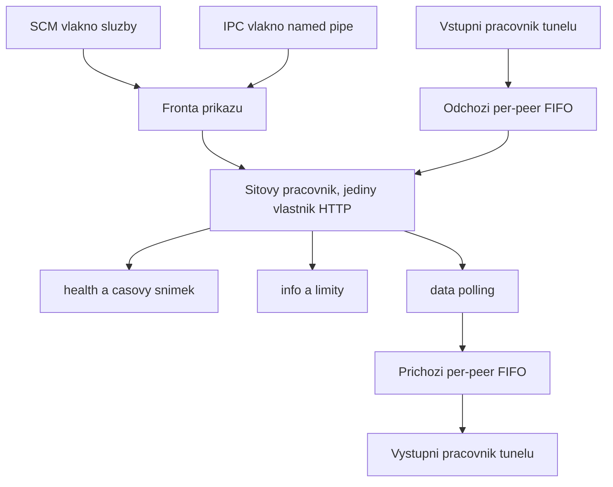

# Implementační plán klienta phpvpn v1 pro Windows

Plán popisuje kompletní implementaci nativního klienta podle [client.md](client.md) proti drátovému protokolu [protocol.md](protocol.md), který je již implementován v serverovém souboru [phpvpn.php](phpvpn.php). Primární a jedinou dodávanou platformou v1 jsou Windows, jádro však zůstává platformně nezávislé, aby šlo později doplnit Linux a macOS.

Audit [PROBLEM_CLIENT.md](PROBLEM_CLIENT.md) se v tomto plánu záměrně neřeší. Rizika, která popisuje, jsou vědomě přijatá rozhodnutí zadavatele, zejména veřejná lokální named pipe, podpora čistého HTTP, výchozí `trustAnyTlsCertificate` s hodnotou `true` a instalace řízená skriptem `install.bat`.

## 1. Potvrzená rozhodnutí

- **Jazyk a toolchain.** C++20, kompilátor MSVC z Visual Studio Build Tools 2022, generátor CMake a Ninja. Klient nepoužívá žádnou knihovnu třetí strany a nepoužívá vcpkg. HTTP zajišťuje WinHTTP, kryptografii CNG (`bcrypt.dll`), síťovou konfiguraci IP Helper, uživatelské rozhraní tray aplikace nativní Win32.
- **Validace přijaté dávky je atomická.** Platí normativní pravidlo `protocol.md` kapitoly 9.4: jediný nevyhovující paket uvnitř dešifrované dávky zahodí celou dávku a do příchozí fronty se nevloží jediný paket. Tím je překonána odlišná formulace v `client.md` v částech „Úplná validace vnitřních IPv4 paketů“ a „Příjem dat“.
- **Adresní prostor je v konfiguraci.** `masterSetup.vpnCidr` je kanonický IPv4 CIDR s výchozí hodnotou `10.99.99.0/24`. Z něj se odvozuje množina platných klientských adres, `maxRemotePeers`, prefix vlastní adresy i jediná split-tunnel routa.

## 2. Dokumentovaná rozhodnutí implementace

Body, které `client.md` nechává otevřené. Každý bude v kódu okomentovaný odkazem na kapitolu specifikace.

1. **Platné klientské adresy obecného prefixu.** V prefixu `vpnCidr` je adresa sítě rezervovaná, první hostitelská adresa je rezervovaná pro bránu nebo relay a poslední adresa je broadcast. Platné klientské adresy jsou tedy `network+2` až `broadcast-1`. Pro výchozí `10.99.99.0/24` je to `10.99.99.2` až `10.99.99.254`, celkem 253 adres a po odečtení vlastní adresy 252 vzdálených peerů. Povolená délka prefixu je 16 až 29, protože kratší prefix vede na nesmyslné rezervace a delší neposkytuje ani jednoho peera.
2. **Síťový pracovník existuje po celou dobu běhu služby.** Je jediným vlastníkem všech HTTP operací, tedy bootstrapu, pravidelného pollingu, periodické i rychlé synchronizace času a jednorázového `get-info` z IPC. Přijímá serializované příkazy ze své fronty, takže nikdy nemůže vzniknout paralelní request. Oba tunelové pracovníky vznikají a zanikají spolu s tunelem. Vlákno SCM a vlákno IPC nejsou pracovní role, nikdy nesahají na HTTP, tunel ani kryptografický stav a pouze předávají příkazy.
3. **Model vlastnictví adaptéru je efemérní.** Služba adaptér vždy vytváří voláním `WintunCreateAdapter` s deterministickým `RequestedGUID` odvozeným z instalační identity a při disconnectu jej `WintunCloseAdapter` odstraní. `WintunOpenAdapter` se používá výhradně při reconciliation po pádu, a to jen tehdy, když žurnál jednoznačně prokáže shodu názvu, GUID i LUID.
4. **LUID se zjišťuje přes IP Helper.** Allowlist Wintun API v `client.md` neobsahuje `WintunGetAdapterLUID`, proto se LUID adaptéru získá pomocí `ConvertInterfaceAliasToLuid(L"phpvpn", ...)` bezprostředně po vytvoření adaptéru a ověří proti tabulce rozhraní.
5. **WinHTTP běží v asynchronním režimu.** Pouze tak lze spolehlivě přerušit DNS, TCP connect, TLS handshake i pomalé čtení těla. Síťový pracovník zůstává sériový, protože čeká na jednu událost dokončení. Zrušení uzavře request handle a počká na `WINHTTP_CALLBACK_STATUS_HANDLE_CLOSING`.
6. **Transport nepoužívá proxy ani přesměrování.** Otevírá se s `WINHTTP_ACCESS_TYPE_NO_PROXY`, přesměrování jsou vypnutá přes `WINHTTP_OPTION_DISABLE_FEATURE` s `WINHTTP_DISABLE_REDIRECTS`, automatická autentizace se nepoužívá. `serverUrl` musí být absolutní `http` nebo `https` URL bez userinfo, bez query a bez fragmentu. Query `?action=<akce>` se přidává pevně.
7. **Jeden payload klíč slouží oběma směrům.** Konfigurace uvádí právě jeden `payloadKey` na peera, takže se použije pro uspořádanou dvojici lokální adresa a peer i pro opačný směr. Oddělení směrů zajišťuje AAD, které podle kapitoly 9.4 protokolu obsahuje `src` i `dst`.
8. **IPC má pevný framing.** Named pipe pracuje v message režimu, na jedno spojení připadá právě jeden požadavek a jedna odpověď a spojení se poté uzavírá. Limit zprávy je 8 KiB pro běžné příkazy a 1 MiB pro `set-config`. Delší zpráva se zahodí bez parsování. Pipe se vytváří s `PIPE_REJECT_REMOTE_CLIENTS`, protože specifikace mluví o lokálním IPC, a s DACL, která povoluje připojení každé lokální aplikaci.
9. **Konfigurace má aktivní a uloženou generaci.** `set-config` po úplné validaci atomicky zapíše soubor a zvýší generaci uložené konfigurace. Aktivní neměnný snímek se mění pouze při `connect`. Teardown a reconciliation pracují výhradně s generací, se kterou byly prostředky vytvořeny.
10. **JSON se parsuje vlastním striktním parserem.** Konfigurace a IPC používají malý DOM parser, drátové zprávy protokolu jednoprůchodové skenery se zavřenou sadou polí. Duplicitní i neznámý člen je chyba.
11. **Zápis konfigurace je crash safe.** Dočasný soubor vznikne ve stejném chráněném adresáři, zapíše se, provede se `FlushFileBuffers` a teprve potom `ReplaceFileW`. Poslední známá platná konfigurace zůstane jako záloha.
12. **Plánovač respektuje i počet záznamů.** Kromě rozpočtu `maxRequestBodyBytes - 1024` dodržuje `maxDataRecordsPerRequest` z ověřené odpovědi `info`.
13. **Účet služby je LocalSystem.** Vytvoření adaptéru, adresy a routy vyžaduje `SeLoadDriverPrivilege` a plná síťová práva, takže omezený účet v1 nestačí.
14. **Chyby se nepropagují výjimkou přes hranici role.** Interní API vrací typ `Result<T>` se stabilním kódem chyby. Výjimka se zachytí na vrcholu každé role a převede na řízenou recovery.
15. **Ikona a další statické prostředky jsou v repozitáři jako hotové `.ico`.** Generují se offline pomocným skriptem, takže běžný build nepotřebuje Python.

## 3. Vývojové a testovací prostředí

Na stroji zatím není nainstalovaný žádný C++ toolchain. Následující tabulka je úplný seznam toho, co musí být k dispozici, aby šlo klienta přeložit, odladit a otestovat. Instalace mimo kořen projektu se provede až po výslovném potvrzení uživatele podle bezpečnostní politiky.

### 3.1 Povinné nástroje pro překlad

| Nástroj | Verze | Účel |
|---|---|---|
| Windows 10 22H2 nebo Windows 11 | 22631+ | Cílová a vývojová platforma, dostupné WinHTTP, CNG a IP Helper API |
| Git | 2.40+ | Správa zdrojového kódu, již nainstalováno |
| Visual Studio Build Tools 2022 | 17.10+ | MSVC v143, linker, hlavičky a knihovny |
| Komponenta MSVC v143 x64/x86 | součást VCTools | Překlad hlavní architektury |
| Komponenta MSVC v143 ARM64 | volitelná | Druhá podporovaná architektura vydání |
| Windows 11 SDK | 10.0.22621 nebo novější | `winhttp.h`, `bcrypt.h`, `iphlpapi.h`, `netioapi.h`, `signtool.exe`, `rc.exe`, `mt.exe` |
| CMake | 3.28+ | Build systém projektu |
| Ninja | 1.11+ | Generátor pro rychlé inkrementální buildy |
| Komponenta C++ AddressSanitizer | součást VCTools | Build preset `asan` pro paměťové testy |

Instalace pomocí winget v konzoli se zvýšenými oprávněními:

```powershell
winget install --id Microsoft.VisualStudio.2022.BuildTools --override "--quiet --wait --norestart --add Microsoft.VisualStudio.Workload.VCTools --add Microsoft.VisualStudio.Component.VC.Tools.x86.x64 --add Microsoft.VisualStudio.Component.VC.ASAN --add Microsoft.VisualStudio.Component.Windows11SDK.22621 --add Microsoft.VisualStudio.Component.VC.CMake.Project"
winget install --id Kitware.CMake
winget install --id Ninja-build.Ninja
```

Ověření po instalaci, spouštěné z „x64 Native Tools Command Prompt for VS 2022“:

```powershell
cl
cmake --version
ninja --version
where signtool.exe
```

### 3.2 Povinné komponenty a data projektu

| Položka | Zdroj | Účel |
|---|---|---|
| Wintun 0.14.1 | ZIP z `wintun.net`, SHA-256 `07c256185d6ee3652e09fa55c0b673e2624b565e02c4b9091c79ca7d2f24ef51` | Jediný podporovaný L3 TUN backend, do repozitáře se ukládá pouze nepřejmenovaná architekturní `wintun.dll` a upstream licence |
| Testovací podpisový certifikát | `New-SelfSignedCertificate -Type CodeSigningCert` | Podpis vývojového release manifestu a binárek, aby šel testovat fail-closed instalátor |
| Účet s právy administrátora | lokální stroj | Registrace služby, vytvoření adaptéru, adres a rout |

Ověření integrity staženého archivu před rozbalením:

```powershell
Get-FileHash .\wintun-0.14.1.zip -Algorithm SHA256
```

### 3.3 Nástroje pro testování

| Nástroj | Verze | Účel |
|---|---|---|
| uv | aktuální, již nainstalováno | Jediný způsob spouštění Pythonu v tomto repozitáři |
| Python | 3.13 přes uv | Běh existující integrační sady a virtuálního peera |
| pytest, cryptography, requests | přes `uv run --with` | Existující sada [tests-integration](tests-integration/README.md) |
| nginx a PHP 8.5 | lokální nasazení v `D:\nginx` | Relay server pro kontraktní a integrační testy, spouští se skriptem [tools/start-test-server.ps1](tools/start-test-server.ps1) |
| Pillow a CairoSVG | přes `uv run --with` | Jednorázové vygenerování `.ico` z ikony Material Symbols `shield_lock` |
| CTest | součást CMake | Spouštěč unit a kontraktních testů |

Ověření běhu relay serveru a existující sady:

```powershell
powershell -ExecutionPolicy Bypass -File tools\start-test-server.ps1
curl.exe -s -i "http://127.0.0.1/phpvpn.php"
uv run --python 3.13 --with pytest --with cryptography --with requests -- pytest tests-integration -v -m "not slow"
```

### 3.4 Doporučené nástroje pro ladění

| Nástroj | Účel |
|---|---|
| Sysinternals Suite (Process Explorer, Handle, PipeList, DebugView) | Kontrola handle leaků, ověření DACL a existence named pipe, sledování diagnostiky |
| Application Verifier ze Windows SDK | Detekce chyb práce s handle a haldou ve službě běžící pod LocalSystem |
| WinDbg ze Windows SDK | Analýza pádů služby a crash dumpů |
| Wireshark | Kontrola provozu na Wintun adaptéru při end-to-end testu |
| Hyper-V nebo druhý fyzický stroj | Test dvou skutečných tunelů proti sobě, kdy každá instalace vlastní právě jeden adaptér |
| LLVM (clang-format, clang-tidy) | Volitelná statická analýza a jednotné formátování |

### 3.5 Vlastní pomocné nástroje, které v rámci plánu vzniknou

| Nástroj | Umístění | Účel |
|---|---|---|
| `virtual-peer.py` | `tools/` | Virtuální protějšek postavený nad [tests-integration/phpvpn_client.py](tests-integration/phpvpn_client.py). Mluví protokolem, dešifruje dávky a odpovídá na ICMP echo i UDP, takže lze `ping 10.99.99.3` ověřit tunel z jediného stroje bez druhé instalace |
| `make-icons.py` | `tools/` | Převod SVG `shield_lock` na tři barevné varianty `.ico` |
| `dev-install.ps1` a `dev-uninstall.ps1` | `tools/` | Rychlá lokální registrace a odregistrace služby z build adresáře bez plné distribuce |
| `make-dist.ps1` | `tools/` | Sestavení složky `dist`, výpočet per-DLL hashů a podpis release manifestu |

## 4. Rozvržení repozitáře

Serverová část zůstává v kořeni beze změny. Klient je samostatný podstrom.

```text
client/
    CMakeLists.txt
    CMakePresets.json
    src/
        core/
            base/          Result, logger, secure_buffer, string_view utility
            config/        parser, validator, ActiveConfigSnapshot
            crypto/        rozhraní CryptoProvider, HKDF, KeyDerivation
            protocol/      base64url, iso8601, json_scanner, ndjson_reader,
                           request_builder, response_parser, payload_batch, ipv4
            queues/        peer_queue, admission, scheduler, counters
            runtime/       state_machine, network_worker, tunnel_workers, time_sync
        platform/
            iface/         Tunnel, Transport, CryptoProvider, NetConfig, Clock
            windows/       crypto_cng, transport_winhttp, tunnel_wintun,
                           netconfig_iphlpapi, ownership_journal, service_host,
                           ipc_server, paths, acl
    apps/
        service/           phpvpn-service.exe
        tray/              phpvpn-tray.exe
        cli/               phpvpn-cli.exe
    tests/
        unit/              vlastní micro harness a testy jádra
        contract/          testy proti běžícímu relay serveru
    third_party/wintun/    wintun.dll podle architektury a upstream LICENSE.txt
    assets/                ico, verze a manifesty prostředků
dist/                      výstup make-dist.ps1, není verzovaný
```

## 5. Build

Jeden CMake projekt, čtyři cíle, žádný autoload a žádná externí závislost.

- Standard C++20, `/permissive-`, `/W4`, `/WX`, `/utf-8`, `/EHsc`, `/GS`, `/guard:cf`, `/Zi` a linker `/DEBUG`, `/OPT:REF`, `/OPT:ICF`, `/DYNAMICBASE`, `/HIGHENTROPYVA`, `/NXCOMPAT`, `/INCREMENTAL:NO`.
- Statický runtime `/MT` a `/MTd`, aby distribuce nevyžadovala Visual C++ redistributable.
- Presety `debug`, `release`, `asan` a volitelně `arm64-release`.
- Knihovny linkované systémově: `winhttp.lib`, `bcrypt.lib`, `iphlpapi.lib`, `ws2_32.lib`, `advapi32.lib`, `shell32.lib`, `user32.lib`, `comctl32.lib`, `shlwapi.lib`, `version.lib`.
- Každý spustitelný soubor nese resource s verzí, popisem a ikonou. Instalační pomocník má manifest s `requireAdministrator`, služba a tray manifest s `asInvoker`.
- `SetDefaultDllDirectories(LOAD_LIBRARY_SEARCH_SYSTEM32)` se volá jako první příkaz v `wmain` a `wWinMain` každé aplikace.

## 6. Architektura jádra

| Modul | Obsah | Poznámka |
|---|---|---|
| `base` | `Result<T>`, stabilní kódy chyb, logger, `SecureBuffer` s vynulováním v destruktoru přes `SecureZeroMemory` | Bez závislosti na Win32 kromě `SecureZeroMemory`, které má platformní alternativu |
| `config` | Parser JSON, validátor, `ActiveConfigSnapshot` s generací | Snímek je neměnný a sdílí se přes `shared_ptr<const>` |
| `crypto` | Rozhraní `CryptoProvider` s SHA-256, HMAC-SHA-256, AES-256-GCM a CSPRNG, nad ním HKDF podle RFC 5869 a `KeyDerivation` | Implementace je platformní, jádro nezná CNG |
| `protocol` | Kanonická base64url, přesný UTC formát, skenery zpráv, stavitel requestů, streamovaný čtenář odpovědi, binární dávka, validace IPv4 | Celé jádro protokolu bez I/O |
| `queues` | Per-peer FIFO, admission účetnictví, kruhový plánovač, agregované čítače zahození | Zamyká se pouze při vložení, odebrání a změně počítadel |
| `runtime` | Stavový automat, síťový pracovník, dva tunelové pracovníky, synchronizace času, recovery | Jediné místo, kde vzniká vlákno jádra |
| `platform/iface` | `Tunnel`, `Transport`, `CryptoProvider`, `NetConfig`, `Clock` | Hranice, za kterou se doplní Linux a macOS |

## 7. Vlákna a stavový automat



Stavy jsou `disconnected`, `connecting`, `connected`, `recovering` a `error`. Fáze jsou `idle`, `health`, `info`, `access-key-check`, `starting-tunnel`, `running` a `stopping`, přesně podle množin, které vrací IPC příkaz `get-status`.

Pořadí připojení odpovídá kapitole „Stavový automat připojení“ v `client.md`:

1. načtení a úplná validace konfigurace, na Windows ověření manifestu, hashe a API `wintun.dll` bez vytvoření adaptéru,
2. `health` a vytvoření prvního časového snímku,
3. `info`, validace a atomická publikace runtime limitů,
4. prázdný autentizovaný polling `data` jako ověření `ACCESS_KEY`,
5. fail-closed preflight sítě, vytvoření adaptéru, kontrola běžící verze ovladače, session s ringem 4 MiB,
6. přidání vlastní adresy a jediné routy prefixu `vpnCidr`, ověření nezměněné výchozí routy a DNS,
7. spuštění obou tunelových pracovníků a pravidelného pollingu.

Recovery při dočasné chybě nevypíná tunel okamžitě, používá exponenciální backoff od 250 ms do 30 s s jitterem a opakuje `health`, `info` a prázdný polling. Chyba konfigurace, ověření serveru nebo přístupového klíče vede do stavu `error`, který vyžaduje zásah uživatele.

## 8. Konfigurace a validace

Soubor je `%ProgramData%\phpvpn\config.json` s DACL pouze pro `SYSTEM` a `Administrators`. Validace probíhá před každým pokusem o připojení a před každým zápisem přes `set-config`.

Kontroly:

- `serverUrl` je absolutní `http` nebo `https` URL bez userinfo, query a fragmentu, s kanonickým hostem a platným portem.
- `vpnCidr` je kanonický zápis `A.B.C.D/len` s délkou prefixu 16 až 29 a nulovými host bity.
- `virtualIp` je platná klientská adresa uvnitř `vpnCidr`.
- Každý klíč `communicationContracts` je platná klientská adresa uvnitř `vpnCidr`, různá od `virtualIp`, a v mapě se vyskytuje právě jednou.
- `serverSecret` je neprázdný řetězec, prázdná hodnota se normalizuje na 32 ASCII znaků `0` přesně testem nulové délky podle kapitoly 3.2 protokolu.
- `accessKey` a každý `payloadKey` má přesně 64 malých hexadecimálních znaků.
- Všechny runtime hodnoty jsou kladná celá čísla reprezentovatelná v `int64_t`.
- `maxRemotePeers` se odvodí z `vpnCidr` a pro oba směry samostatně platí `maxQueueBytes >= maxRemotePeers * minPerPeerQueueBytes`. Součin se počítá kontrolovaně, přetečení konfiguraci odmítne.
- `maxNdjsonLineBytes <= maxResponseBodyBytes`.

Chyba validace vrací stabilní kód a bezpečný popis. Hodnoty klíčů se nikdy neobjeví v chybě ani v logu.

## 9. Kryptografie

Rozhraní `CryptoProvider` má metody `sha256`, `hmacSha256`, `aesGcmSeal`, `aesGcmOpen` a `randomBytes`. Windows implementace používá CNG:

- `BCryptOpenAlgorithmProvider(BCRYPT_SHA256_ALGORITHM, ...)` a varianta s `BCRYPT_ALG_HANDLE_HMAC_FLAG` pro HMAC.
- `BCRYPT_AES_ALGORITHM` s `BCRYPT_CHAINING_MODE` nastaveným na `BCRYPT_CHAIN_MODE_GCM` a strukturou `BCRYPT_AUTHENTICATED_CIPHER_MODE_INFO` s 12bajtovým nonce, AAD a 16bajtovým tagem.
- `BCryptGenRandom` s `BCRYPT_USE_SYSTEM_PREFERRED_RNG`.
- Handles algoritmů se otevírají jednou a sdílí se, klíčové handles vznikají per operaci nebo se cachují na peera.

HKDF je vlastní implementace RFC 5869 nad HMAC, tedy extract a expand, protože `BCRYPT_HKDF_ALGORITHM` není na všech podporovaných buildech dostupný stejně.

`KeyDerivation` počítá přesně podle kapitol 7.1 až 7.3 protokolu:

```text
semiKey     = HKDF(secret, SHA256("phpvpn/auth-semi/salt"), "phpvpn/auth-semi/key", 32)
fullAuthKey = HKDF(accessKey32, HMAC(secret, "phpvpn/auth-full/salt" NUL src),
                   "phpvpn/auth-full/key" NUL src, 32)
healthKey   = HKDF(secret, SHA256("phpvpn/health-response/salt" NUL requestId),
                   "phpvpn/health-response/key" NUL requestId, 32)
infoKey     = HKDF(secret, salt32, "phpvpn/info-response/" || requestId, 32)
```

Odvozené klíče žijí v `SecureBuffer`. Porovnání tagů je vždy konstantní časem vlastní funkcí bez větvení.

Známé odpovědi pro AES-256-GCM, HMAC-SHA-256, HKDF, všechna čtyři odvození a `data-mac` se ověřují v unit testech. Test se navíc křížově porovná s vektory, které již používá [tests-integration/test_crypto_vectors.py](tests-integration/test_crypto_vectors.py).

## 10. Drátová vrstva

- **`Base64Url`** kóduje, dekóduje a ověřuje kanoničnost. Kontrola je abeceda, délka modulo 4 různá od jedné a nulové nevyužité bity posledního znaku. Přijme `_w` a `__8`, odmítne `_x`, `__9`, `=`, whitespace, `+` i `/`.
- **`Iso8601`** parsuje a formátuje přesně 24 znaků `YYYY-MM-DDTHH:MM:SS.sssZ` bez závislosti na časové zóně procesu, s vlastním celočíselným převodem days from civil.
- **`JsonScanner`** čte ploché objekty se zavřenou sadou polí, odmítá duplicitní člen, neznámý člen, escape sekvenci a jakýkoli bajt za uzavírací závorkou.
- **`RequestBuilder`** sestavuje `auth-none`, `auth-semi`, `auth-full` a řádek `data` v přesném pořadí členů a bez whitespace.
- **`NdjsonResponseReader`** čte odpověď `data` průběžně. Uplatňuje `maxResponseBodyBytes`, `maxNdjsonLineBytes` a `maxDataRecordsPerResponse` dříve, než začne dekódovat pole řádku. Každý řádek `data` převede na záznam s dekódovaným ciphertextem a zapamatuje dvojici `messageId` a přesný text GCM tagu pro pozdější `data-mac`.

Ověření odpovědi `data` má pevné pořadí. Nejprve struktura a pořadí řádků, potom `data-result` se shodným `requestId`, potom `data-mac` nad kanonickým řetězcem podle kapitoly 9.5 protokolu. Kanonický řetězec vyžaduje počet záznamů před dvojicemi, proto se dvojice drží v paměti a HMAC se počítá až na konci. Teprve po úspěšném konstantním porovnání se smí použít `acceptedMessageIds` a dešifrovat jednotlivé záznamy.

Špičková paměť odpovědi je dána `maxResponseBodyBytes`, dekódovaný ciphertext je zhruba tři čtvrtiny této hodnoty a seznam dvojic zhruba 60 bajtů na záznam. Pro výchozí hodnoty je to jednotky desítek MiB a v diagnostice se sleduje jako samostatný čítač.

## 11. Transport

WinHTTP v asynchronním režimu, jedno spojení na request, žádná session cache mezi requesty jiného typu.

- `WinHttpSetTimeouts` s resolve a connect 5 s podle kapitoly 11.2 protokolu, celkový deadline `responseTimeoutSeconds` hlídá síťový pracovník vlastním časovačem.
- Při HTTPS a `trustAnyTlsCertificate` se nastaví `SECURITY_FLAG_IGNORE_UNKNOWN_CA`, `SECURITY_FLAG_IGNORE_CERT_CN_INVALID`, `SECURITY_FLAG_IGNORE_CERT_DATE_INVALID` a `SECURITY_FLAG_IGNORE_CERT_WRONG_USAGE`. Startovní log tento stav zřetelně hlásí jako přijaté riziko.
- Content-Type je `application/json; charset=utf-8` pro `health` a `info` a `application/x-ndjson; charset=utf-8` pro `data`.
- Tělo se posílá jedním `WinHttpWriteData` z už sestaveného bufferu, odpověď se čte po blocích přímo do parseru.
- Zrušení má jeden token na request. Uzavře handle a probudí čekání bez ohledu na nakonfigurovaný timeout, takže disconnect a zastavení služby mají tvrdý horní limit.

## 12. Synchronizace času

Veškerý stav vlastní síťový pracovník. Snímek obsahuje ověřený serverový čas, `serverTimeAtReceive`, `receiveMono`, RTT, rozdíl vůči lokálnímu UTC a okamžik synchronizace, a publikuje se pouze jako celek.

```text
RTT                 = receiveMono - sendMono
serverTimeAtReceive = authenticatedServerTimestamp + RTT / 2
safetyMargin        = max(1000 ms, RTT / 2 + 250 ms)
requestTimestamp    = serverTimeAtReceive + (currentMonotonic - receiveMono) - safetyMargin
```

Monotónní zdroj je `QueryPerformanceCounter`. Záporné RTT, zpětný chod hodin nebo nereprezentovatelný výsledek pokus zneplatní a snímek zůstane beze změny. Periodická obnova běží každých `timeSyncIntervalSeconds` monotónního času. Rychlou obnovu vyvolá `SERVICE_CONTROL_POWEREVENT` s `PBT_APMRESUMEAUTOMATIC`, událost změny síťové vrstvy z `NotifyIpInterfaceChange` a zjištěná změna systémových hodin. Ani jedna obnova nesmí vytvořit paralelní request.

## 13. Fronty a plánování

Odchozí fronty se účtují podle `dst`, příchozí podle `src`. Fronta vzniká líně při prvním paketu daného peera.

Admission test se provádí pro obsazenost po hypotetickém vložení a musí platit obojí:

```text
soucet skutecnych obsazenosti <= maxQueueBytes
soucet max(obsazenostPeerFronty, minPerPeerQueueBytes) pres vsechny mozne fronty <= maxQueueBytes
```

Při porušení se zahodí pouze nový paket. Již zařazené pakety se nikdy neodstraňují ani nepřeuspořádávají. Zahození se eviduje agregovaně podle důvodu a peera bez obsahu paketu.

Plánovač requestu drží kruhové pořadí cílů. V prvním průchodu vezme alespoň jeden paket z každé neprázdné fronty, v dalších průchodech doplňuje kruhově, dokud zbývá rozpočet bajtů a počet záznamů. Rozhodující je vždy přesně změřené sestavené tělo. Paket, který se nevejde ani do jinak prázdného platného requestu, se atomicky odstraní z čela fronty a trvale zahodí, aniž by se změnilo pořadí zbývajících paketů.

Interval pollingu vychází z ověřené odpovědi `info` a z absolutních lokálních mezí:

```text
effectiveMinPollIntervalMs = clamp(minDataPollIntervalMs, 20, 2000)
effectiveMaxPollIntervalMs = clamp(maxDataPollIntervalMs, 20, 2000)
```

Pokud po clampu vyjde minimum větší než maximum, použije se minimum pro obě hranice a stav se zaloguje. Polling probíhá i při prázdných odchozích frontách a odloží se pouze tehdy, když předběžná ochrana příchozí fronty nedovolí bezpečně přijmout další paket.

## 14. Payload a validace IPv4

Binární dávka podle kapitoly 9.4 protokolu má `packetCount` jako 32bitové big-endian číslo, tabulku 16bitových délek a poté přesné bajty paketů. Encoder i decoder pracují bez alokace podle neověřených hodnot.

Validace IPv4 vyžaduje alespoň 20 bajtů, verzi 4, `IHL` alespoň 5, hlavičku uvnitř bufferu, `total length` rovnou délce bufferu a platný kontrolní součet hlavičky. Fragment projde jako samostatný celý paket, klient nikdy neskládá.

Odchozí směr vyžaduje vnitřní zdroj rovný `virtualIp` a vnitřní cíl rovný cíli kontraktu. Příchozí směr vyžaduje vnitřní zdroj rovný `src` datového řádku a vnitřní cíl rovný `virtualIp`. Podle potvrzeného rozhodnutí se při jediné chybě zahodí celá dávka a do fronty se nevloží žádný její paket.

## 15. Wintun vrstva

Načtení knihovny probíhá výhradně `LoadLibraryExW` s absolutní kanonickou cestou instalačního adresáře a příznaky `LOAD_LIBRARY_SEARCH_DLL_LOAD_DIR | LOAD_LIBRARY_SEARCH_SYSTEM32`. Vyřeší se přesně jedenáct funkcí z allowlistu `client.md`, chybějící symbol je neobnovitelná chyba bez jakéhokoli fallbacku.

Po vytvoření adaptéru se ověří `WintunGetRunningDriverVersion` proti podporovanému rozsahu. Session má ring přesně 4194304 bajtů.

Vstupní pracovník je jediným volajícím `WintunReceivePacket` a každý buffer vrací právě jednou `WintunReleaseReceivePacket`, i u zahozeného paketu. Ukazatel do ringu nikdy neopustí zásobník funkce. Čeká se přerušitelně přes `WaitForMultipleObjects` nad `WintunGetReadWaitEvent` a událostí ukončení.

Výstupní pracovník je jediným volajícím `WintunAllocateSendPacket` a `WintunSendPacket`. Při plném ringu použije omezené čekání s rostoucí pauzou 1, 2, 4 a nejvýše 10 ms proti události ukončení, nikdy busy-loop. Buffer se nikdy neodesílá dvakrát ani nesdílí mezi vlákny.

## 16. Síťová konfigurace a vlastnictví

Preflight před první změnou načte žurnál, projde `GetUnicastIpAddressTable` a `GetIpForwardTable2` a zjistí kolize zamýšlené adresy, prefixu i routy. Shoda názvu adaptéru nebo adresy sama o sobě není důkazem vlastnictví. Nejednoznačnost končí bezpečnou chybou bez jakékoli změny.

Adresa se přidává přes `InitializeUnicastIpAddressEntry` a `CreateUnicastIpAddressEntry` s LUID vlastního adaptéru a prefixem z `vpnCidr`. Routa vzniká přes `InitializeIpForwardEntry` a `CreateIpForwardEntry2` s explicitním cílovým prefixem, on-link next hopem, konkrétním LUID a explicitní metrikou. Implementace nikdy nehledá „nejlepší“ rozhraní.

Žurnál je `%ProgramData%\phpvpn\state\ownership.json`. Obsahuje verzi formátu, instalační identitu, generaci konfigurace, GUID a LUID adaptéru, příznak `created` nebo `opened`, každou vytvořenou adresu a routu a u každého kroku stav `planned`, `created` nebo `removed`. Zápis je crash safe stejným postupem jako u konfigurace. Žurnál nikdy neobsahuje klíče, tagy ani obsah paketů.

Po dokončení se ověří, že výchozí routa a konfigurace DNS zůstaly beze změny a že relay server je dosažitelný přes rozhraní, které není phpvpn. Selhání spustí rollback pouze jednoznačně vlastních kroků.

Disconnect má pevné pořadí: zastavit zakládání nových pollingů, zrušit nebo bezpečně dokončit jediný běžící request, signalizovat a připojit všechna vlákna, odstranit vlastní routy a adresu, nejvýše jednou `WintunEndSession` a nejvýše jednou `WintunCloseAdapter`. Každý krok je idempotentní a stav `disconnected` se hlásí až po dokončení celého pořadí.

## 17. Služba, IPC, tray a konzole

Služba se jmenuje `phpvpn`, běží pod LocalSystem s uvozeným absolutním `ImagePath`, přijímá `SERVICE_ACCEPT_STOP`, `SERVICE_ACCEPT_SHUTDOWN` a `SERVICE_ACCEPT_POWEREVENT` a nikdy nezobrazuje UI. Singleton zajišťuje pojmenovaný mutex v globálním namespace.

IPC je named pipe `\\.\pipe\phpvpn-ipc-v1` v message režimu s verzovanou smlouvou v1. Každý požadavek nese `ipcVersion` s hodnotou 1, čerstvé UUIDv4 `requestId` a `command` z uzavřeného seznamu `get-status`, `connect`, `disconnect`, `get-info`, `get-config`, `set-config` a `get-diagnostics`. Neznámá verze, neznámý příkaz, duplicitní nebo nadbytečné pole končí stručnou bezpečnou chybou bez provedení operace.

`get-status` a `get-diagnostics` jsou čistě čtecí a nespouštějí síťovou operaci ani tunel. `connect` a `disconnect` jsou globální a idempotentní. `get-info` se zařadí jako příkaz do fronty síťového pracovníka, souběžné požadavky se deduplikují na jediné provedení a odpověď se rozešle všem čekajícím. `get-config` a `set-config` přenášejí celý konfigurační JSON bez IPC obálky přesně podle specifikace, včetně vědomě přijatého zpřístupnění tajných hodnot každé lokální aplikaci.

Tray aplikace běží v každé interaktivní relaci, po startu volá `get-status` a poté se dotazuje pevně jednou za 5 sekund a navíc ihned po `connect` a `disconnect`. Ikona `shield_lock` je šedá pro odpojeno, oranžová pro připojování a zelená pro ověřené připojení. Menu má pořadí Edit Config, Show Info a Connect nebo Disconnect. Editační okno je víceřádkové pole s neproporcionálním písmem a tlačítky Save a Cancel, okno Show Info je pouze pro čtení.

Konzolová aplikace je rovnocenný IPC klient s příkazy odpovídajícími smlouvě, hodí se pro skriptování a diagnostiku. Nespouští VPN provoz sama a neobchází hranici instalace a odinstalace.

## 18. Logování a diagnostika

Log je textový soubor v `%ProgramData%\phpvpn\logs` s rotací po 8 MiB a pěti historickými soubory, závažné události navíc jdou do Windows Event Logu. Log nikdy neobsahuje klíče, HMAC ani GCM tagy, ciphertext, obsah paketů, timestampy requestů, přesný časový offset, celá těla ani interní cesty. Smí obsahovat adresu serveru, `virtualIp`, seznam vzdálených adres, fáze bootstrapu, výsledky ověření, agregované čítače a stabilní kódy chyb.

Startovní log povinně zřetelně uvádí, že `trustAnyTlsCertificate` je zapnuté a že IPC pipe je dostupná každé lokální aplikaci.

## 19. Matice odolnosti

| Situace | Chování |
|---|---|
| Neplatná konfigurace | Bez připojení, stav `error`, bezpečný popis přes IPC |
| `health` selže nebo má neplatný tag | Časový snímek beze změny, backoff, opakování, žádný autentizovaný request |
| `info` selže | Limity se nepublikují, opakování, tunel se nespustí |
| První `data` polling vrátí `401` | Diagnostika označí problém `ACCESS_KEY`, stav `error` |
| Neplatný `data-mac` | Celá odpověď se zahodí, nic se neodstraní z odchozí fronty, nepředá se žádný payload |
| Neplatný GCM tag jednoho řádku | Zahodí se pouze tento řádek, ostatní pokračují |
| Neplatná dávka po dešifrování | Zahodí se celá dávka bez jediného paketu, agregovaný čítač |
| Plná odchozí nebo příchozí fronta | Zahodí se pouze nový paket, existující fronty se nemění |
| Timeout nebo síťová chyba | Request se zruší, přechod do `recovering` s backoffem, tunel běží dál |
| Chyba Wintun session | Tunelové role se zastaví, provede se bezpečný teardown a nový bootstrap |
| Pád nebo restart služby | Idempotentní reconciliation podle žurnálu, cizí prostředky se nikdy nemažou |
| Nejednoznačný nebo poškozený žurnál | Nic se neodstraní ani nepřepíše, stav `error` pro zásah správce |
| Neshoda hashe nebo podpisu `wintun.dll` | Fail-closed, žádný adaptér, session ani síťová změna |
| Sleep, hibernate a resume | Probuzení čekání, rychlá obnova času, pokračování bez deadlocku |

## 20. Testy

Unit testy běží nad vlastním malým harnessem, registrují se automaticky a spouští přes CTest jako `phpvpn-client-tests.exe`. Kontraktní testy potřebují běžící relay server, integrační testy navíc administrátorská práva.

| Skupina | Obsah |
|---|---|
| Kryptografie | Known-answer testy AES-256-GCM, HMAC, HKDF, čtyř odvození klíčů, `data-mac`, normalizace prázdného `SERVER_SECRET` a citlivost na změnu jediného bajtu |
| Drátový formát | Kanonická base64url včetně `_w`, `__8`, `_x`, `__9`, striktní timestamp, duplicitní a neznámé pole, CRLF, chybějící závěrečný LF, pořadí členů záznamu `data`, řádek za `data-mac` |
| Konfigurace | Devět scénářů z části „Povinné testovací scénáře front a per-peer kvót“ v `client.md`, včetně výchozího `vpnCidr`, hranice `maxQueueBytes` a meze jedné fronty 34209792 bajtů |
| Čas | Devět scénářů z části „Povinné testovací scénáře synchronizace času“, včetně obou větví bezpečnostní rezervy a zpětného chodu monotónních hodin |
| Fronty a plánovač | FIFO uvnitř fronty, spravedlivé kruhové střídání, přesné měření sestaveného těla, dodržení `maxDataRecordsPerRequest`, trvalé zahození nadměrného paketu |
| Payload a IPv4 | Dávka se dvěma pakety, nulový `packetCount`, chybná tabulka délek, trailing bajt, neshoda vnitřních adres, kontrolní součet hlavičky, atomické zahození celé dávky |
| Kontrakt proti serveru | `health`, `info`, prázdný polling, odeslání a příjem dat, `413` při překročení limitu, chování při `401` a `503`, měření latence |
| End-to-end s virtuálním peerem | `ping` a UDP přes tunel proti `tools/virtual-peer.py`, ztráta odpovědi, plná fronta, replay pollingu |
| Windows lifecycle | Osmnáct scénářů z části „Povinné Windows integrační a lifecycle testy“ v `client.md`, zejména čistá instalace, souběh s WireGuard, fail-closed odmítnutí, opakované connect a disconnect, pád v každé fázi, sleep a resume, overflow ringu, dvě uživatelské relace |

## 21. Postup prací

1. Příprava prostředí podle kapitoly 3, ověření překladu prázdné kostry a zprovoznění lokálního relay serveru.
2. Jádro bez I/O: `base`, `config`, `protocol`, `crypto` a jejich unit testy včetně known-answer vektorů.
3. Transport WinHTTP a kontraktní testy `health`, `info` a prázdného pollingu proti běžícímu serveru.
4. Synchronizace času, síťový pracovník a jeho fronta příkazů.
5. Fronty, admission účetnictví, kruhový plánovač a přesné měření requestu bez tunelu.
6. Binární dávka, validace IPv4 a testy parseru, poté oboustranný přenos dat proti virtuálnímu peerovi.
7. Wintun vrstva, síťová konfigurace, žurnál vlastnictví, preflight a reconciliation.
8. Windows Service, IPC server a konzolová aplikace.
9. Tray aplikace, ikony a obě dialogová okna.
10. Distribuční složka `dist`, release manifest, `install.bat` a `uninstall.bat`.
11. Windows lifecycle testy, zátěžové a pádové scénáře, doladění rozpočtů a diagnostiky.

## 22. Otevřené body k potvrzení během implementace

- Podporovaný rozsah běžící verze Wintunu se zafixuje po ověření proti aktuálnímu 0.14.1 a zapíše se do manifestu i do kontroly v kódu.
- Metrika vlastní routy se zvolí tak, aby nepřebíjela existující specifičtější routy, výchozí návrh je nízká explicitní hodnota potvrzená testem číslo 12 z lifecycle sady.
- Formát a kanonizace release manifestu se dokončí spolu s `make-dist.ps1`, včetně rozhodnutí, zda se v ostrém vydání použije podpis Authenticode nebo oddělený podpis manifestu.
- Rozsah podporovaných architektur vydání, tedy zda kromě x64 vzniká i ARM64, se potvrdí před přípravou distribuce.
